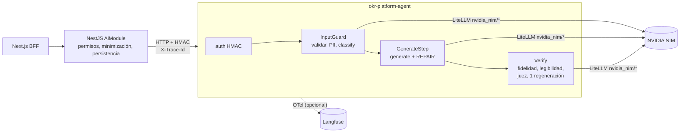

# okr-platform-agent

Agente de **accesibilidad cognitiva** de OKR Platform. Servicio Python (FastAPI + Google ADK + LiteLLM) que llama a modelos de
**NVIDIA NIM** (build.nvidia.com) para:

- `POST /v1/adapt` — versión en **lectura fácil** (UNE 153101) o **lenguaje claro** (UNE-ISO 24495-1) de un objetivo, check-in o feedback.
- `POST /v1/okr-suggest` — sugerencia de redacción de un objetivo y sus KRs.
- `POST /v1/checkin-summary` — resumen del historial de check-ins de un KR.
- `POST /v1/admin/chat` — **asistente de administración**: un turno del chat ADMIN -> plan de acciones (propone, nunca ejecuta), consulta de
  auditoría de solo lectura, respuesta del manual, aclaración o fuera de alcance.
- `POST /v1/admin/digest-summary` — redacta en lenguaje claro las "novedades" del admin a partir de hechos calculados por NestJS.
- `POST /v1/help/answer` — responde "¿cómo hago X?" usando solo los fragmentos del manual que envía NestJS (cita sus ids).
- `GET /health` — estado, modelos y prompts cargados (sin secretos).

El agente **no tiene base de datos ni herramientas que escriban**. Lo consume `okr-platform-back` (NestJS), que decide permisos,
minimiza los datos y es el único que persiste. El acoplamiento entre ambos es **solo** el contrato HTTP:
`docs/ai/agent-contract.md` (v1) del monorepo; los tres endpoints nuevos, en su extensión `docs/ai/agent-contract-admin.md` (v1).

## Arquitectura



Cada feature es un `SequentialAgent([InputGuard, GenerateStep, Verify])` de ADK:

1. **InputGuard**: valida (vacío / demasiado largo → `422 INPUT_REJECTED`, sin llamar a ningún LLM), **enmascara PII**
   (emails, DNI/NIE, teléfonos → `[EMAIL_1]`, `[DNI_1]`, `[TEL_1]`) y corre el **clasificador** (fuera de alcance o sospecha de
   inyección → `422`; contenido sensible → se procesa pero fuerza revisión humana). Si el clasificador no responde, el pedido falla
   (*fail-closed*: sin guard no se genera).
2. **GenerateStep**: el generador devuelve JSON validado con Pydantic. Si no parsea, **un** paso `REPAIR` con el error; si vuelve a
   fallar → `502 OUTPUT_INVALID`.
3. **Verify**: controles **deterministas** (números, fechas, porcentajes, placeholders y `mustPreserve` presentes; legibilidad
   Szigriszt-Pazos ≥ 65 en lectura fácil / ≥ 55 en lenguaje claro) y **juez LLM** de otra familia. Si algo falla, **una**
   regeneración con el motivo. Si falla otra vez, se devuelve el **texto original** con `needsHumanReview=true`
   (gancho de validación humana, RD 707/2026 art. 4.2.g). Si el juez no responde: `verdict=SKIPPED` y también `needsHumanReview=true`.

Resiliencia (`ResilientLlm`): timeout por intento (20 s por defecto; `timeout_s` por tier: generate/regenerate 40–60 s, judge 30 s) → **1 reintento** con
backoff (1,5 s) → **modelo de fallback**; deadline total del pedido 120 s (`AGENT_REQUEST_DEADLINE_S`; NestJS debe esperar más: 125 s); semáforo de concurrencia hacia NVIDIA (4) con espera máxima de 5 s (`429 RATE_LIMITED`). Cada intento, exitoso o
fallido, queda en `usage[]` (tokens, latencia, costo estimado, modelo efectivo, `isFallback`, versión y hash del prompt) y se
devuelve **incluso en las respuestas de error**, para que NestJS registre todo en `LlmCall`.

## Modelos por tarea y por qué

Configurados en `config/models.yaml` (**los IDs hay que verificarlos en build.nvidia.com** antes de usar; se pueden sobrescribir con
`AGENT_MODEL_<TIER>` / `AGENT_MODEL_<TIER>_FALLBACK`).

| Tarea | Modelo | Fallback | Por qué (medido el 2026-10-18 contra esta cuenta) |
|---|---|---|---|
| `classify` | `nvidia/nemotron-3-super-120b-a12b` (sin thinking) | `google/diffusiongemma-26b-a4b-it` | 1,0–2,2 s y ≈ 35 tokens de salida (≈ $0,0003/llamada). Clasificó bien los 10 textos de evals (incluida la inyección real). diffusiongemma es más rápido (≈ 0,9 s) pero marcó `outOfScope` en 3 de 9 textos laborales válidos y a veces omite el `{` inicial: queda de fallback. |
| `generate` | `nvidia/nemotron-3-super-120b-a12b` (sin thinking) | `nvidia/nemotron-3-ultra-550b-a55b` | Conserva números y estructura. **Con thinking activo tarda 30–43 s (≈ 1.600 tokens de razonamiento para ≈ 170 útiles); con `enable_thinking=false` ≈ 1,5–4,5 s.** ultra (≈ 18 s) da la mejor lectura fácil pero es demasiado lento como primario. |
| `regenerate` (paso REGENERATE, opcional) | `nvidia/nemotron-3-ultra-550b-a55b` (sin thinking, `timeout_s` 60) | `nvidia/nemotron-3-super-120b-a12b` | Se usa UNA vez cuando falla legibilidad, fidelidad o el juez. nemotron-super oscila (o conserva palabras largas, Szigriszt 55,7 < 65, o cambia "100 %" por "todo"): ultra da la mejor lectura fácil ("7 de cada 10") y en 3 corridas de evals regeneró en 0,9–4,6 s y pasó siempre. **No es el generador primario**: su latencia en el free tier es muy variable (1,3 s a > 38 s; un intento agotó 40 s) mientras super (1–6 s) pasa 11/11; ultra solo se paga en ≈ 25 % de los pedidos. Sin este tier, REGENERATE usa `generate`. |
| `planner` (`/v1/admin/chat`: PLAN/REPAIR; también `admin_query`) | `nvidia/nemotron-3-ultra-550b-a55b` (sin thinking, `timeout_s` 90, `planner.mode: schema`) | `nvidia/nemotron-3-super-120b-a12b` (modo tools: `tools_fallback` `google/diffusiongemma-26b-a4b-it`) | Arma el plan de acciones (JSON con 9 tipos de acción y referencias por handle): la tarea más exigente, por eso ultra aunque el pedido tarde unos segundos. Medido con 29 casos (ver "Planner: schema vs tools"). El fallback super usa json_schema estricto, el structured output más fiable medido. |
| `summarize` (`/v1/admin/digest-summary`) | `nvidia/nemotron-3-super-120b-a12b` (sin thinking) | `google/diffusiongemma-26b-a4b-it` | Redacta 1 oración por tema con los hechos dados: 1–3 s, ≈ USD 0,0003. La fidelidad no depende del modelo: números/nombres se verifican de forma determinista y, si fallan tras 1 regeneración, se devuelve la plantilla. |
| `judge` (prompt `judge` v2 para adapt y resumen; `judge_suggest` v1 para okr-suggest) | `google/diffusiongemma-26b-a4b-it` (`timeout_s` 30) | `openai/gpt-oss-20b` | **Otra familia** que el generador (el servicio no arranca si el juez —modelo o fallback— comparte familia con el generador). En 4 pares de prueba (fiel / número cambiado / dato inventado / juicio de valor) acertó 4/4 en 0,3–2,5 s. gpt-oss-20b razona: 6–15 s, marcó como no fiel una versión fiel y a veces agota los 20 s; con `max_tokens` bajos devuelve contenido vacío. |

Solo responden los modelos "Free Endpoint" de la cuenta (el resto da 404). Descartados: `glm-5-3` (se deprecia), `glm-5-3-flash` y
`nemotron-3.5-lightning` (timeouts/vacío > 55 s), `meta/muse-glimmer-30b` (20–24 s, vacío con `json_object`).
El comportamiento varía por modelo, por eso `model_options` en `models.yaml` permite fijar `json_mode` (`schema` | `object` | `none`)
y `extra_body` por ID de modelo. Costos: **estimación** ($ por 1M tokens en `pricing_usd_per_1m`); el free tier no factura.
Un pedido típico de `adapt` cuesta ≈ $0,0009 estimados y tarda ≈ 4–9 s.

Lo determinista (PII, legibilidad, preservación de números, tendencia del KR) **no usa LLM**: es más barato, reproducible y auditable.

## Extensión: asistente de administración y ayuda

Contrato: `docs/ai/agent-contract-admin.md` (v1). **El agente propone, NestJS dispone**: el plan es dato puro (sin contraseñas, sin UUID: handles
opacos), cada acción lleva un `sourceQuote` literal del mensaje de la persona ADMIN y NestJS revalida todo antes de ejecutar.

```
/v1/admin/chat:  InputGuard (largos, PII) -> admin_classify (inyección -> 422) -> ACTION  -> planner -> verificación local (+1 REPAIR) -> desenmascarar PII
                                                                              -> QUERY   -> admin_query -> ReadQuery (AUDIT_SEARCH)
                                                                              -> HOW_TO  -> help_answer (BM25-lite + citas ⊆ enviadas)
                                                                              -> CLARIFY | OUT_OF_SCOPE | SMALL_TALK -> admin_reply
/v1/admin/digest-summary:  hechos -> SUMMARIZE -> fidelidad (números por grupo, nombres) -> 1 regeneración -> plantilla determinista
/v1/help/answer:           BM25-lite sobre los chunks -> ANSWER -> citas filtradas; sin soporte -> found=false SIN llamar al LLM
```

- **Whitelist v1**: crear usuario / equipo / ciclo / objetivo / KR, agregar-quitar miembro y líder, activar ciclo, cambiar responsable de un KR. Cerrar ciclos,
  publicar/borrar, cambiar roles, desactivar, resetear claves => `HOW_TO` con el paso a paso del manual. Las acciones ⚠ de `adaptation-requests` (v1.1) no están implementadas.
- **Defensa contra inyección**: el catálogo y los hechos se entregan como datos delimitados y saneados; lo que NO depende del modelo es el anclaje (`sourceQuote`
  debe existir en los mensajes ADMIN) y que nada se ejecuta sin confirmación en NestJS. Evals: 4 casos de inyección (título de objetivo, de KR, nombre de equipo con
  marcador de cierre, mensaje explícito) sin una sola acción inyectada anclada.
- **Digest**: nunca un número o nombre que no esté en los hechos; `checks` informa lo que el modelo inventó y `fallbackUsed`.
- **Ayuda**: solo con los fragmentos enviados; sin fuente que respalde, se rehúsa. Las citas son ids ASCII (`admin#como-creo-un-usuario`).

### Planner: schema vs tools

`planner.mode` en `config/models.yaml` (o `AGENT_PLANNER_MODE=schema|tools`). Ambos modos producen el mismo `Plan`:
`schema` = `output_schema` + REPAIR; `tools` = ADK FunctionTools que **solo registran** propuestas (no ejecutan nada). Medición real (2026-10-18, NVIDIA NIM free tier,
29 casos de `evals/admin_plan.test.json`, mismo código y prompts, pedidos espaciados 4 s):

| | `schema` (default) | `tools` |
|---|---|---|
| Casos que pasan | **28/29** (96,6 %) | **29/29** (100 %) |
| Latencia por caso (media / p50 / máx) | **3,3 s** / 2,9 s / 9,7 s | 11,0 s / 5,3 s / 53,8 s |
| Tokens de entrada / salida (total) | **114.374** / 4.912 | 295.312 / 5.456 |
| Costo estimado (free tier = USD 0) | **USD 0,103** | USD 0,285 |
| REPAIR / intentos fallidos | 1 / 1 | 0 / 1 |

El único caso que falló en `schema` (`destructivo-borrar-objetivo`) es del **clasificador** (mandó "Borrá el objetivo" al planner, que respondió con una aclaración): no depende del
modo y en `tools` pasó por azar; tras agregar ese ejemplo a `admin_classify` pasó 2/2 en reintentos dirigidos. La precisión de acciones es equivalente, así que se elige `schema`:
3,3x más rápido y 2,8x más barato. En `tools` ultra emite **una** llamada por turno (acciones + `set_plan_summary` = N+1 vueltas, cada una reenvía catálogo y 11 esquemas).
Con ultra, `json_mode: none` + Pydantic + REPAIR dio JSON válido 29/29. Evals de digest 7/7 y ayuda 8/8 (tras ajustar la expectativa de `titulo-inyectado`).

Evals reales: `$env:AGENT_PLANNER_MODE='tools'; .venv\Scripts\pytest -m eval -s tests/evals/test_admin_evals.py -k plan` (`EVAL_SLEEP_S`, `EVAL_RESULTS_FILE`).

## Cómo correrlo

Requisitos: Python ≥ 3.12 (probado con 3.13). Sin `uv`: `venv` + `pip`.

```powershell
python -m venv .venv
.venv\Scripts\pip install -e ".[dev]"
Copy-Item .env.example .env        # completar NVIDIA_NIM_API_KEY y AGENT_SHARED_SECRET (NUNCA commitear .env)
.venv\Scripts\uvicorn okr_agent.api.main:app --port 8088
```

- `NVIDIA_NIM_API_KEY`: clave de build.nvidia.com (free tier).
- `AGENT_SHARED_SECRET`: mismo valor que en `okr-platform-back`, ≥ 32 bytes aleatorios
  (`python -c "import secrets; print(secrets.token_hex(32))"`).
- `GET http://localhost:8088/health` → `status: "ok"` si hay clave configurada, `"degraded"` si no.

Docker: `docker build -t okr-platform-agent .` (usuario no root, `HEALTHCHECK` sobre `/health`; los secretos entran por variables de entorno).
En el monorepo lo levanta el servicio `agent` del `docker-compose` de `okr-platform-back` (perfil `ai`).

### Tests

```powershell
.venv\Scripts\pytest                     # unit + api + contract; NO tocan la red (FakeLlm)
.venv\Scripts\ruff check src tests
.venv\Scripts\pytest -m eval -s          # evals contra NVIDIA real (exige NVIDIA_NIM_API_KEY; gasta tokens)
```

Los tests de contrato validan los ejemplos JSON del contrato (`tests/contract/fixtures/`) contra los schemas y comprueban que el
agente produce la misma forma. NestJS usa los mismos fixtures.

### Probar a mano un pedido firmado

```powershell
$secret = $env:AGENT_SHARED_SECRET
$body   = '{"level":"EASY_READ","entityType":"CHECK_IN","locale":"es","segments":[{"key":"checkin.note","text":"Bajamos a 5,5 h; lo escalamos el 15/11."}],"mustPreserve":["5,5 h","15/11"]}'
$ts     = [string][int][DateTimeOffset]::UtcNow.ToUnixTimeSeconds()
$hmac   = New-Object System.Security.Cryptography.HMACSHA256 (,[Text.Encoding]::UTF8.GetBytes($secret))
$sig    = "sha256=" + (($hmac.ComputeHash([Text.Encoding]::UTF8.GetBytes("$ts.$body")) | ForEach-Object { $_.ToString("x2") }) -join "")
Invoke-RestMethod -Method Post -Uri http://localhost:8088/v1/adapt -ContentType "application/json; charset=utf-8" `
  -Headers @{ "X-Agent-Timestamp" = $ts; "X-Agent-Signature" = $sig; "X-Trace-Id" = [guid]::NewGuid().ToString() } -Body $body
```

La firma es `HMAC_SHA256(secret, "{timestamp}.{rawBody}")` en hex minúscula, sobre los **bytes exactos** del body; tolera ±300 s de skew.

## Cómo medir tokens y costo

Todo pedido (éxito **o error**) devuelve `usage[]` con **una entrada por intento de LLM**:

```json
{ "step": "GENERATE", "attempt": 2, "model": "nvidia/nemotron-3-super-120b-a12b", "isFallback": false,
  "inputTokens": 1320, "outputTokens": 610, "latencyMs": 7450, "costUsdEst": 0.001006, "status": "OK", "errorCode": null }
```

- Los **tokens** son los que reporta NVIDIA (0 si el intento falló antes de la respuesta).
- `costUsdEst` es una **estimación**: `tokens × pricing_usd_per_1m` de `config/models.yaml` (precios de referencia aproximados). El free
  tier de NVIDIA **no factura**; la cifra sirve para dimensionar el costo si se pasa a un plan pago.
- NestJS persiste cada entrada en `LlmCall` (append-only) y expone `GET /ai/usage` y `GET /ai/impact` (solo ADMIN): llamadas, fallos
  por paso, tokens, costo estimado y latencia p50/p95 por feature y por modelo.
- Orden de magnitud por pedido (precios de la tabla): adaptar ≈ USD 0,0018 (peor caso con reintentos y regeneración ≈ 0,0040);
  sugerir OKR ≈ 0,0015; resumir check-ins ≈ 0,0012. ~1000 adaptaciones/mes ≈ USD 1,8–4 estimados; costo real en free tier = 0.
- En evals (`pytest -m eval -s`) se imprime el costo estimado y los pasos de cada caso.

## Langfuse (opcional)

Sin credenciales el servicio funciona igual (telemetría no-op). Para activar trazas:

```dotenv
LANGFUSE_PUBLIC_KEY=pk-lf-...
LANGFUSE_SECRET_KEY=sk-lf-...
LANGFUSE_HOST=https://cloud.langfuse.com   # o http://langfuse-web:3000 si es self-hosted
```

- Al arrancar se inicializa el cliente de Langfuse y `GoogleADKInstrumentor` (OpenInference), que instrumenta ADK vía OpenTelemetry.
- Cada pedido abre un span raíz con el atributo **`okr.trace_id`** y `session.id` = `X-Trace-Id`, para cruzar la fila `LlmCall.traceId`
  de NestJS con la traza de Langfuse. El prompt (id, versión, hash) viaja en `usage[]`.
- Alternativa genérica sin SDK de Langfuse: exportador OTLP (`OTEL_EXPORTER_OTLP_ENDPOINT=$LANGFUSE_HOST/api/public/otel`,
  `OTEL_EXPORTER_OTLP_HEADERS=Authorization=Basic base64(pk:sk)`).
- Privacidad: el texto que llega a Langfuse ya viene **enmascarado** (PII reemplazada) porque el enmascarado ocurre antes de cualquier
  llamada al modelo.

## Prompts

`prompts/<id>/v<N>.md` con front-matter (`id`, `version`, `tier`, `output_schema`, `description`). El `hash` (sha256, 12 caracteres del
archivo) viaja en cada `UsageStep`. **Nunca se edita una versión publicada**: se agrega `v2.md`; la activa es la mayor, o la fijada en
`prompts/active.yaml` (`judge: "1"`).

## Estructura

```
config/models.yaml           modelos por tarea, fallbacks, precios estimados, mínimos de legibilidad
prompts/                     prompts versionados (13: los 7 base + admin_classify, admin_planner, admin_query, admin_reply, help_answer, digest_summary)
evals/                       casos de evaluación (se corren con pytest -m eval)
src/okr_agent/
  api/                       FastAPI: main, auth HMAC, schemas del contrato, envelope de errores
  agent/                     pipeline, subagentes ADK, pasos (InputGuard/Generate/Verify), ResilientLlm, usage, features
  agent/admin/               extensión asistente admin: plan_models, local_checks, planner_tools, digest_logic, agents, runner, text
  guards/                    PII, legibilidad (Fernández-Huerta, Szigriszt-Pazos/INFLESZ), fidelidad (+ miles es "400.000"), jerga sin explicar (`config/jargon.yaml`, extensible), tendencia, entrada
  prompts/loader.py          carga y render de prompts
  telemetry.py               Langfuse/OTel opcional
tests/                       unit, api, admin (extensión), contract (fixtures del contrato, incl. contract/fixtures/admin), evals
```
