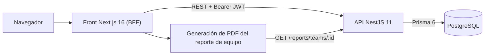
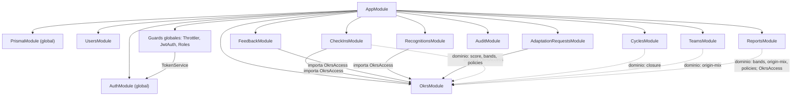
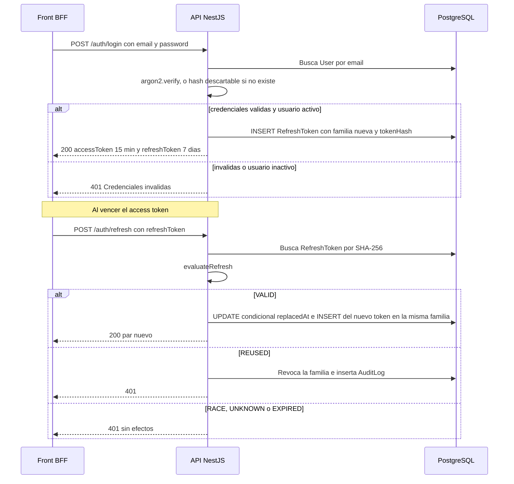
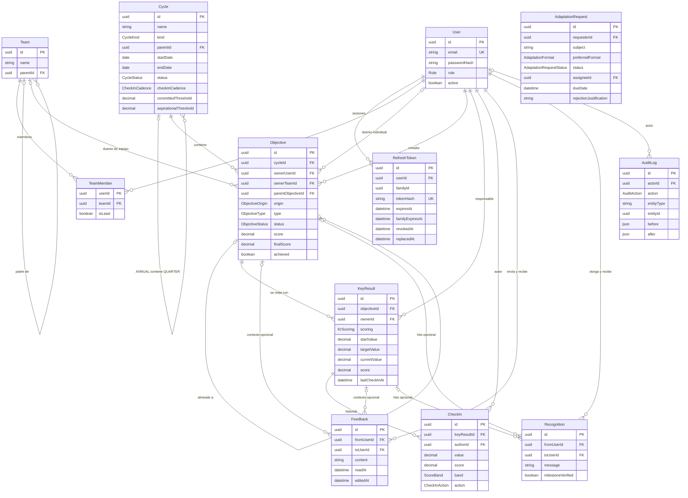
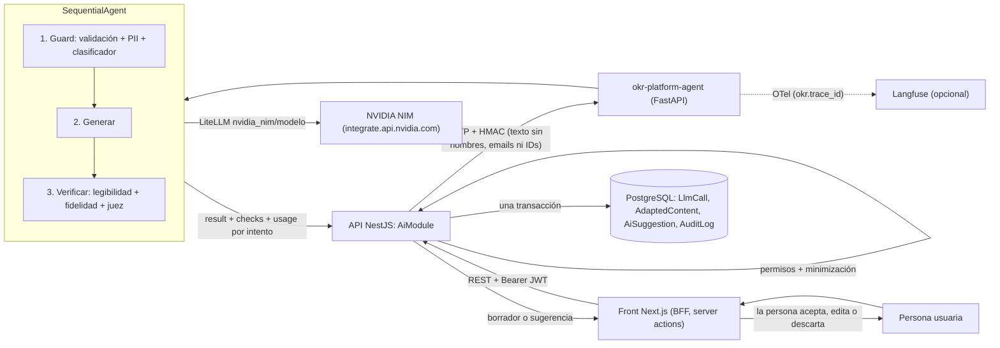
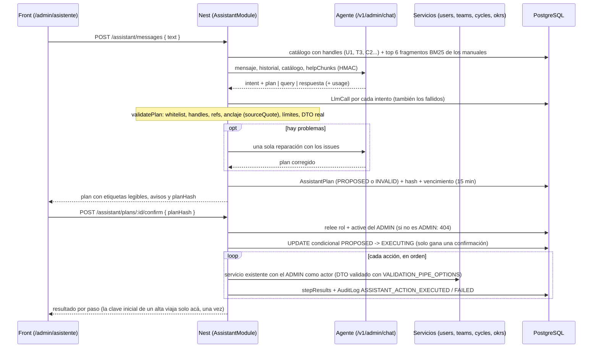

# Arquitectura del back

API de la plataforma OKR: NestJS 11 + Prisma 6 + PostgreSQL. La aplicación vive en `okr-platform/` (este repo agrega en la raíz el `docker-compose.yml`, husky y la configuración de lint/format compartida).

> Todas las rutas de archivo de este documento son relativas a `okr-platform/`.

## 1. Vista general del sistema

El front actúa de BFF: guarda los tokens del back en cookies httpOnly y llama a esta API desde el servidor. El PDF del reporte de equipo se genera en el front con los datos de `GET /reports/teams/:id?cycleId=`; el back solo entrega el JSON. El detalle del front está en [`apps/front/docs/arquitectura.md`](../../front/docs/arquitectura.md) (ruta del monorepo).

## 2. Módulos del back

`src/app.module.ts` registra los módulos de feature, el `ThrottlerModule`, el `ConfigModule` global, cuatro guards globales (en este orden: `ThrottlerGuard` → `JwtAuthGuard` → `PasswordChangeRequiredGuard` → `RolesGuard`) y el filtro global `PrismaExceptionFilter`. `PrismaModule` y `AuthModule` son `@Global()`: el primero expone `PrismaService` a todos; el segundo exporta `TokenService`, que usa el `JwtAuthGuard`.

Las flechas continuas son dependencias de módulo Nest (imports/exports). Las punteadas son imports directos de funciones puras de `src/okrs/domain/`, sin inyección. Todos los módulos usan `PrismaService` (global).

| Módulo             | Carpeta                   | Responsabilidad                                                                                                                                                                         | Endpoints principales                                                                                                                                                                                                                                                                                    |
| ------------------ | ------------------------- | --------------------------------------------------------------------------------------------------------------------------------------------------------------------------------------- | -------------------------------------------------------------------------------------------------------------------------------------------------------------------------------------------------------------------------------------------------------------------------------------------------------- |
| Health             | `src/health`              | Liveness (público)                                                                                                                                                                      | `GET /health`                                                                                                                                                                                                                                                                                            |
| Auth               | `src/auth`                | Login, rotación de refresh, logout, perfil y cambio de la clave propia (obligatorio con clave inicial)                                                                                  | `POST /auth/login`, `POST /auth/refresh`, `POST /auth/logout`, `GET /auth/me`, `POST /auth/change-password`                                                                                                                                                                                              |
| Users              | `src/users`               | Alta y edición de usuarios, rol, desactivación y reseteo de clave                                                                                                                       | `GET /users`; ADMIN: `POST /users`, `PATCH /users/:id`, `POST /users/:id/password`                                                                                                                                                                                                                       |
| Teams              | `src/teams`               | Árbol de equipos sin ciclos, membresías con líder (`isLead`) e indicador 50/50                                                                                                          | `GET /teams`, `GET /teams/:id?cycleId=`; ADMIN: `POST /teams`, `PATCH /teams/:id`, `PUT` y `DELETE /teams/:id/members/:userId`                                                                                                                                                                           |
| Cycles             | `src/cycles`              | Ciclos ANNUAL/QUARTER, cadencia de check-in, umbrales, activación y cierre                                                                                                              | `GET /cycles`, `GET /cycles/:id`; ADMIN: `POST /cycles`, `PATCH /cycles/:id`, `POST /cycles/:id/activate`, `POST /cycles/:id/close`                                                                                                                                                                      |
| Okrs               | `src/okrs`                | Objetivos y KRs: límites, publicación, alineación, visibilidad y score                                                                                                                  | `GET/POST /objectives`, `GET/PATCH/DELETE /objectives/:id`, `POST /objectives/:id/publish`, `POST /objectives/:id/key-results`, `PATCH/DELETE /key-results/:id`                                                                                                                                          |
| CheckIns           | `src/check-ins`           | Check-ins inmutables con snapshot de score y banda, historial y pendientes vencidos                                                                                                     | `POST/GET /key-results/:id/check-ins`, `GET /check-ins/pending`                                                                                                                                                                                                                                          |
| Feedback (CFR)     | `src/cfr/feedback`        | Feedback privado entre emisor y receptor                                                                                                                                                | `POST/GET /feedback`, `GET/PATCH/DELETE /feedback/:id`, `PATCH /feedback/:id/read`                                                                                                                                                                                                                       |
| Recognitions (CFR) | `src/cfr/recognitions`    | Muro público de reconocimientos, con hito validado opcional                                                                                                                             | `POST /recognitions`, `GET /recognitions`                                                                                                                                                                                                                                                                |
| Reports            | `src/reports`             | Datos agregados del equipo en un ciclo para el PDF                                                                                                                                      | ADMIN o líder del equipo: `GET /reports/teams/:id?cycleId=`                                                                                                                                                                                                                                              |
| Audit              | `src/audit`               | Consulta paginada y filtrada del log de auditoría                                                                                                                                       | ADMIN: `GET /audit`                                                                                                                                                                                                                                                                                      |
| AdaptationRequests | `src/adaptation-requests` | Pedidos de un documento adaptado a una persona (art. 14.5): estados, plazo, entrega y rechazo justificado                                                                               | `POST /adaptation-requests`, `GET /adaptation-requests/mine`, `GET /adaptation-requests/:id` (dueño o ADMIN; el resto 404); ADMIN: `GET /adaptation-requests?status=&overdue=`, `PATCH /adaptation-requests/:id/assign`, `POST /adaptation-requests/:id/deliver`, `POST /adaptation-requests/:id/reject` |
| Assistant          | `src/assistant`           | Asistente de administración: planes que el agente propone y Nest valida, confirma y ejecuta, consultas de auditoría, novedades y ayuda con manuales (ver "Asistente de administración") | ADMIN (404 al resto): `GET /assistant/digest`, `GET/POST /assistant/messages`, `POST /assistant/plans/:id/confirm\|discard`, `DELETE /assistant/conversation`                                                                                                                                            |
| Ai                 | `src/ai`                  | Ayudas de IA de accesibilidad cognitiva: versión en lectura fácil o lenguaje claro, sugerencia de OKR y resumen de check-ins                                                            | `GET /ai/status`, `POST/GET /ai/adapt/:entityType/:id?level=`, `POST /ai/adapted/:id/accept`, `PATCH /ai/adapted/:id/validate`, `POST /ai/okr-suggest`, `POST /ai/check-ins/:krId/summary`, `POST /ai/suggestions/:id/accept\|discard`; ADMIN: `GET /ai/usage`, `GET /ai/impact`                         |

Piezas transversales en `src/common/`: decoradores (`@Public`, `@Roles`, `@CurrentUser`), guards, `PrismaExceptionFilter` (P2002 y P2003 → 409, P2025 → 404, violación de CHECK → 422), validadores y el tipo `Result` del dominio (`src/common/domain/result.ts`).

`src/configure-app.ts` concentra la configuración compartida entre `main.ts` y los tests e2e: `helmet`, CORS restringido a `FRONT_ORIGIN`, `ValidationPipe` con `whitelist`, `forbidNonWhitelisted` y `transform`, y Swagger en `/api`. El documento OpenAPI se versiona en `openapi.json` (lo emite `npm run openapi:emit`) y `src/openapi.spec.ts` falla si quedó desactualizado; el front genera sus tipos desde ese contrato.

### Convención de capas

Cada feature separa:

- **Controller**: HTTP, DTOs y Swagger.
- **Service**: orquesta I/O (Prisma, transacciones, locks, auditoría).
- **`domain/`**: funciones puras sin Nest ni Prisma, que devuelven `Result` (`ok` / `err(code, message)`). Los servicios traducen el código de error a HTTP con un mapeo por feature (`src/okrs/okrs.errors.ts`, `src/cycles/cycles.errors.ts`, `src/cfr/cfr.errors.ts`, `src/adaptation-requests/adaptation-requests.errors.ts`). Jest exige 90 % de cobertura en `**/domain/**`.

## 3. Autenticación y autorización

### Tokens

| Token   | Formato                                                                                             | Vida                                                          | Dónde se valida                |
| ------- | --------------------------------------------------------------------------------------------------- | ------------------------------------------------------------- | ------------------------------ |
| Access  | JWT HS256 con `sub` y `role`, firmado con `JWT_ACCESS_SECRET`                                       | 15 minutos                                                    | `JwtAuthGuard` en cada request |
| Refresh | Opaco: 32 bytes aleatorios en base64url; en BD se guarda solo su SHA-256 (`RefreshToken.tokenHash`) | 7 días deslizantes, con techo absoluto de 30 días por familia | `AuthService.refresh`          |

Constantes en `src/auth/auth.constants.ts`; firma y hash en `src/auth/token.service.ts`.

- **Login** (`AuthService.login`): normaliza el email, verifica con argon2 y, si el usuario no existe, verifica igual contra un hash descartable para no filtrar por tiempo qué emails existen. Credenciales inválidas y usuario inactivo devuelven el mismo 401. Cada login abre una **familia** nueva de refresh tokens.
- **Refresh con rotación** (`AuthService.refresh` + `src/auth/domain/refresh-rotation.ts`): la función pura `evaluateRefresh` clasifica el token presentado:
  - `VALID`: se marca `replacedAt` con un `UPDATE` condicional dentro de una transacción (solo una request concurrente gana) y se emite un par nuevo en la misma familia.
  - `RACE`: el token se reemplazó hace 10 s o menos (requests paralelas legítimas). Devuelve 401 sin revocar nada.
  - `REUSED`: el token ya estaba revocado o se reemplazó fuera de la gracia. Se revoca toda la familia y se audita `REFRESH_REUSE_DETECTED` (primera detección) o `REFRESH_REVOKED_USED` (la familia ya estaba revocada).
  - `UNKNOWN` / `EXPIRED`: 401 sin efectos. El reuso tiene prioridad sobre la expiración.
- **Revocación**: `POST /auth/logout` revoca la familia (idempotente). Desactivar un usuario o resetearle la clave (`src/users/users.service.ts`) revoca todos sus refresh tokens.
- **Efecto inmediato**: el `JwtAuthGuard` (`src/common/guards/jwt-auth.guard.ts`) busca al usuario por PK en cada request. Si está inactivo devuelve 401, y el rol que adjunta a `req.user` es el vigente en BD, no el del token.

### Roles y guards

- **Roles globales** (`Role` en `prisma/schema.prisma`): `ADMIN`, `LEADER` y `MEMBER`. El liderazgo de un equipo concreto lo da `TeamMember.isLead`, no el rol.
- **Guards globales** (`src/app.module.ts`). El orden importa:
  1. `ThrottlerGuard`: límite general de 300 requests por minuto. `POST /auth/login` y `POST /auth/refresh` declaran con `@Throttle` un límite propio de 5 por minuto, configurable con `LOGIN_THROTTLE_LIMIT` (solo para e2e).
  2. `JwtAuthGuard`: exige un Bearer válido salvo en rutas `@Public()` (`/health`, login, refresh y logout).
  3. `PasswordChangeRequiredGuard` (`src/common/guards/password-change-required.guard.ts`): si la persona tiene `mustChangePassword` (clave inicial dada por administración), solo deja pasar las rutas marcadas `@AllowPasswordChange()` (`POST /auth/change-password` y `GET /auth/me`); el resto responde 403 `PASSWORD_CHANGE_REQUIRED`.
  4. `RolesGuard` (`src/common/guards/roles.guard.ts`): si la ruta declara `@Roles(...)`, exige uno de esos roles. Si no, deja pasar.
- **Autorización fina en el dominio**: lo que depende del recurso no está en decoradores. Vive en funciones puras:
  - `src/okrs/domain/policies.ts`:
    - **Crear objetivos**: un MEMBER solo para sí mismo; un LEADER también para los equipos donde es `isLead`; un ADMIN para cualquiera.
    - **Editar objetivos**: el dueño, el líder del equipo dueño o un ADMIN.
    - **Ver**: un DRAFT solo lo ven quienes pueden editarlo.
    - **Cambiar start/target de un KR publicado**: ADMIN o líder.
    - **Check-in**: el responsable del KR, el dueño del objetivo o los miembros del equipo dueño. **Sin bypass para ADMIN.**
  - `src/reports/domain/policies.ts`: el reporte de un equipo (`canViewTeamReport`) lo ven solo un ADMIN o quien tiene `isLead` en ese equipo exacto. Ser LEADER por rol, miembro del equipo o líder de otro equipo no alcanza (403).
  - `src/cfr/feedback/domain/privacy.ts`: el feedback lo ven solo el emisor y el receptor. **Sin bypass por rol.**

  `OkrsAccess` (`src/okrs/okrs-access.service.ts`) carga el actor con sus membresías y devuelve 404 (no 403) ante un objetivo que el actor no puede ver, para no revelar que existe.

## 4. Modelo de datos

Fuente: `prisma/schema.prisma`. El cliente se genera en `generated/prisma` (no versionado). Los CHECK y el índice parcial que Prisma no modela se agregan a mano en las migraciones:

- `0001_init`:
  - equipo raíz único;
  - fechas y umbrales de ciclo válidos;
  - exactamente un dueño por objetivo;
  - scores en [0,1];
  - valores obligatorios de un KR DERIVED;
  - no auto-feedback ni auto-reconocimiento.
- `20261009180000_auditlog_append_only`: trigger de `AuditLog`.

Notas:

- `Objective` tiene un único dueño: `ownerUserId` **o** `ownerTeamId` (CHECK `objective_single_owner`).
- `CheckIn` y `AuditLog` no tienen `updatedAt`: son inmutables.
- `Feedback` y `Recognition` tienen dos relaciones con `User` (`fromUser` y `toUser`). El diagrama las resume en una sola línea.
- `AdaptationRequest` tiene dos relaciones con `User` (`requester` y `assignee`, ambas `SET NULL`). El diagrama muestra solo los campos principales.
- Un guard anti-compensación (`src/schema-guard.ts`, verificado por `src/schema-guard.spec.ts`) falla si el schema incorpora modelos, campos o enums con nombres de salario, bonus, rating, ranking, etc.

## 5. Reglas de dominio clave

### Score y bandas

| Regla               | Detalle                                                                                                                                                                                              | Dónde                                                                                              |
| ------------------- | ---------------------------------------------------------------------------------------------------------------------------------------------------------------------------------------------------- | -------------------------------------------------------------------------------------------------- |
| Score de KR DERIVED | `(actual - inicial) / (meta - inicial)`, acotado a [0,1] y redondeado a 4 decimales. Admite meta menor que el inicial (métricas a la baja).                                                          | `krScore` en `src/okrs/domain/score.ts`                                                            |
| Score de KR MANUAL  | Valor manual en [0,1], en pasos de 0,1.                                                                                                                                                              | `krScore` y `assertManualStep` en `src/okrs/domain/score.ts`                                       |
| Score de objetivo   | Promedio simple de los scores de sus KRs; sin KRs vale 0. Un KR sin check-ins aporta 0: se crea con `score` 0 y, si es DERIVED, con `currentValue` igual al inicial.                                 | `objectiveScore` en `src/okrs/domain/score.ts`; alta en `src/okrs/key-results.service.ts`          |
| Recálculo           | El score del objetivo se recalcula en la misma transacción al crear, editar o borrar un KR y en cada check-in. Las escrituras se serializan con un advisory lock por objetivo (`krs:<objectiveId>`). | `src/okrs/key-results.service.ts`, `src/check-ins/check-ins.service.ts`, `OkrsAccess.advisoryLock` |
| Bandas              | Sobre el score sin redondear: RED [0; 0,4), YELLOW [0,4; 0,7), GREEN [0,7; 1].                                                                                                                       | `bandOf` en `src/okrs/domain/bands.ts`                                                             |
| Sin check-ins       | Los DTOs exponen `hasCheckIns` (derivado de `lastCheckInAt`) para que el front muestre un estado neutro en vez de RED.                                                                               | `src/okrs/okrs.mapper.ts`                                                                          |
| Logro al cierre     | `achieved = finalScore >= umbral`. El umbral es `committedThreshold` (default 1,00) para COMMITTED y `aspirationalThreshold` (default 0,70) para ASPIRATIONAL. El borde es inclusivo.                | `isAchieved` en `src/okrs/domain/closure.ts`                                                       |

### KR DERIVED vs MANUAL

`src/okrs/domain/key-result.ts`:

- **DERIVED** (numérico): exige valor inicial y meta, y que sean distintos. Los decimales se comparan como enteros escalados para evitar errores de coma flotante.
- **MANUAL** (binario): no lleva valor inicial ni meta.

En el check-in (`src/check-ins/domain/check-in.ts`), DERIVED exige `value` y calcula el score; MANUAL exige `manualScore` y rechaza `value`. Cambiar el valor inicial o la meta de un KR de un objetivo PUBLISHED queda auditado como `KR_TARGET_CHANGED`.

### Objetivos: límites, publicación y alineación

- **Límites** (`src/okrs/domain/limits.ts`):
  - máximo 5 objetivos por dueño y ciclo (cuentan DRAFT y PUBLISHED);
  - máximo 5 KRs por objetivo;
  - para publicar hacen falta al menos 3 objetivos del dueño en el ciclo y al menos 3 KRs en el objetivo.
- **Ciclo de vida**: DRAFT → PUBLISHED (`POST /objectives/:id/publish`, auditado `OBJECTIVE_PUBLISHED`) → CLOSED (solo al cerrar el ciclo).
  - Tras publicar solo se editan título, descripción y alineación.
  - Un objetivo CLOSED no se edita (`src/okrs/domain/objective-update.ts`).
  - Solo se borran objetivos y KRs en DRAFT.
- **Alineación** (`src/okrs/domain/alignment.ts`): el padre puede estar en otro ciclo, debe estar PUBLISHED y no puede formar un ciclo en el árbol.
- **Indicador 50/50** (`src/okrs/domain/origin-mix.ts`): advierte si el porcentaje de objetivos BOTTOM_UP queda fuera de [40 %, 60 %]. Es solo un indicador y nunca bloquea. Lo usan `GET /teams/:id?cycleId=` y el reporte.

### Ciclos y cadencia

`src/cycles/domain/cycles.ts` y `src/cycles/cycles.service.ts`:

- **Jerarquía**: un ANNUAL no tiene padre. Un QUARTER es hijo de un ANNUAL, debe estar contenido en sus fechas y no puede solaparse con QUARTERs hermanos.
- **Transiciones**: solo DRAFT → ACTIVE → CLOSED, con `UPDATE` condicional y auditoría (`CYCLE_ACTIVATED`, `CYCLE_CLOSED`).
- **Edición**: las fechas solo se editan en DRAFT. Los umbrales deben estar en (0, 1] y su cambio se audita (`CYCLE_THRESHOLDS_CHANGED`).
- **Cierre**: cada objetivo PUBLISHED pasa a CLOSED con `finalScore` (su score vigente) y `achieved` calculado con los umbrales vigentes al cierre. Cada uno queda auditado como `OBJECTIVE_CLOSED`. Los DRAFT no se cierran ni se puntúan.
- **Cadencia de check-in** (`WEEKLY` 7 días, `BIWEEKLY` 14, `MONTHLY` 30) en `src/check-ins/domain/overdue.ts`: un KR está vencido si pasó estrictamente más que la cadencia desde su último check-in, o desde la publicación si no tiene ninguno. Solo vencen KRs de objetivos PUBLISHED.
  - `GET /check-ins/pending` lista los vencidos del responsable del KR, del dueño del objetivo individual y del líder del equipo dueño.
- **Check-ins**: solo sobre objetivos PUBLISHED de ciclos no cerrados. Son inmutables y guardan un snapshot de valor, score y banda. Si el score del KR cambia, se audita como `KR_SCORE_CHANGED`.

### Auditoría append-only

`AuditLog` registra los eventos del enum `AuditAction` (publicación y cierre de objetivos, cambios de meta y score de KR, activación, cierre y umbrales de ciclo, cambio de rol y desactivación de usuarios, reuso de refresh, acciones de IA y pedidos de adaptación). Las entradas se escriben dentro de la misma transacción que el cambio.

La inmutabilidad se impone en la BD: el trigger `audit_log_append_only` (migración `20261009180000_auditlog_append_only`) rechaza todo `UPDATE` y `DELETE`. La única excepción es el `SET NULL` de `actorId` que provoca el borrado de un usuario. `TRUNCATE` también está bloqueado: el trigger de sentencia `audit_log_no_truncate` (migración `20261018130000_auditlog_no_truncate`) lo rechaza, porque los triggers de fila no se disparan con `TRUNCATE`. La consulta es solo para ADMIN (`GET /audit`, con filtros por entidad, actor, acción y rango de fechas, paginada hasta 100 por página). El front la muestra en `admin/auditoria` (ADMIN; el resto recibe 404): acciones con etiquetas en español, nombre de quien actuó (`actorId` nulo = "Usuario eliminado"), filtros por acción, elemento, persona y fechas, y un diff antes/después de una lista permitida de campos (nunca ids técnicos, texto libre ni contenido de feedback).

### CFR

- **Feedback privado** (`src/cfr/feedback/feedback.service.ts`, `src/cfr/feedback/domain/privacy.ts`):
  - solo lo ven el emisor y el receptor, sin bypass para ADMIN ni LEADER;
  - el filtro va en el `WHERE` de cada consulta, así que un feedback ajeno da 404, igual que uno inexistente;
  - solo el autor edita (fija `editedAt`) o borra, y solo el destinatario lo marca como leído (`readAt`);
  - no se puede enviar a uno mismo;
  - nunca se audita ni aparece en reportes.
- **Reconocimientos** (`src/cfr/recognitions/recognitions.service.ts`, `src/cfr/recognitions/domain/milestone.ts`):
  - forman un muro público y paginado, sin agregados por persona ni ranking;
  - pueden ser libres o enlazados a un objetivo o KR visible. En ese caso el enlace debe ser un hito (KR con score >= 0,7 u objetivo CLOSED) y queda `milestoneVerified = true`; si no lo es, devuelve 422.

### Reporte de equipo

`src/reports/reports.service.ts` arma, para un equipo y un ciclo (`cycleId` obligatorio):

- los objetivos propios del equipo;
- los objetivos individuales de sus miembros directos, agrupados por persona y ordenados por nombre;
- solo objetivos PUBLISHED y CLOSED, con KRs, scores, bandas, `finalScore` y `achieved`;
- el indicador 50/50.

Lo puede pedir solo un ADMIN o un líder de ese equipo (`TeamMember.isLead` en ese `teamId`, regla `canViewTeamReport` en `src/reports/domain/policies.ts`). Cualquier otro usuario autenticado recibe 403 `{ statusCode: 403, message, code: "REPORT_FORBIDDEN" }` (`src/reports/reports.errors.ts`, misma forma que los errores de dominio de OKRs y CFR). El orden de las comprobaciones es: equipo inexistente (404), permiso (403) y ciclo inexistente (404); así a un no autorizado nunca se le confirma si el ciclo existe. Por diseño no incluye feedback, reconocimientos, rankings ni subequipos.

### IA de accesibilidad cognitiva

`src/ai` es el único que decide permisos, minimiza datos y persiste. La generación la hace un servicio aparte (`okr-platform-agent`, FastAPI + Google ADK) al que se llega por HTTP con firma HMAC; el contrato versionado es `docs/ai/agent-contract.md` (v1) del monorepo y los mismos ejemplos están como fixtures en `okr-platform/test/fixtures/agent/`. El resumen de la funcionalidad frente al checklist del AI Day está en `docs/ai/README.md`.

#### Flujo

- **Capas**: `ai.controller.ts` (HTTP + Swagger) → `ai.service.ts` (Prisma, transacciones, auditoría) → `domain/` (`minimize`, `access`, `adaptation-state`, `source-hash`, `usage-mapper`, `metrics`; funciones puras con `Result`). `ai.client.ts` firma el body con HMAC-SHA256 (`"{timestamp}.{rawBody}"`), aplica `AGENT_TIMEOUT_MS` y traduce los errores del agente (`ai.errors.ts`).
- **Tres funciones**: versión accesible de un objetivo, check-in o feedback (`EASY_READ` o `PLAIN`), sugerencia de redacción de un OKR y resumen de los check-ins de un KR. La IA nunca escribe sola: la sugerencia vuelve como borrador y una persona la acepta, la edita o la descarta.
- **Un solo `trace_id` por pedido**: lo genera NestJS, viaja en `X-Trace-Id`, queda en cada fila de `LlmCall` / `AdaptedContent` / `AiSuggestion` y el agente lo adjunta a la traza de Langfuse (`okr.trace_id`). Así se cruza una fila de la base con su traza.

#### Pipeline del agente y manejo de fallos

El agente es un `SequentialAgent` de ADK con tres pasos (`src/okr_agent/agent/pipeline.py`). Los pasos deterministas no gastan tokens y sus resultados viajan en `checks`; cada intento de LLM viaja en `usage[]`.

| Paso                | Qué hace                                                                                                                                                                                                  | Si falla                                                                                                                                                                                              |
| ------------------- | --------------------------------------------------------------------------------------------------------------------------------------------------------------------------------------------------------- | ----------------------------------------------------------------------------------------------------------------------------------------------------------------------------------------------------- |
| 1. Guard de entrada | Valida largo y vacío (`EMPTY` / `TOO_LONG`), enmascara PII (`[EMAIL_n]`, `[DNI_n]`, `[TEL_n]`) y clasifica con el modelo liviano (fuera de alcance, sospecha de inyección de prompts, contenido sensible) | `INPUT_REJECTED` (422): no se llama al generador. Si el clasificador no responde se usa el modelo de respaldo; si tampoco, `MODEL_UNAVAILABLE`                                                        |
| 2. Generar          | Prompt versionado del feature, salida JSON validada con Pydantic                                                                                                                                          | Timeout por intento (20 s) + 1 reintento con backoff, y después modelo de respaldo. JSON inválido: un intento de reparación (`REPAIR`) y después `OUTPUT_INVALID`. Tope de 40 s por pedido            |
| 3. Verificar        | Legibilidad en español (Szigriszt-Pazos / INFLESZ con mínimo por nivel), preservación de números, fechas y metas, y juez de fidelidad (otra familia de modelos que el generador)                          | Una sola regeneración (`REGENERATE`) con el motivo. Si falla otra vez se devuelve el texto original con `needsHumanReview=true`. Si solo cae el juez, se entrega lo generado pidiendo revisión humana |

Nunca hay un 500 crudo: toda respuesta del agente, de éxito o de error, trae `traceId` y `usage[]`, y NestJS los persiste igual (`LlmCall` con `status=FAILED`). Del lado de NestJS la degradación es: `AI_ENABLED=false` → 503 `AI_DISABLED`; agente caído, timeout, `MODEL_UNAVAILABLE`, `INTERNAL` o 401 del agente → 503 `AI_UNAVAILABLE` (el resto de la API sigue funcionando); `RATE_LIMITED` → 429 `AI_RATE_LIMITED`; `INPUT_REJECTED` → 422 `AI_INPUT_REJECTED`; `OUTPUT_INVALID` → 502 `AI_OUTPUT_INVALID`. El agente limita su concurrencia (`AGENT_MAX_CONCURRENCY`) porque el free tier de NVIDIA tiene rate limit.

#### Modelos por tarea

La fuente de verdad es `okr-platform-agent/config/models.yaml` (un tier por paso, con modelo de respaldo, sobrescribible por `AGENT_MODEL_<TIER>[_FALLBACK]`). Los IDs de la tabla son los medidos el 2026-10-18 contra la cuenta real; pueden cambiar con el ajuste de modelos.

| Tier       | Modelo                                             | Respaldo                            | Latencia medida          | Por qué                                                                                                                                                                     |
| ---------- | -------------------------------------------------- | ----------------------------------- | ------------------------ | --------------------------------------------------------------------------------------------------------------------------------------------------------------------------- |
| `classify` | `nvidia/nemotron-3-super-120b-a12b` (sin thinking) | `google/diffusiongemma-26b-a4b-it`  | 1 a 2 s                  | Clasificó bien los 10 casos de las evals. diffusiongemma es más rápido (~1 s) pero marcó como fuera de alcance 3 de 9 textos válidos                                        |
| `generate` | `nvidia/nemotron-3-super-120b-a12b` (sin thinking) | `nvidia/nemotron-3-ultra-550b-a55b` | 2 a 5 s (respaldo ~18 s) | Redacción en español y seguimiento de instrucciones. Con thinking activo tardaba 30 a 43 s por ~1.500 tokens de razonamiento                                                |
| `judge`    | `google/diffusiongemma-26b-a4b-it`                 | `openai/gpt-oss-20b`                | 0,3 a 2,5 s              | **Otra familia** que el generador, para que no se apruebe a sí mismo (el agente lo valida al arrancar). Acertó 4/4 pruebas de fidelidad; gpt-oss tardó 6 a 15 s y falló una |

Restricciones reales de la cuenta: solo responden los modelos "Free Endpoint" (muchos IDs del catálogo dan 404) y algunos candidatos se descartaron por timeouts. El modo JSON y el razonamiento se ajustan por modelo en `model_options` de `models.yaml`. Costo medido en las evals: ~USD 0,0007 a 0,0016 por pedido (estimado).

**Costo**: el free tier de NVIDIA no factura, así que el costo real hoy es USD 0. `LlmCall.costUsdEst` guarda una **estimación** con la tabla `pricing_usd_per_1m` del yaml (precios de referencia de mercado, no facturados). Con tokens típicos de una adaptación (clasificar 600/50, generar 1500/800, juzgar 2000/150) da del orden de USD 0,0015 por pedido; son tokens supuestos, no medidos. La interfaz siempre lo etiqueta como estimación.

#### Seguridad y privacidad

- **Autenticación servicio a servicio**: HMAC-SHA256 sobre los bytes exactos del body con `X-Agent-Timestamp` y ventana de 5 minutos, comparación en tiempo constante. Riesgo aceptado: replay dentro de la ventana, tolerable porque el agente no escribe nada (solo consume tokens).
- **El agente no tiene acceso a la base ni herramientas que escriban**. NestJS decide quién puede pedir qué (reusa `src/okrs/domain/policies.ts`) y es el único que persiste.
- **Minimización**: al agente viajan solo textos (título, descripción, metas, nota, contenido), nunca nombres, emails ni IDs. Además el agente enmascara emails, DNI/NIE y teléfonos antes de llamar a NVIDIA.
- **Humano en el circuito**: ninguna salida se aplica sola. `DRAFT` y `NEEDS_REVIEW` se muestran como "pendiente de validación"; solo una persona autorizada la pasa a `VALIDATED`.
- **Feedback privado**: solo emisor y receptor pueden adaptarlo; cualquier otro, incluido ADMIN, recibe 404 (no 403, para no revelar que existe). No es validable por terceros (422 `AI_VALIDATION_NOT_ALLOWED`) y su texto nunca llega a `AuditLog`.
- **Prompts versionados**: un archivo por versión (`prompts/<id>/v1.md`); el hash de cada prompt (`promptHash`) queda en `LlmCall`. Nunca se edita una versión publicada.
- **Secretos**: solo por variables de entorno (`NVIDIA_NIM_API_KEY`, `AGENT_SHARED_SECRET`, `LANGFUSE_*`); el `.env` del agente no se versiona y el compose no los contiene.
- **Límite por usuario**: los POST/PATCH de `/ai` aceptan `AI_THROTTLE_LIMIT` pedidos por minuto y por usuario (default 20).

#### Medición y trazabilidad

- **`LlmCall`** (append-only por el trigger `llm_call_append_only`): un registro por **cada intento** de llamada a un LLM (paso, intento, modelo, si fue respaldo, prompt y versión, tokens, latencia, costo estimado, estado, código de error), también cuando el pedido falla. Único cambio permitido: poner `actorId` en null si se borra el usuario. `TRUNCATE` también está bloqueado (trigger de sentencia `llm_call_no_truncate`). Si el agente no responde (inalcanzable, timeout o respuesta ilegible) se guarda igual una fila `step = TRANSPORT`, `model = agent`, tokens y costo en 0 y `errorCode` `AGENT_UNREACHABLE`, `AGENT_TIMEOUT` o `AGENT_BAD_RESPONSE`: aparece en `failures` de `/ai/usage` y no cuenta como costo ni como usuario activo en `/ai/impact` ni en `byModel`. En los tests, `truncateAll` desactiva los triggers solo dentro de su transacción (`session_replication_role = replica`). Los textos de check-in que salen hacia el agente usan las etiquetas es-AR de la acción (Continuar, Actualizar, Iniciar, Detener), nunca el enum crudo.
- **`AuditLog`**: `AI_CONTENT_ADAPTED`, `AI_CONTENT_VALIDATED`, `AI_SUGGESTION_ACCEPTED`, con referencias y estado, nunca contenido.
- **Quién valida** (`canValidateAdaptation`, `src/ai/domain/access.ts`): objetivo de equipo, ADMIN o líder (`isLead`) de ese equipo; objetivo individual, ADMIN o líder (`isLead`) de algún equipo de la persona dueña. El rol `LEADER` sin `isLead` no alcanza. La persona dueña de un objetivo individual no se autovalida aunque lidere uno de sus equipos (solo ADMIN conserva el bypass); antes de esta regla, un líder dueño de su propio objetivo individual podía validarse, lo que contradecía el principio de los cuatro ojos. FEEDBACK nunca es validable.
- **Langfuse** (opcional): el agente exporta trazas por OpenTelemetry cuando están `LANGFUSE_*`; sin esas variables la telemetría es no-op. Se puede usar Langfuse Cloud o el perfil `observability` del `docker-compose.yml` (Langfuse v4 self-hosted con Postgres, ClickHouse, Redis y MinIO propios: `docker compose --profile observability up -d`, UI en `http://localhost:3300`). El agente se levanta con `docker compose --profile ai up -d agent`.
- **`GET /ai/usage` y `GET /ai/impact`** (solo ADMIN, agregados con `percentile_cont`, sin datos por persona). La pantalla `admin/uso-ia` del front los muestra.

#### Métricas de impacto

| Dimensión | Métrica                                                                                                                         | De dónde sale                                                  |
| --------- | ------------------------------------------------------------------------------------------------------------------------------- | -------------------------------------------------------------- |
| Adopción  | % de adaptaciones aceptadas o validadas; % de sugerencias de OKR aceptadas                                                      | `AdaptedContent.status`, `AiSuggestion.acceptedAt`             |
| Tiempo    | Latencia pedido → entrega de la adaptación (p50 / p95, art. 14.5 "sin retrasos indebidos"); tiempo hasta decidir una sugerencia | `AdaptedContent.generationMs`, `AiSuggestion.timeToDecisionMs` |
| Calidad   | Delta de INFLESZ entre original y adaptado; tasa de `needsHumanReview`                                                          | `AdaptedContent.readability`                                   |
| Costo     | Tokens y USD estimados por feature y por usuario activo                                                                         | `LlmCall`                                                      |

Cuando no hay datos las tasas son `null` (no se inventa un 0 %).

#### Adaptaciones

`AdaptedContent` se cachea por `(entityType, entityId, level, sourceHash)`; el hash es solo del texto fuente (segmentos minimizados + nivel), no incluye el prompt. Si cambia el texto se genera una fila nueva. Si cambia el prompt del agente, la regla pura `decideAdaptationCache` decide: `VALIDATED` y `ACCEPTED` se sirven siempre (una persona respondió por ese contenido); `DRAFT` y `NEEDS_REVIEW` solo se sirven si su `promptId` + `promptVersion` coinciden con el prompt vigente del nivel (`easy_read` / `plain_language`), que la API lee de `prompts[]` en `GET /health` del agente (cacheado `AI_PROMPTS_TTL_MS`, 60 s por defecto). Si no coinciden, se regenera y la misma fila se reemplaza en el lugar (`AuditLog` con `before`/`after` y `regenerated`), y `GET` responde 404 `AI_ADAPTATION_NOT_FOUND` para que el front pida regenerar. Si `/health` no responde o no informa el prompt, se sirve lo cacheado. Estados: `DRAFT` → `ACCEPTED` (quien la pidió) → `VALIDATED` (ADMIN o líder del equipo dueño, `canEditKrTargetAfterPublish`); `NEEDS_REVIEW` cuando el agente pide revisión humana y trae el texto original.

Variables del back: `AI_ENABLED`, `AGENT_URL`, `AGENT_SHARED_SECRET`, `AGENT_TIMEOUT_MS`, `AI_THROTTLE_LIMIT` (ver `.env.example`). Variables del agente: ver `okr-platform-agent/.env.example`.

### Asistente de administración

`src/assistant` (cambio SDD `asistente-admin-y-manuales`, contrato `docs/ai/agent-contract-admin.md` del monorepo). Un chat solo para ADMIN que **propone** planes de acciones, responde consultas de auditoría y explica tareas con los manuales. **El agente propone, Nest dispone**: el agente no ejecuta nada, no tiene base de datos ni credenciales y nunca ve un UUID, un email existente ni feedback.

#### Flujo

#### Qué puede hacer el asistente (whitelist v1)

Crear usuario, crear equipo, agregar o quitar integrante y asignar líder, crear ciclo, activar ciclo, crear objetivo (queda en borrador), crear KR y cambiar el responsable de un KR. **Fuera, a propósito**: cerrar ciclos, publicar o borrar objetivos, cambiar roles, desactivar usuarios, resetear claves, y todo lo de solicitudes de documento adaptado (asignar, entregar, rechazar). El resto responde con el paso a paso del manual (`HOW_TO`). Las consultas de **solo lectura** son auditoría (`AUDIT_SEARCH`) y listado de solicitudes de adaptación: Nest ejecuta el servicio existente y renderiza la tabla; los registros **nunca vuelven al LLM**.

#### Endpoints (todos ADMIN; cualquier otra persona recibe 404)

| Método | Ruta                           | Qué hace                                                                              |
| ------ | ------------------------------ | ------------------------------------------------------------------------------------- |
| GET    | `/assistant/digest?refresh=`   | Novedades: hechos deterministas + resumen (IA o plantilla), caché de 10 min por ADMIN |
| GET    | `/assistant/messages?limit=`   | Conversación propia (con el plan, la tabla o las citas de cada mensaje)               |
| POST   | `/assistant/messages`          | Un turno de chat: plan, consulta, ayuda con citas o texto. 503 si el agente no está   |
| POST   | `/assistant/plans/:id/confirm` | Confirma con `planHash` y ejecuta. 410 vencido, 409 hash o ya decidido, 422 inválido  |
| POST   | `/assistant/plans/:id/discard` | Descarta un plan sin ejecutar                                                         |
| DELETE | `/assistant/conversation`      | "Borrar conversación": mensajes propios y planes no ejecutados                        |

#### Modelo de seguridad

- **Acceso**: `AssistantAdminGuard` responde 404 a cualquiera que no sea ADMIN (corre antes del límite por usuario). Al confirmar, el ejecutor **relee rol y `active` de la base** aunque el JWT sea válido.
- **Handles opacos**: el agente recibe `U1`, `T3`, `C2`, `O7`, `K12` por pedido; el mapa `handle → uuid` se guarda con el plan. Un plan con un handle inexistente o de otro tipo es inválido.
- **Anclaje (grounding)**: cada acción lleva un `sourceQuote` que debe ser una cita literal (sin tildes ni mayúsculas) de un mensaje de la **persona ADMIN** del turno o de los 3 anteriores. Es la defensa contra inyección desde datos del catálogo (títulos de objetivos, nombres): una acción sin anclaje deja el plan `INVALID`.
- **Confirmación**: `planHash` = sha256 de acciones resueltas + persona + vencimiento. Se compara en tiempo constante con el enviado, el guardado y el recalculado desde las acciones. El plan vence a los 15 minutos (`ASSISTANT_PLAN_TTL_MIN`) y solo lo confirma quien lo pidió. El cerrojo es un `UPDATE ... WHERE status = PROPOSED AND planHash AND expiresAt > now`: con dos confirmaciones simultáneas gana una y la otra recibe 409.
- **Ejecución en proceso**: se llama a los mismos servicios que la API HTTP (mismas reglas de dominio) con la persona ADMIN como actor. Cada payload se valida con las clases DTO reales y las opciones exportadas `VALIDATION_PIPE_OPTIONS` (`src/configure-app.ts`). Se frena en el **primer** fallo (los siguientes pasos quedan `SKIPPED`), sin reintentos ni rollback: lo hecho queda hecho y el estado final es `EXECUTED`, `PARTIAL` o `FAILED`. Un plan `EXECUTING` sin actividad por más de 5 minutos pasa a `INTERRUPTED` y nunca se reanuda.
- **Secretos**: la clave inicial de un alta se genera con `crypto.randomBytes` (20 caracteres base64url), viaja **una sola vez** en `oneTimeSecret` de la respuesta de confirmar y no se guarda en el plan, los mensajes, el `AuditLog` ni los logs. El plan no tiene ningún campo de contraseña.
- **Privacidad hacia el agente**: sin feedback (ni conteos), sin emails, sin la persona que pidió un documento adaptado ni el texto del pedido (puede revelar una discapacidad, RGPD art. 9), sin UUIDs.
- **Auditoría** (sin texto libre): `ASSISTANT_PLAN_CONFIRMED`, `ASSISTANT_PLAN_DISCARDED`, `ASSISTANT_ACTION_EXECUTED` y `ASSISTANT_ACTION_FAILED`, con `after { via: 'assistant', planId, step, actionType, errorCode? }`. Las altas de usuario, equipo y ciclo no se auditaban hoy y por esta vía sí. `LlmCall` registra cada intento (`ADMIN_CHAT`, `ADMIN_DIGEST`, `HELP_ANSWER`; pasos `PLAN`, `ANSWER`, `SUMMARIZE`), incluidas las fallas de transporte.
- **Degradación**: con `ASSISTANT_ENABLED=false`, `AI_ENABLED=false` o el agente caído, el chat responde 503 y las novedades salen con plantilla determinista; el resto de la API sigue igual.

#### Novedades (digest)

Los hechos se calculan en `domain/digest-facts.ts` (funciones puras sobre filas): check-ins vencidos (reusa `isCheckInOverdue`), KRs en rojo, ciclos que terminan en 14 días o ya vencidos sin cerrar, borradores que no se pueden publicar (reusa los límites de `okrs/domain/limits`), usuarios sin equipo, equipos sin líder, adaptaciones por revisar (sin feedback), solicitudes de adaptación abiertas/vencidas/sin asignar (solo conteos) y cambios sensibles de las últimas 72 horas. El agente solo los redacta. **Fidelidad**: Nest vuelve a verificar que todo número del texto esté en los hechos; si no, usa su plantilla. Sin novedades no llama al agente.

#### Retención

Mensajes del chat **30 días**, planes **90 días** (nunca se borra uno `EXECUTING`). Decisión: **purga perezosa** (al abrir el asistente, como mucho una vez por hora por proceso, y al arrancar) más `npm run assistant:purge` para un cron externo. No se agrega `@nestjs/schedule`: sin dependencia nueva ni un timer por instancia, el borrado es idempotente entre instancias y lo único que podría quedar viejo es lo de alguien que dejó de usar el asistente, que cubre el comando. "Borrar conversación" elimina mensajes y planes no ejecutados; los ejecutados se conservan 90 días por trazabilidad (el `AuditLog` permanente no tiene texto libre).

#### Ayuda y manuales (anclas)

El **front es la fuente**: `okr-platform-front/docs/manuales/help-index.json` (lo emite `manuals:build`; `schemaVersion: 1`, `slugAlgorithm: "github-slugger@2.0.0"`). El back **copia, no regenera**: `npm run assistant:help-index` lo deja en `src/assistant/help/help-index.json` y `help.spec.ts` falla si, con el repo del front presente, el `sourceHash` de la copia difiere. El back no parsea Markdown.

Algoritmo de anclas (github-slugger 2.0.0, **por manual**): minúsculas, se quitan los caracteres que no son letra, número, espacio, guion ni guion bajo, los espacios pasan a `-`, **se conservan las tildes y la ñ**, y los repetidos reciben `-1`, `-2`. Ejemplo: `admin#cómo-creo-un-usuario`, URL `/ayuda/admin#cómo-creo-un-usuario`. Un fragmento buscable es cada sección H2 o H3 con texto (título = "H2 > H3").

Búsqueda: BM25 propio (`domain/bm25.ts`, k1=1.2, b=0.75, título ×2, sin tildes, stopwords y stemming livianos), máximo 6 fragmentos y 12000 caracteres, filtrados por audiencia (el manual de administración es solo para ADMIN). **Ojo con el contrato del agente**: exige ids `^(admin|usuario)#[a-z0-9-]+$` y las anclas del front llevan tildes, así que al agente viajan ids ASCII (`wireId`: sin tildes, `-N` si chocan) y las citas que vuelven se traducen de nuevo al id y la URL reales del front; una cita que no se envió se descarta.

#### Clave inicial obligatoria (`mustChangePassword`)

Toda cuenta creada por administración (UI o asistente) nace con `User.mustChangePassword = true`; el reseteo de clave por administración también lo vuelve a activar. `POST /users` acepta `password` opcional (compatibilidad con la UI actual): si falta, el back genera una clave aleatoria y la devuelve **una sola vez** en `initialPassword`. El login y `GET /auth/me` informan `mustChangePassword`. Mientras sea `true`, el guard global `PasswordChangeRequiredGuard` (después de `JwtAuthGuard`, antes de `RolesGuard`) responde **403 `PASSWORD_CHANGE_REQUIRED`** salvo en `POST /auth/change-password`, `GET /auth/me`, y las rutas públicas (login, refresh, logout). `POST /auth/change-password { currentPassword, newPassword }` exige la actual, una nueva de al menos 12 caracteres (como el seed) y distinta, apaga el flag, **revoca todas las familias de refresh**, audita `USER_PASSWORD_CHANGED` (sin la clave) y devuelve una sesión nueva. El directorio `GET /users` no expone el flag.

#### Variables

`ASSISTANT_ENABLED` (default `false`; además requiere `AI_ENABLED=true`), `ASSISTANT_PLAN_TTL_MIN` (15), `ASSISTANT_AGENT_TIMEOUT_MS` (120000) y `ASSISTANT_TIMEZONE` (`America/Argentina/Buenos_Aires`, define "hoy" en las novedades).

#### Evidencia

`src/assistant/domain/*.spec.ts` (validación de planes, hash, estados, retención, novedades, BM25, índice de ayuda), `test/assistant.e2e-spec.ts` (404 a no ADMIN, rol degradado, vencido, hash adulterado, doble confirmación concurrente, fallo parcial, interrumpido, inyección, consulta de auditoría, ayuda, degradación, novedades, retención y borrado) y `test/must-change-password.e2e-spec.ts`.

### Pedidos de documento adaptado (art. 14.5)

`src/adaptation-requests` cubre la parte humana del art. 14.5 del RD 707/2026: la persona trabajadora puede pedir un documento adaptado **a una persona**, no solo a la IA. Funciona igual con `AI_ENABLED=false`.

- **Modelo `AdaptationRequest`**: `requesterId`, `subject` (máx. 150), `description` (máx. 2000), vínculo opcional `entityType` (`OBJECTIVE`, `CHECK_IN` o `FEEDBACK`) + `entityId`, `preferredFormat` (`LECTURA_FACIL`, `LENGUAJE_CLARO`, `AUDIO`, `APOYO_VISUAL`, `REUNION_ADAPTADA`, `OTRO`), `status` (`PENDIENTE`, `EN_CURSO`, `ENTREGADA`, `RECHAZADA`), `assigneeId` (ADMIN), `dueDate`, `resolutionNote`, `resolutionLink`, `rejectionJustification`, `resolvedAt`. Los nombres evitan las palabras que prohíbe el guard anti-compensación.
- **Plazo**: `dueDate = createdAt + ADAPTATION_DUE_DAYS` (días corridos, default 10; un valor inválido cae en 10). `overdue` lo calcula `isOverdue`: abierto (`PENDIENTE` o `EN_CURSO`) y vencido; un pedido resuelto nunca vence.
- **Dominio puro** (`domain/transitions.ts`, `Result`): `assignTransition` (abierto → `EN_CURSO`), `deliverTransition` (exige nota de al menos 10 caracteres), `rejectTransition` (exige justificación de al menos 20 caracteres), `validateAssignee` (solo ADMIN activo), `canLinkFeedback`. `ENTREGADA` y `RECHAZADA` son terminales (409 `ADAPTATION_REQUEST_STATE_CONFLICT`). La falta de justificación es 422 `ADAPTATION_REJECTION_JUSTIFICATION_REQUIRED` (regla de negocio, no 400 de formato).
- **Permisos**: cualquier persona autenticada crea y lee los suyos (`GET /adaptation-requests/mine`); `GET /:id` lo ve solo quien lo pidió o ADMIN (el resto, 404). Listar todos, asignar, entregar y rechazar son solo ADMIN (403 al resto). Un LEADER no ve pedidos ajenos.
- **Privacidad del vínculo**: un objetivo o check-in se vincula si el actor puede verlo (`OkrsAccess.getVisibleObjective`; si no, 404). Un **feedback** solo se vincula si la persona es emisor o receptor, **sin bypass de ADMIN** (404 en cualquier otro caso). Administración recibe el pedido con `entityType: FEEDBACK` pero `entityId: null`: no puede leer ese feedback y el id no le sirve.
- **Auditoría** (`ADAPTATION_REQUEST_CREATED`, `_ASSIGNED`, `_DELIVERED`, `_REJECTED`): `entityType: AdaptationRequest`, `entityId` = id del pedido y solo ids y estado en `before`/`after`. Nunca asunto, detalle, nota de entrega, enlace, justificación ni el id del elemento vinculado.
- **Evidencia**: `src/adaptation-requests/domain/transitions.spec.ts` y `test/adaptation-requests.e2e-spec.ts`; en el front, `e2e/journeys/07-pedidos-adaptacion.spec.ts`.

### Cumplimiento RD 707/2026

El RD 707/2026 es el _Reglamento de condiciones básicas de accesibilidad cognitiva_ (BOE-A-2026-18509), **no** una norma sobre IA. Entra en vigor el **02/01/2027**. La IA es la herramienta con la que esta plataforma cubre la parte de textos y documentos; esta tabla dice qué artículo cubre cada pieza y dónde se comprueba. No es un dictamen jurídico.

| Artículo            | Exigencia                                                                                                                    | Funcionalidad                                                                                                                                                                                                                                                                                                                                                                                                                                                                                                                                                                                                                                                      | Evidencia                                                                                                                                                                                                                                                                                                                                         |
| ------------------- | ---------------------------------------------------------------------------------------------------------------------------- | ------------------------------------------------------------------------------------------------------------------------------------------------------------------------------------------------------------------------------------------------------------------------------------------------------------------------------------------------------------------------------------------------------------------------------------------------------------------------------------------------------------------------------------------------------------------------------------------------------------------------------------------------------------------ | ------------------------------------------------------------------------------------------------------------------------------------------------------------------------------------------------------------------------------------------------------------------------------------------------------------------------------------------------- |
| 3.i, 3.j, 3.k y 5.2 | Tres niveles de texto: lectura fácil (UNE 153101), lenguaje claro (UNE-ISO 24495-1) y lenguaje sencillo (mínimo obligatorio) | `level=EASY_READ` (lectura fácil) y `level=PLAIN` (lenguaje claro) en `POST /ai/adapt/:entityType/:id`; mínimo INFLESZ por nivel en `readability_min` (65 y 55)                                                                                                                                                                                                                                                                                                                                                                                                                                                                                                    | `ai.e2e-spec.ts` ("genera, persiste LlmCall + AdaptedContent + AuditLog…"); agente: `tests/unit/test_readability.py`, `tests/api/test_pipeline_adapt.py`; golden set `evals/adapt_*.test.json`                                                                                                                                                    |
| 5.1.b               | Las adaptaciones y herramientas tecnológicas son gratuitas para la persona usuaria                                           | No hay cobro ni límite por costo: el pedido lo paga la organización (hoy USD 0 en el free tier). El costo se mide como estimación para poder planificarlo                                                                                                                                                                                                                                                                                                                                                                                                                                                                                                          | `LlmCall.costUsdEst`; `GET /ai/usage` ("agrega uso por feature/modelo…" en `ai.e2e-spec.ts`); pantalla `admin/uso-ia`                                                                                                                                                                                                                             |
| 6                   | Servicios digitales accesibles cognitivamente: textos, formularios e interacción                                             | Panel "Versión accesible" en el detalle de objetivo, en check-ins y en feedback; sugerencia de redacción de OKR; resumen de check-ins; estado siempre con ícono y palabra                                                                                                                                                                                                                                                                                                                                                                                                                                                                                          | Front: `e2e/journeys/adaptacion-ia.spec.ts` (7 tests, con axe en modo claro y oscuro)                                                                                                                                                                                                                                                             |
| 14.5                | La persona trabajadora puede pedir documentos adaptados; solo se rechaza por carga desproporcionada y por escrito            | **Circuito humano**: `POST /adaptation-requests` (formato preferido, vínculo opcional a objetivo, check-in o feedback propio), plazo configurable (10 días por defecto, `overdue` visible), asignación a ADMIN, entrega con nota y enlace, y **rechazo con justificación escrita obligatoria** (422 si falta) que la persona lee; cada paso auditado sin texto libre. **Vía inmediata con IA**: la adaptación se pide a demanda y se entrega en segundos (`generationMs`, p50 / p95 en `GET /ai/impact`). El sistema no rechaza por costo. Si el agente cae, el texto original sigue disponible (503 `AI_UNAVAILABLE`) y el pedido a una persona sigue funcionando | `test/adaptation-requests.e2e-spec.ts` ("rechazar SIN justificación… -> 422", "otra persona… 404", vínculo a feedback solo emisor/receptor, auditoría sin texto libre); `domain/transitions.spec.ts`; front `e2e/journeys/07-pedidos-adaptacion.spec.ts`; `ai.e2e-spec.ts` ("agente caído -> 503 AI_UNAVAILABLE…"); `AdaptedContent.generationMs` |
| 4.2.g               | Las medidas se verifican, "cuando sea posible", con equipos que incluyan personas con dificultades cognitivas                | **Parcial**: el software da el gancho de validación humana (`needsHumanReview` → `NEEDS_REVIEW`, `PATCH /ai/adapted/:id/validate` → `VALIDATED`, con corrección humana marcada `humanEdited`). La validación con personas con dificultades cognitivas es un proceso de la organización                                                                                                                                                                                                                                                                                                                                                                             | `ai.e2e-spec.ts` ("validate: MEMBER 403, líder 200…", "ADMIN valida y NEEDS_REVIEW -> VALIDATED…")                                                                                                                                                                                                                                                |

**Fuera de alcance, de forma explícita**

- **Art. 14.4 (acceso sin memorizar contraseña)**: no se toca la autenticación.
- **Validación con personas con dificultades cognitivas (4.2.g)**: no la hace el software ni la reemplaza el golden set de regresión; hay que planificarla con la organización.
- **Certificación UNE**: las versiones se generan siguiendo las reglas de cada nivel y se miden con INFLESZ, pero no están certificadas como lectura fácil por una entidad validadora. Por eso se muestran como "Generado por IA · pendiente de validación".
- **Conversaciones 1:1**: quedan para la fase 2 de CFR, con un cambio SDD aparte.
- **Preparar y entregar los documentos adaptados** y decidir si un rechazo está justificado por carga desproporcionada: lo decide la organización. El software registra el pedido, el plazo, la entrega y exige la justificación escrita, pero no juzga el motivo.

#### Riesgo RGPD: transferencia internacional

NVIDIA NIM (`integrate.api.nvidia.com`) procesa en EE. UU., así que los textos que se envían son una transferencia internacional de datos. Qué se hizo para reducir el riesgo:

- Minimización: solo texto, sin nombres, emails ni IDs, y solo de lo que la persona pidió adaptar.
- Enmascarado de PII en el agente (emails, DNI/NIE, teléfonos) antes de enviar.
- Feedback adaptable solo por emisor y receptor, a pedido explícito.
- `AI_ENABLED=false` apaga la funcionalidad sin afectar al resto.
- Sin conservar contenido en el agente (no tiene base de datos) ni en `AuditLog`.

**Riesgo que queda**: el enmascarado por patrones no detecta nombres propios ni datos personales escritos en texto libre. Antes de producción en España hay que cubrir base legal y evaluación de impacto, y el contrato con NVIDIA (cláusulas contractuales tipo) o una opción sin transferencia. Esa opción existe: un **NIM self-hosted** dentro de la UE; alcanza con cambiar `NVIDIA_NIM_API_BASE` (y los IDs de modelos en `models.yaml`), sin tocar código.

## 6. Cómo correrlo y tests

Los comandos se ejecutan desde `okr-platform/` (scripts en `okr-platform/package.json`). El `README.md` de la raíz resume el setup. La demo local completa (API en el puerto 3100 y front en el 3101) está documentada en `tools/demo/README.md` y en el README del monorepo `okr-platform-monorepo`.

- **Base de datos**: `docker compose up -d db` desde la raíz del repo (Postgres 15 en el puerto 5432). Copiar `.env.example` a `.env` (`DATABASE_URL`, `PORT`, `FRONT_ORIGIN`, `JWT_ACCESS_SECRET`).
- **IA (opcional)**: `docker compose --profile ai up -d agent` construye y levanta el agente (`../okr-platform-agent`, o `AGENT_DIR=../agent` en el monorepo) en el puerto 8088 con el `.env` del propio agente; `docker compose --profile observability up -d` agrega Langfuse self-hosted (UI en el puerto 3300). Sin perfiles, `docker compose up -d db` no los toca. En el back, `AI_ENABLED=true`, `AGENT_URL` y `AGENT_SHARED_SECRET` (el mismo valor que en el agente).
- **Setup**: `npm install`, `npx prisma generate`, `npx prisma migrate deploy` y `npx prisma db seed`. El seed requiere `SEED_ADMIN_EMAIL` y `SEED_ADMIN_PASSWORD`, y crea el admin y el equipo raíz.
- **Desarrollo**: `npm run start:dev`. Swagger queda en `http://localhost:<PORT>/api`.
- **Tests unitarios**: `npx jest`, con specs junto al código y foco en `domain/`.
- **Tests e2e**: `docker compose up -d db-test` (Postgres efímero en el puerto 55433) y luego `npm run test:e2e`, que usa `.env.test`. El `globalSetup` aplica las migraciones y se niega a correr si la URL no apunta a una base de test.
- **Contrato OpenAPI**: tras cambiar endpoints o DTOs, correr `npm run openapi:emit` y commitear `openapi.json`.
