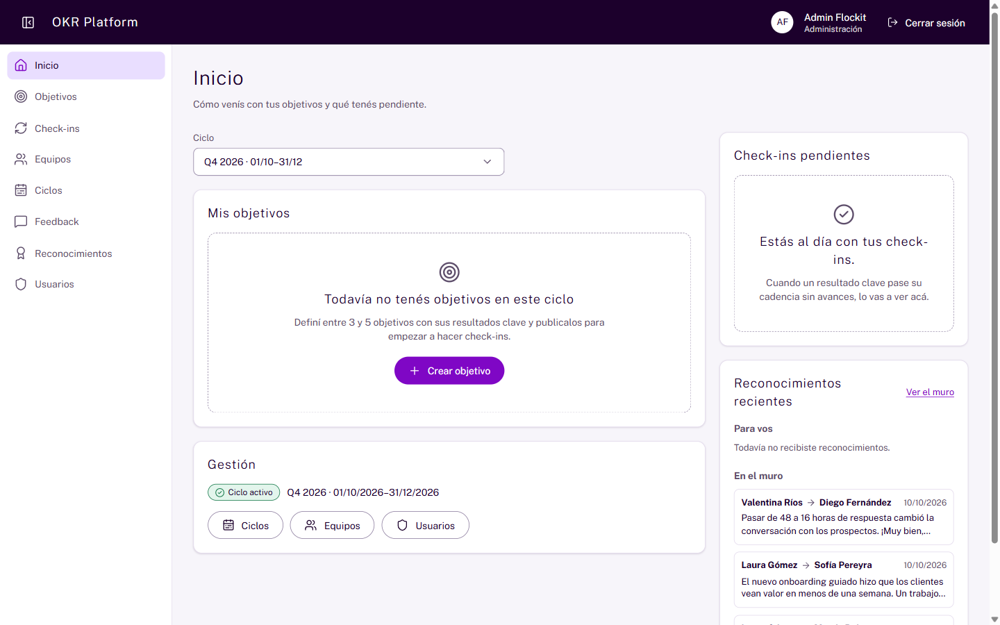
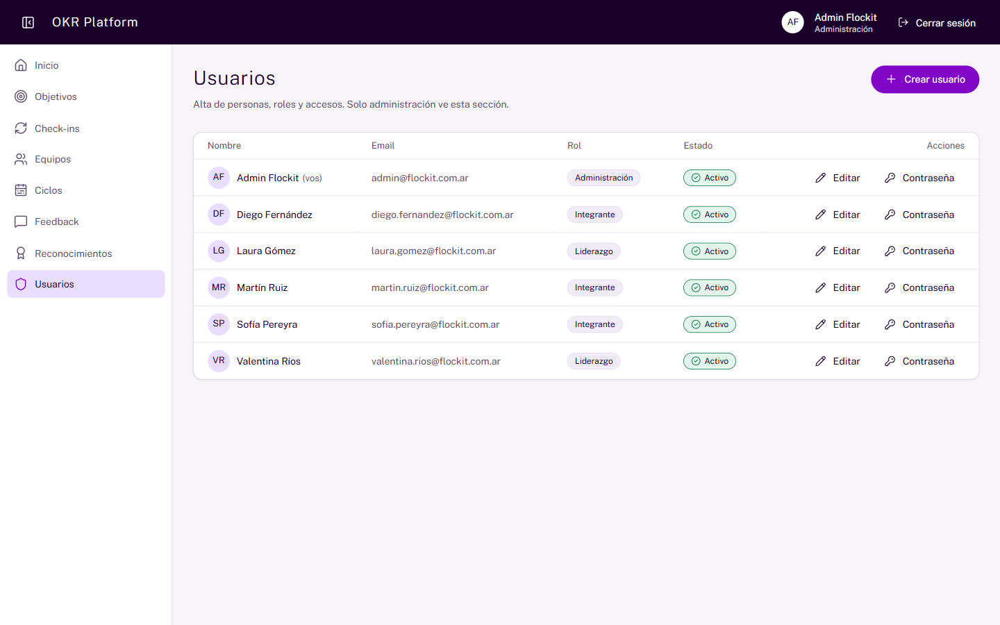
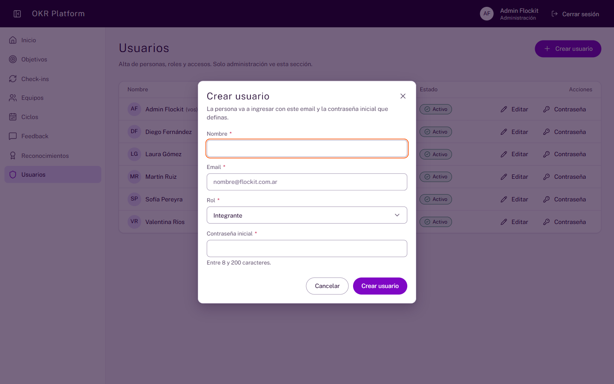
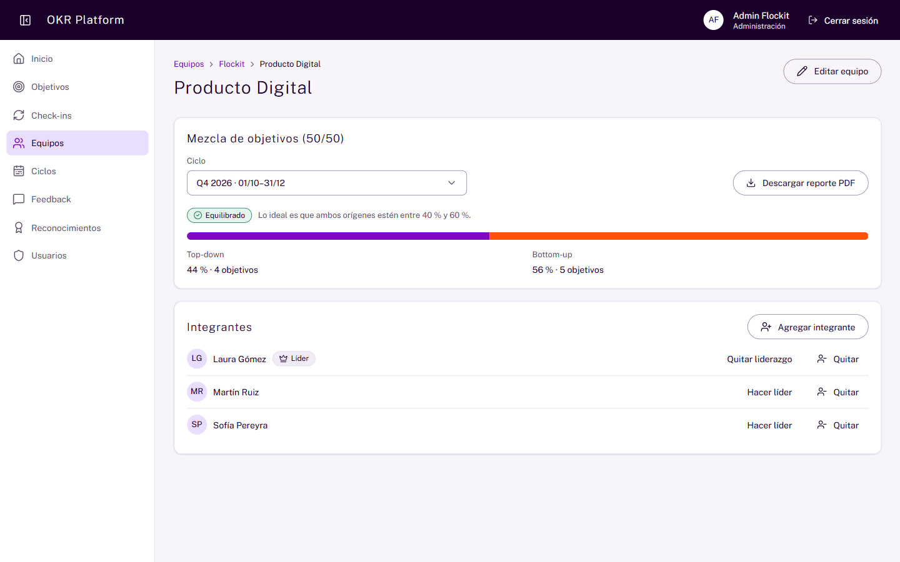
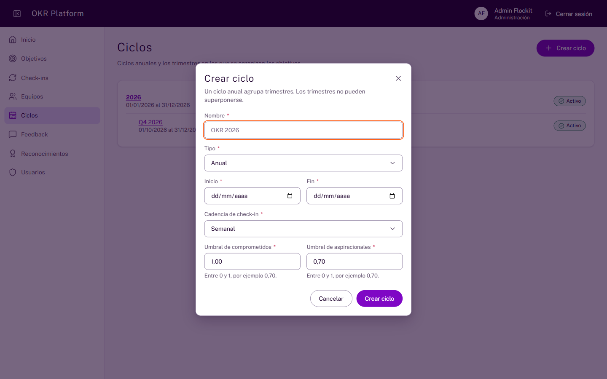
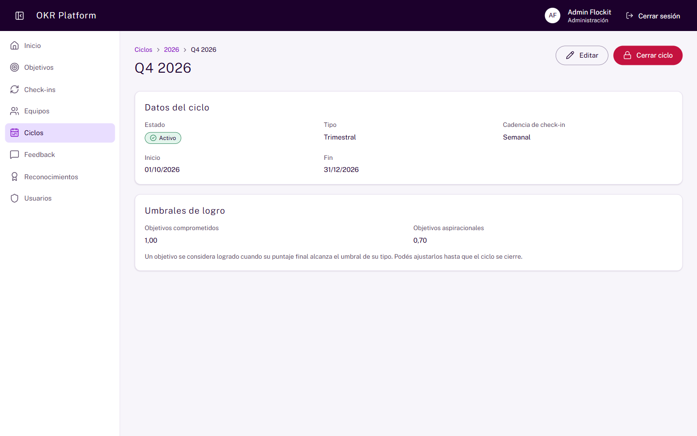

# Manual de administración de OKR Platform

Este manual es para las personas con rol Administración. Explica las tareas que solo vos podés hacer: gestionar usuarios, equipos y ciclos, controlar la ayuda de IA, atender los pedidos de documentos adaptados y consultar la auditoría.

Todo lo que hacen integrantes y líderes está en el [manual de usuario](manual-usuario.md). Leelo primero. Aquí no se repite.

Los ejemplos usan los datos de la demo: el equipo "Producto Digital", el equipo "Comercial" y los ciclos "2026" y "Q4 2026".

## Qué puede hacer administración

### Qué tareas son solo de administración

Solo Administración puede:

- crear y editar usuarios, cambiar su rol, desactivarlos y darles una contraseña nueva;
- usar el **Asistente** para pedir tareas de administración en un chat;
- crear y editar equipos, y agregar o quitar integrantes y líderes;
- crear, editar, activar y cerrar ciclos;
- crear objetivos para cualquier persona o equipo;
- ver el panel **Uso de IA**;
- atender los **Pedidos de adaptación**: asignarlos, entregarlos o rechazarlos;
- consultar la pantalla **Auditoría**.

Administración también puede descargar el reporte PDF de cualquier equipo y cambiar el valor inicial y la meta de cualquier resultado clave publicado.

### Qué no puede hacer administración

Estas reglas valen para todos los roles. Son a propósito.

- **No puede leer el feedback de otras personas.** El feedback es privado entre dos personas.
- **No tiene permisos especiales para registrar check-ins.** Solo registra en lo suyo o en lo de su equipo.
- **No puede cambiar su propio rol ni desactivarse a sí misma.** Otra persona de administración lo tiene que hacer.
- **No ve rankings ni datos por persona.** Los reportes y el panel de IA son agregados.
- **No puede reabrir un ciclo cerrado.**

### Qué ves en Inicio

En **Inicio** tenés la tarjeta **Gestión**. Muestra el ciclo activo y accesos directos a Ciclos, Equipos y Usuarios.

El menú lateral suma cuatro secciones que otros roles ven apagadas: **Usuarios**, **Uso de IA**, **Pedidos de adaptación** y **Auditoría**.

## Usuarios

### Cómo veo la lista de usuarios

Entrá a **Usuarios**. La lista muestra nombre, email, rol y estado de cada persona.

### Qué roles existen

La plataforma tiene tres roles globales:

| Rol                | Qué es                                                                       |
| ------------------ | ---------------------------------------------------------------------------- |
| **Administración** | Gestiona usuarios, equipos, ciclos y el panel de IA.                         |
| **Líder**          | Persona con rol de líder. Puede crear objetivos para los equipos que lidera. |
| **Integrante**     | Persona que trabaja con sus objetivos y los de su equipo.                    |

El rol **Líder** solo no alcanza para liderar un equipo. Además, la persona debe figurar como **Líder del equipo** en ese equipo. Son dos cosas distintas: el rol es de toda la plataforma y el liderazgo de equipo es de un equipo en particular. Mirá [Cómo marco a una persona como líder de un equipo](#cómo-marco-a-una-persona-como-líder-de-un-equipo).

### Cómo creo un usuario

1. Hacé clic en **Crear usuario**.
2. Completá **Nombre** y **Email**.
3. Elegí el **Rol**: Administración, Líder o Integrante.
4. Escribí una **Contraseña inicial** si querés elegirla vos. Debe tener entre 8 y 200 caracteres. Si la dejás en blanco, la plataforma genera una segura.
5. Hacé clic en **Crear usuario**.
6. Si dejaste la contraseña en blanco, aparece el aviso **Usuario creado** con la contraseña. Hacé clic en **Copiar contraseña** y cerrá el aviso.

Compartí la contraseña inicial con la persona por un canal seguro. No hay email automático. No puede haber dos usuarios con el mismo email.

La contraseña generada se muestra una sola vez. No la guardamos y no se puede volver a ver. Si la perdés, restablecé la contraseña de la persona.

### Qué es el cambio de contraseña obligatorio

Todo usuario nuevo nace con la obligación de cambiar su contraseña. Pasa igual si elegiste vos la contraseña inicial.

Cuando la persona ingresa por primera vez, ve la pantalla **Elegí tu contraseña**. Hasta que la cambie, no puede usar nada más de la plataforma. Solo puede cambiarla o cerrar sesión.

La contraseña nueva tiene que tener al menos 12 caracteres y ser distinta de la inicial. Al cambiarla, se cierran las otras sesiones abiertas de esa persona.

Administración no ve la contraseña nueva. Queda registrado en **Auditoría** que la persona la cambió, con la acción **Cambio de contraseña**.

Esto también pasa cuando restablecés una contraseña: la persona tiene que elegir otra al ingresar.

### Cómo cambio el rol o el nombre de un usuario

1. En la fila de la persona, hacé clic en **Editar**.
2. Cambiá el **Nombre** o el **Rol**.
3. Guardá los cambios.

No podés cambiar tu propio rol. El cambio de rol queda en la auditoría y rige desde el siguiente pedido de la persona.

### Cómo desactivo un usuario

1. En la fila de la persona, hacé clic en **Editar**.
2. Apagá la opción **Usuario activo**.
3. Guardá los cambios.

Una persona desactivada no puede ingresar. Sus sesiones abiertas se cierran. Sus datos siguen en la plataforma. Para volver a activarla, prendé de nuevo **Usuario activo**.

No podés desactivarte a vos misma.

### Cómo restablezco una contraseña

1. En la fila de la persona, hacé clic en **Contraseña**.
2. Escribí la **Contraseña nueva**. Debe tener entre 8 y 200 caracteres.
3. Confirmá.

La contraseña anterior deja de funcionar y se cierran las sesiones abiertas de esa persona. Pasale la nueva por un canal seguro. La persona va a tener que cambiarla al ingresar. Mirá [Qué es el cambio de contraseña obligatorio](#qué-es-el-cambio-de-contraseña-obligatorio).

No existe la opción "Olvidé mi contraseña". Todo pedido de contraseña llega a vos.

## Equipos y líderes

### Cómo se organizan los equipos

Los equipos forman un árbol. Hay un equipo raíz, que no tiene padre. En la demo es "Flockit". Los demás equipos, como "Producto Digital" y "Comercial", cuelgan de otro equipo.

### Cómo creo o edito un equipo

1. En **Equipos**, hacé clic en **Crear equipo**. Para uno existente, abrilo y hacé clic en **Editar equipo**.
2. Escribí el **Nombre**.
3. Elegí el **Equipo padre**.
4. Guardá los cambios.

### Cómo agrego o quito integrantes

1. Abrí el detalle del equipo.
2. En **Integrantes**, hacé clic en **Agregar integrante**.
3. Elegí a la persona.
4. Si corresponde, activá **Es líder del equipo**.
5. Confirmá.

Para sacar a alguien, usá **Quitar** en su fila. La plataforma pide confirmación.

### Cómo marco a una persona como líder de un equipo

En **Integrantes** del equipo:

- Usá **Hacer líder del equipo** para marcar a un integrante como líder.
- Usá **Quitar como líder del equipo** para sacarle ese papel.

En la lista de integrantes, quien lidera el equipo muestra la etiqueta **Líder del equipo**.

Ser líder da permisos solo en ese equipo. Esa persona puede crear y editar objetivos del equipo, cambiar metas de KR y descargar el reporte PDF. También puede validar versiones adaptadas por IA. Mirá [Quién valida y por qué](#quién-valida-y-por-qué).

Un líder de otro equipo no tiene esos permisos aquí.

## Ciclos

### Qué tipos de ciclo hay

- **Anual**. Es estratégico. No tiene ciclo padre. Ejemplo: "2026".
- **Trimestral**. Es táctico. Pertenece a un ciclo anual. Ejemplo: "Q4 2026".

Un trimestre debe estar dentro de las fechas de su ciclo anual. No puede superponerse con otro trimestre del mismo anual.

La plataforma no ofrece ciclos mensuales. Lo mensual es una opción de cadencia de check-in.

### Qué estados tiene un ciclo

Un ciclo solo avanza en un sentido:

| Estado       | Qué significa                                                        |
| ------------ | -------------------------------------------------------------------- |
| **Borrador** | Recién creado. Se pueden editar todas las fechas.                    |
| **Activo**   | Rige la cadencia de check-ins. Las fechas ya no se editan.           |
| **Cerrado**  | Terminó. Se calculó el puntaje final. No se puede editar ni reabrir. |

### Cómo creo un ciclo

1. Entrá a **Ciclos** y hacé clic en **Crear ciclo**.
2. Completá el formulario:
   - **Nombre**. Ejemplos: "OKR 2026" o "Q1 2027".
   - **Tipo**: Anual o Trimestral. Si elegís Trimestral, aparece **Ciclo anual**. Elegí a cuál pertenece.
   - **Inicio** y **Fin**.
   - **Cadencia de check-in**.
   - **Umbral de comprometidos** y **Umbral de aspiracionales**.
3. Hacé clic en **Crear ciclo**.

El ciclo se crea en estado **Borrador**.

### Qué es la cadencia de check-in

La cadencia dice cada cuánto se espera un check-in en el ciclo.

| Cadencia      | Días |
| ------------- | ---- |
| **Semanal**   | 7    |
| **Quincenal** | 14   |
| **Mensual**   | 30   |

Un KR queda vencido si pasa más tiempo que la cadencia sin check-in. El tiempo se cuenta desde el último check-in. Si no hubo ninguno, se cuenta desde la publicación del objetivo. Solo vencen los KR de objetivos publicados.

### Qué son los umbrales de logro

El umbral es el puntaje mínimo para considerar logrado un objetivo al cerrar el ciclo. Hay uno por tipo de objetivo:

| Umbral                       | Valor por defecto | Qué significa                                     |
| ---------------------------- | ----------------- | ------------------------------------------------- |
| **Umbral de comprometidos**  | 1,00              | Un objetivo comprometido se logra con 1,00 o más. |
| **Umbral de aspiracionales** | 0,70              | Un objetivo aspiracional se logra con 0,70 o más. |

Cada umbral debe ser mayor que 0 y no pasar de 1. El borde cuenta: con un puntaje igual al umbral, el objetivo se logra.

Los umbrales se pueden cambiar hasta que el ciclo se cierre. Cada cambio queda en la auditoría. Se usan los umbrales vigentes al momento del cierre.

### Cómo edito un ciclo

1. Abrí el ciclo y hacé clic en **Editar**.
2. Cambiá lo que necesites.
3. Guardá los cambios.

Las fechas solo se editan mientras el ciclo es borrador. Los umbrales se editan hasta el cierre.

### Cómo activo un ciclo

1. Abrí el ciclo en borrador.
2. Hacé clic en **Activar ciclo**.
3. Confirmá con **Activar ciclo**.

Desde ese momento rige la cadencia de check-ins. Las fechas ya no se pueden editar.

### Cómo cierro un ciclo

1. Abrí el ciclo activo.
2. Hacé clic en **Cerrar ciclo**.
3. Leé el aviso y confirmá con **Cerrar ciclo**.

Esta acción no se puede deshacer. Al cerrar:

- cada objetivo publicado pasa a **Cerrado**;
- cada objetivo guarda su puntaje final;
- cada objetivo queda como **Logrado** o **No logrado**, según los umbrales;
- ya no se admiten check-ins.

Los objetivos en borrador no se puntúan ni se cierran.

Antes de cerrar, revisá los umbrales. Después del cierre, el resultado de cada objetivo no cambia.

## Objetivos de la organización y de los equipos

### Qué objetivos puede crear administración

Administración puede elegir como responsable a cualquier persona o a cualquier equipo. Esto sirve para cargar los objetivos de la organización en el ciclo anual y los de cada equipo.

El proceso de crear, agregar KR y publicar es el mismo que en el [manual de usuario](manual-usuario.md).

### Qué límites rigen para todos

Estas reglas valen para cualquier responsable, también para administración:

- Máximo 5 objetivos por responsable y ciclo. Cuentan los borradores y los publicados.
- Máximo 5 resultados clave por objetivo.
- Para publicar hacen falta al menos 3 objetivos del responsable en el ciclo y al menos 3 KR en el objetivo.
- Después de publicar solo se editan el título, la descripción y la alineación.
- Solo se eliminan objetivos y KR en borrador.

### Cómo funciona la alineación

Un objetivo puede alinearse a otro ya publicado. El otro objetivo puede ser de otro ciclo. Así se conecta un objetivo trimestral con uno anual de la organización.

La alineación no puede formar un círculo. Por ejemplo, A alineado a B y B alineado a A no es posible.

## Reglas de equilibrio 50/50

### Qué es la mezcla 50/50

Cada objetivo tiene un origen: top-down (baja desde la dirección) o bottom-up (nace en las personas). La mezcla 50/50 mide esa proporción en cada equipo.

La regla es que el porcentaje bottom-up esté entre 40 % y 60 %.

### Qué pasa si un equipo se sale del rango

La plataforma muestra un aviso suave. El aviso es solo un indicador. Nunca bloquea nada: no impide crear, editar ni publicar.

### Dónde veo la mezcla

- En el detalle de cada equipo, en **Mezcla de objetivos (50/50)**. Elegí el ciclo.
- En el reporte PDF del equipo.
- Los líderes la ven también en la tarjeta **Mis equipos** de Inicio.

Ejemplo: "Top-down 44 % · Bottom-up 56 % · Equilibrado".

## Auditoría

### Qué registra la auditoría

La plataforma anota ciertos cambios importantes. Cada anotación se guarda en la misma operación que el cambio. No se puede modificar ni borrar. Esto lo impone la base de datos.

Se registran estos eventos:

- publicación y cierre de objetivos;
- cambio de meta o inicio de un KR publicado;
- cambio de puntaje de un KR;
- activación y cierre de ciclos;
- cambio de umbrales de un ciclo;
- cambio de rol y desactivación de usuarios;
- uso de IA: versión adaptada, versión validada y sugerencia aceptada;
- pedidos de documento adaptado: creado, asignado, entregado y rechazado;
- sesión cerrada por seguridad e intento de reutilizar una sesión ya cerrada.

### Qué no registra la auditoría

- No guarda el texto del feedback.
- No guarda el contenido de los textos que genera la IA. Solo guarda referencias y el estado.
- No guarda el texto de un pedido de documento adaptado: ni el asunto, ni el detalle, ni la nota de entrega, ni la justificación de un rechazo. Solo guarda quién lo hizo, cuándo y el estado.

### Cómo consulto la auditoría

1. En el menú lateral, entrá a **Auditoría**.
2. Leé la tabla. Va del registro más nuevo al más viejo. Cada fila muestra:
   - **Fecha**: día y hora de Buenos Aires.
   - **Quién**: el nombre de la persona. Si dice "Usuario eliminado", esa persona ya no existe en la plataforma.
   - **Acción**: qué pasó, con palabras comunes. Por ejemplo, "Objetivo publicado" o "Pedido de documento adaptado rechazado".
   - **Elemento**: sobre qué cosa fue (un objetivo, un ciclo, una persona) y un código corto.
   - **Qué cambió**: el valor de antes y el de después. Por ejemplo, "Estado: Borrador → Publicado".
3. Para acotar la búsqueda, usá los filtros **Acción**, **Elemento**, **Quién**, **Desde** y **Hasta**, y hacé clic en **Filtrar**.
4. Para volver a ver todo, hacé clic en **Quitar filtros**.
5. Si hay más de una página, usá **Anterior** y **Siguiente**. Cada página muestra hasta 20 registros.

La pantalla es solo de lectura. Nadie puede editar ni borrar un registro. Solo administración la ve: si otra persona escribe la dirección, la plataforma responde que no encontró la página.

La pantalla nunca muestra el contenido de un feedback ni el texto libre de un pedido. Muestra únicamente datos de estado, como puntajes, roles, ciclos y estados.

## Uso de IA

### Para qué sirve el panel Uso de IA

El panel **Uso de IA** muestra cuánto se usa la ayuda de IA, cuánto cuesta y qué impacto tiene. Solo lo ve Administración. Las demás personas ven la sección apagada, con una explicación.

El panel muestra datos agregados. No muestra personas ni rankings.

### Cómo elijo el período

Arriba a la derecha hay tres opciones de **Período**:

- **Últimos 7 días**.
- **Últimos 30 días**.
- **Últimos 90 días**.

Por defecto se muestran los últimos 30 días.

### Qué mide cada número de Adopción

| Número                                 | Qué significa                                                                                                                           |
| -------------------------------------- | --------------------------------------------------------------------------------------------------------------------------------------- |
| **Versiones accesibles que sirvieron** | Porcentaje de versiones adaptadas que una persona marcó con **Me sirve** o que se validaron. Debajo ves el total, por ejemplo "3 de 4". |
| **Sugerencias aceptadas**              | Porcentaje de sugerencias de redacción que alguien usó. Debajo ves el total.                                                            |

Si no hay datos, el panel dice "Sin datos". No inventa un 0 %.

### Qué mide cada número de Tiempo

| Número                                                   | Qué significa                                                                                               |
| -------------------------------------------------------- | ----------------------------------------------------------------------------------------------------------- |
| **Tiempo de entrega de una versión accesible (mediana)** | Cuánto tarda una persona en recibir la versión adaptada. Mediana: la mitad tarda menos y la otra mitad más. |
| **Tiempo hasta decidir una sugerencia (mediana)**        | Cuánto tarda una persona en usar o descartar una sugerencia.                                                |

Este tiempo se relaciona con el artículo 14.5 del RD 707/2026: las adaptaciones no deben demorarse sin motivo.

### Qué mide cada número de Calidad

| Número                                        | Qué significa                                                                                                                                                        |
| --------------------------------------------- | -------------------------------------------------------------------------------------------------------------------------------------------------------------------- |
| **Mejora media de legibilidad**               | Cuántos puntos sube la facilidad de lectura entre el texto original y la versión adaptada. Se mide con el índice de Szigriszt-Pazos. Más puntos significa más fácil. |
| **Versiones que requirieron revisión humana** | Porcentaje de versiones en las que la IA no pudo garantizar fidelidad. En esos casos se muestra el texto original.                                                   |

### Qué mide cada número de Costo (estimado)

| Número                                     | Qué significa                                                                                  |
| ------------------------------------------ | ---------------------------------------------------------------------------------------------- |
| **Costo total estimado**                   | Suma del costo estimado de todas las llamadas del período.                                     |
| **Personas que usaron la IA**              | Cuántas personas distintas la usaron. Solo el conteo, sin nombres.                             |
| **Costo estimado por persona usuaria**     | Costo total dividido por esas personas.                                                        |
| **Costo estimado: (nombre de la función)** | Un número por cada función: Versión accesible, Sugerencia de redacción y Resumen de check-ins. |

El costo siempre es una **estimación**. Se calcula con una tabla de precios de referencia. El plan gratuito del proveedor no factura, así que hoy el costo real es cero. En las pruebas, cada pedido costó entre US$ 0,0007 y US$ 0,0016.

Las personas usuarias no pagan nada por la IA. Eso lo pide el artículo 5.1.b del RD 707/2026. Este panel te ayuda a planificar el costo para la organización.

### Qué muestran las tablas Uso por función y Uso por modelo

Cada fila tiene estas columnas:

| Columna                    | Qué significa                                                                            |
| -------------------------- | ---------------------------------------------------------------------------------------- |
| **Llamadas**               | Cuántas veces se llamó al modelo de IA. Una sola petición puede generar varias llamadas. |
| **Fallidas**               | Cuántas llamadas fallaron.                                                               |
| **Tokens de entrada**      | Cantidad de texto que se envió al modelo. Un token es un trozo de palabra.               |
| **Tokens de salida**       | Cantidad de texto que devolvió el modelo.                                                |
| **Costo estimado**         | Costo calculado con precios de referencia.                                               |
| **Latencia p50**           | Tiempo de respuesta típico. La mitad de las llamadas tardó menos.                        |
| **Latencia p95**           | Tiempo de respuesta en los casos lentos. El 95 % de las llamadas tardó menos.            |
| **Con modelo de respaldo** | Porcentaje de llamadas que usaron el modelo de reserva porque el principal falló.        |

Si el modelo de respaldo se usa mucho, el modelo principal tiene problemas.

### Qué muestra la tabla Fallos por paso

Cada pedido a la IA pasa por varios pasos. La tabla dice en qué paso falló y por qué.

| Paso                       | Qué hace                                                        |
| -------------------------- | --------------------------------------------------------------- |
| **Clasificación**          | Revisa que el texto sea adecuado y no tenga contenido riesgoso. |
| **Generación**             | Escribe la versión adaptada o la sugerencia.                    |
| **Reparación**             | Intenta arreglar una respuesta con formato roto.                |
| **Verificación (juez)**    | Comprueba que la versión sea fiel al original.                  |
| **Regeneración**           | Repite la generación con el motivo del rechazo.                 |
| **Conexión con el agente** | Falla la comunicación con el servicio de IA.                    |

| Motivo                              | Qué significa                                        |
| ----------------------------------- | ---------------------------------------------------- |
| **Tiempo agotado**                  | El modelo tardó demasiado.                           |
| **Error del proveedor**             | El proveedor del modelo devolvió un error.           |
| **Límite del proveedor**            | El proveedor limitó los pedidos.                     |
| **Respuesta no válida**             | El modelo respondió algo ilegible.                   |
| **Formato inesperado**              | La respuesta no tenía la forma esperada.             |
| **Agente inalcanzable**             | No hay conexión con el servicio de IA.               |
| **El agente no respondió a tiempo** | El servicio de IA tardó demasiado.                   |
| **Respuesta ilegible del agente**   | El servicio de IA devolvió algo que no se pudo leer. |

Los fallos de conexión no cuentan como costo ni como personas activas.

### Cómo apago la IA

La IA se apaga desde la configuración del servidor, con la variable `AI_ENABLED=false`. Es una tarea del equipo técnico. Al apagarla, los botones de IA desaparecen. El resto de la plataforma sigue igual.

Si el servicio de IA se cae sin que lo apaguen, las personas ven el aviso "La ayuda de IA no está disponible ahora. El resto de la plataforma funciona normal." No pierden ningún dato.

## Validación de versiones adaptadas

### Quién valida y por qué

Toda versión generada por IA nace como **Generado por IA · pendiente de validación**. Una persona autorizada puede validarla. Esto es el control humano que exige el diseño: la IA nunca decide sola.

Quién puede validar depende de quién es la persona dueña del objetivo:

| El objetivo es...               | Pueden validar                                                                                   |
| ------------------------------- | ------------------------------------------------------------------------------------------------ |
| **De un equipo**                | Administración y quien figura como **Líder del equipo** de ese equipo.                           |
| **Individual** (de una persona) | Administración y quien figura como **Líder del equipo** en alguno de los equipos de esa persona. |

Estas reglas valen siempre:

- El rol **Líder** solo no alcanza. Hay que figurar como **Líder del equipo** en el equipo que corresponde.
- Un líder de otro equipo no puede validar.
- La persona dueña de un objetivo individual **no valida su propia versión**, aunque además lidere uno de sus equipos. Hace falta una segunda persona: así hay cuatro ojos sobre el texto. Administración sí puede validar lo suyo.
- Un integrante común nunca valida.
- El **feedback no se valida nunca**. Es privado entre dos personas y nadie más puede leerlo. Quien lo recibió solo puede marcar **Me sirve**.

Si no podés validar, el botón **Validar** aparece apagado y explica el motivo. En un objetivo individual, la pantalla ofrece **Validar** a quien lidera algún equipo y la plataforma confirma al hacer clic. Si no corresponde, muestra un aviso.

### Cómo valido una versión

1. Abrí el objetivo o el check-in con una versión adaptada.
2. Leé la versión y compará con el original.
3. Hacé clic en **Validar**.
4. Si hace falta, corregí el texto. Mantené los mismos bloques y el mismo orden.
5. Si querés, escribí una **Nota de validación**.
6. Hacé clic en **Validar versión**.

La marca pasa a **Validado por una persona**. Si corregiste el texto, queda anotado que hubo corrección humana. Una versión validada ya no vuelve atrás.

### Qué pasa con las versiones "Requiere revisión humana"

La IA no pudo garantizar que la versión fuera fiel. Se muestra el texto original con un aviso. Revisá el texto y, si la versión es buena, validala.

### Cuándo se regenera una versión

Si alguien cambia el texto original, se genera una versión nueva. Si cambia el prompt de la IA, las versiones sin validar se regeneran. Las versiones validadas o aceptadas se mantienen siempre, porque una persona respondió por ellas.

## Pedidos de documentos adaptados

### Qué es un pedido de documento adaptado

Cualquier persona puede pedir a otra persona un documento en otro formato: lectura fácil, lenguaje claro, audio, apoyo visual o una reunión adaptada. Es el artículo 14.5 del RD 707/2026. Funciona aunque la IA esté apagada o no alcance.

La persona entra a **Documentos adaptados**, hace clic en **Pedir un documento adaptado** y completa el formulario. También puede pedirlo desde un objetivo, un check-in o un feedback, con el enlace **Pedilo a una persona**. Si el pedido es sobre un feedback, vos no ves cuál es: el feedback es privado.

Tu parte es atender los pedidos desde **Pedidos de adaptación**. Cada pedido tiene un estado:

| Estado        | Qué significa                                      |
| ------------- | -------------------------------------------------- |
| **Pendiente** | Nadie se hizo cargo todavía.                       |
| **En curso**  | Una persona de administración lo está atendiendo.  |
| **Entregada** | Ya se entregó el documento, con una nota.          |
| **Rechazada** | No se pudo hacer. La justificación es obligatoria. |

### Cómo veo los pedidos y los filtro

1. En el menú lateral, entrá a **Pedidos de adaptación**.
2. Mirá la tabla. Cada fila muestra el asunto, quién lo pidió, el formato, el estado, la fecha límite y quién se ocupa.
3. Para ver solo algunos, hacé clic en **Pendiente**, **En curso**, **Entregada**, **Rechazada** o **Vencidos**. **Todos** vuelve a mostrar la lista completa.

Solo administración ve esta pantalla. Las demás personas solo ven sus propios pedidos.

### Cuál es el plazo para responder

Cada pedido tiene una **fecha límite**: 10 días corridos desde que se pidió. El equipo técnico puede cambiar esos días con la variable `ADAPTATION_DUE_DAYS`.

Un pedido **Vencido** está abierto y ya pasó su fecha límite. En la tabla se ve con fondo de advertencia, un ícono de alerta y la palabra "Vencido". El color solo no alcanza para saberlo. Atendé primero los vencidos.

Un pedido entregado o rechazado nunca figura como vencido.

### Cómo asigno un pedido

1. En la fila del pedido, hacé clic en **Asignar**.
2. Elegí quién se hace cargo. Solo aparecen personas de administración activas. Por defecto aparecés vos.
3. Hacé clic en **Asignar**.

El pedido pasa a **En curso**. Podés reasignarlo con **Reasignar** mientras siga abierto.

### Cómo entrego un documento adaptado

1. Preparé el documento por fuera de la plataforma.
2. En la fila del pedido, hacé clic en **Entregar**.
3. En **Nota de entrega**, contá qué entregás y cómo acceder. Escribí al menos 10 caracteres.
4. Si querés, pegá en **Enlace al documento** una dirección completa que empiece con https://.
5. Hacé clic en **Marcar como entregado**.

La persona ve la nota y el enlace en **Documentos adaptados**. El pedido pasa a **Entregada** y ya no se puede cambiar.

### Cómo rechazo un pedido y justifico

Solo corresponde rechazar si adaptar el documento supone una carga desproporcionada. El costo por sí solo no es un motivo válido. La justificación es obligatoria.

1. En la fila del pedido, hacé clic en **Rechazar**.
2. En **Justificación**, explicá el motivo por escrito, en lenguaje claro y con frases cortas. Escribí al menos 20 caracteres. La persona lo va a leer.
3. Hacé clic en **Rechazar pedido**.

Si dejás la justificación vacía o muy corta, la plataforma no rechaza el pedido y te lo avisa. El pedido pasa a **Rechazada** y la persona ve tu justificación en **Documentos adaptados**. No se puede deshacer.

Cada paso queda en la [auditoría](#cómo-consulto-la-auditoría), sin el texto que escribiste.

## Cumplimiento del RD 707/2026

### Qué es el RD 707/2026

El Real Decreto 707/2026 es el Reglamento de condiciones básicas de accesibilidad cognitiva. Entra en vigor el 2 de enero de 2027. No es una norma sobre IA. La plataforma usa la IA para cubrir la parte de textos y documentos.

Esta sección no es un dictamen jurídico. Es una guía práctica de qué hace el software y qué le toca a la organización.

### Qué hace el software

| Artículo            | Qué exige                                                                                                                 | Qué hace la plataforma                                                                                                                                                                                                                                                                                                                                 |
| ------------------- | ------------------------------------------------------------------------------------------------------------------------- | ------------------------------------------------------------------------------------------------------------------------------------------------------------------------------------------------------------------------------------------------------------------------------------------------------------------------------------------------------ |
| 3.i, 3.j, 3.k y 5.2 | Textos en lectura fácil, en lenguaje claro y en lenguaje sencillo                                                         | Ofrece **Ver en lectura fácil** y **Ver en lenguaje claro**. Mide la legibilidad de cada versión.                                                                                                                                                                                                                                                      |
| 5.1.b               | Que las adaptaciones sean gratuitas para la persona                                                                       | No cobra ni limita por costo. Mide el costo estimado para que la organización lo planifique.                                                                                                                                                                                                                                                           |
| 6                   | Servicios digitales accesibles cognitivamente                                                                             | Usa estados con ícono y palabra, textos con voseo claro, sugerencias de redacción y resumen de check-ins.                                                                                                                                                                                                                                              |
| 14.5                | Que se puedan pedir documentos adaptados a una persona, sin demoras indebidas, y que un rechazo se justifique por escrito | Hay un circuito de **Pedidos de adaptación**: cualquier persona pide un formato, el pedido tiene fecha límite (10 días por defecto) y administración lo asigna, lo entrega o lo rechaza. El rechazo exige una justificación escrita que la persona lee. Cada paso queda en la auditoría. La IA suma una vía inmediata, pero no reemplaza a la persona. |
| 4.2.g               | Verificar las medidas con personas con dificultades cognitivas, cuando sea posible                                        | Cubre solo una parte: ofrece la validación humana. Ver más abajo.                                                                                                                                                                                                                                                                                      |

### Qué le toca a la organización

El software no puede hacer estas tareas por sí solo. Tenés que planificarlas:

1. **Validar con personas con dificultades cognitivas (art. 4.2.g).** La plataforma da la herramienta de validación humana. Pero la validación con personas con dificultades cognitivas es un proceso de la organización. Hay que planificarlo, convocar a las personas y registrar sus conclusiones.
2. **Atender los pedidos a tiempo.** La plataforma registra los pedidos y marca los vencidos, pero alguien tiene que preparar los documentos. Definí quién lo hace y revisá **Pedidos de adaptación** con frecuencia.
3. **Rechazar solo por carga desproporcionada (art. 14.5).** La plataforma exige una justificación escrita para rechazar, pero no juzga si el motivo es válido. Eso lo decide tu organización. La plataforma nunca rechaza por costo.
4. **Certificar, si se necesita.** Las versiones siguen las reglas de cada nivel, pero ninguna entidad validadora las certificó como lectura fácil. Por eso llevan la marca "pendiente de validación".
5. **Resolver la protección de datos.** El proveedor actual de IA procesa los textos en Estados Unidos. Eso es una transferencia internacional de datos. Antes de producción en España hay que cubrir la base legal, la evaluación de impacto y el contrato con el proveedor. Hay una alternativa sin transferencia: un modelo propio dentro de la Unión Europea.
6. **Acceso sin memorizar contraseña (art. 14.4).** La plataforma no cambió el ingreso con contraseña. Ese artículo queda fuera de alcance y lo tiene que resolver la organización.

### Qué hace la plataforma para proteger los datos

- Envía a la IA solo texto, sin nombres, emails ni identificadores.
- Oculta emails, DNI y teléfonos del texto antes de enviarlo.
- Solo quien escribió o recibió un feedback puede pedir su versión adaptada.
- No guarda contenido en el servicio de IA ni en la auditoría.
- Permite apagar la IA sin afectar al resto.

Un límite: el ocultamiento por patrones no detecta nombres propios escritos dentro de un texto libre. Avisale a las personas que no escriban datos personales en los títulos ni en las notas.

### Qué no cubre este manual

- Las conversaciones 1:1 quedan para una etapa futura.
- La certificación UNE de las versiones adaptadas.

## Asistente de administración

El asistente es un chat que te ayuda con las tareas de administración. Vos le escribís qué necesitás, con tus palabras. Para cambiar algo, primero te muestra un plan. Solo si lo confirmás, lo hace.

### Cómo abro el asistente

1. En el menú, hacé clic en **Asistente**.
2. Arriba vas a ver las **Novedades**.
3. Abajo está la **Conversación** con un cuadro para escribir.

Solo Administración ve esta pantalla. Las demás personas ven el ítem **Asistente** deshabilitado, con la explicación "Solo administración puede usar el asistente".

Si el asistente no está disponible, la pantalla te avisa. El resto de la plataforma sigue funcionando igual. Podés hacer las mismas tareas desde las pantallas de siempre.

### Qué son las novedades del asistente

Las **Novedades** son un resumen de lo que conviene revisar hoy. Por ejemplo, check-ins vencidos, equipos sin líder o ciclos por cerrar.

Cada línea tiene una cantidad y un enlace **Resolver** que te lleva a la pantalla donde se arregla.

Los números salen de la base de datos, no de la IA. La IA solo los redacta. Una etiqueta te dice quién escribió el resumen:

- **Resumen generado por IA**: lo redactó la IA y se verificó que no cambie los números.
- **Resumen automático (plantilla)**: lo armó la plataforma sin IA.

Para volver a calcularlo, hacé clic en **Actualizar novedades**. Si no lo hacés, se reutiliza el resumen de los últimos 10 minutos.

### Cómo le pido una acción al asistente

1. Escribí lo que necesitás en el cuadro **Qué necesitás**. Podés usar hasta 2000 caracteres.
2. Presioná **Enter** o hacé clic en **Enviar**. Para agregar un renglón, presioná **Mayús + Enter**.
3. Esperá la respuesta. Puede tardar hasta un minuto y medio. Mientras tanto ves "El asistente está pensando" y los segundos que pasaron. Podés salir de la pantalla: la respuesta te espera cuando vuelvas.

Ejemplo: "Creá el equipo Datos dentro de Producto Digital, dá de alta a Lucía Gómez (lucia@ejemplo.com) y poné a Lucía de líder del equipo".

El asistente puede hacer estas acciones:

- crear un usuario;
- crear un equipo;
- agregar o quitar a una persona de un equipo, y marcarla como líder del equipo;
- crear y activar un ciclo;
- crear un objetivo;
- crear un resultado clave;
- cambiar quién es responsable de un resultado clave.

Si tu pedido no es claro, el asistente te pregunta antes de armar un plan. Si escribís algo que no puede procesar, te lo dice y tu texto sigue en el cuadro.

### Cómo confirmo un plan del asistente

El plan aparece en la conversación con el título **Plan propuesto**. Antes de confirmar, revisá cada parte:

1. Mirá la lista **Qué voy a hacer, en este orden**.
2. Leé los **Supuestos que tomé**. Son cosas que el asistente decidió porque no las dijiste.
3. Leé los **Avisos para tener en cuenta**. Por ejemplo, si el plan crea a una persona con acceso de administración.
4. Mirá cuándo vence el plan. Dura 15 minutos.
5. Hacé clic en **Confirmar y ejecutar**. Si no querés seguir, hacé clic en **Descartar**.

Hasta que confirmás, no se hace ningún cambio.

Si el plan tiene problemas que impiden ejecutarlo, el botón **Confirmar y ejecutar** no aparece o está deshabilitado. Un texto explica el motivo. Por ejemplo, un email que ya existe. Pedí el plan de nuevo con más detalle.

Cuando termina, ves el resultado paso por paso. Cada paso dice **Hecho**, **Falló** o **No se hizo**, y tiene un enlace a lo que se creó.

Si el asistente creó un usuario sin que vos escribieras contraseña, te muestra la **contraseña inicial** una sola vez. Hacé clic en **Copiar contraseña** y pasásela a la persona por un canal seguro. No la guardamos y no se puede volver a ver. La persona tendrá que cambiarla en su primer ingreso. Mirá [Qué es el cambio de contraseña obligatorio](#qué-es-el-cambio-de-contraseña-obligatorio).

### Qué pasa si un paso del plan falla

El asistente ejecuta los pasos en orden. Se detiene en el primer error.

- Los pasos anteriores quedan hechos. No se deshacen solos.
- El paso con error aparece como **Falló** y dice por qué.
- Los pasos siguientes aparecen como **No se hizo**.

Por ejemplo, si alguien creó el equipo "Ventas" justo antes de que confirmaras, el plan crea los equipos anteriores y se detiene en "Ventas".

Para seguir, revisá el resultado y pedí el resto en un mensaje nuevo. El asistente no reintenta solo.

Otros avisos que podés ver:

- **El plan venció**: pasaron más de 15 minutos. No se hizo nada. Pedilo de nuevo.
- **El plan cambió desde que lo viste**: no se hizo nada. Pedilo de nuevo y revisalo.
- **Este plan ya se había confirmado**: otra pestaña o persona lo decidió antes. La pantalla muestra cómo quedó.
- **Hiciste muchos pedidos seguidos**: esperá un minuto.

### Cómo consulto la auditoría o pido ayuda al asistente

Además de acciones, podés hacerle preguntas:

- **Consultas de auditoría.** Por ejemplo, "¿Quién cambió el rol de Marta Miembro?". El asistente muestra una tabla con los registros. La tabla la arma la plataforma, no la IA. Un enlace te lleva a **Auditoría** con los mismos filtros.
- **Preguntas de ayuda.** Por ejemplo, "¿Cómo cierro un ciclo?". El asistente responde con los pasos de este manual y enlaza la sección que usó.

Todo lo que el asistente hace por vos queda en **Auditoría** con la marca **Vía asistente**.

### Qué no puede hacer el asistente y por qué

El asistente no puede:

- cerrar ciclos;
- publicar ni borrar objetivos;
- cambiar roles;
- desactivar usuarios;
- restablecer contraseñas.

Esas tareas son más delicadas o difíciles de deshacer. Hacelas vos desde su pantalla.

Además, el asistente:

- no ejecuta nada sin tu confirmación;
- solo hace lo que está en su lista, aunque se lo pidas;
- nunca ve el contenido del feedback ni quién pidió un documento adaptado;
- no tiene acceso directo a la base de datos: la plataforma valida y ejecuta cada paso.

### Cómo borro la conversación

1. Hacé clic en **Borrar conversación**.
2. Leé el aviso y confirmá con **Borrar conversación**.

Se borran todos tus mensajes con el asistente. No se puede deshacer. Los registros de **Auditoría** no se borran.

### Cuánto tiempo se guarda la conversación

- Los mensajes de la conversación se guardan 30 días.
- Los planes se guardan 90 días, para poder revisar qué se hizo.
- La **Auditoría** se guarda sin límite de tiempo. No incluye el texto que escribiste, solo qué pasó.
- La contraseña inicial nunca se guarda.

Para pedir la respuesta, la plataforma le envía a la IA tu mensaje, la conversación reciente y una lista de nombres de usuarios, equipos, ciclos y objetivos. No le envía emails de personas que ya existen, contraseñas ni feedback.

## Preguntas frecuentes de administración

### Cómo le doy acceso a una persona nueva

1. Creá su usuario en **Usuarios**.
2. Agregala a su equipo desde el detalle del equipo.
3. Si lidera, activá **Es líder del equipo**.
4. Pasale la contraseña inicial por un canal seguro. En su primer ingreso, la persona va a elegir una contraseña propia.

### Una persona me pide cambiar de equipo. Qué hago

Sacala del equipo anterior con **Quitar**. Después agregala al equipo nuevo con **Agregar integrante**. Sus objetivos individuales siguen siendo suyos.

### Puedo reabrir un ciclo cerrado

No. El cierre no se puede deshacer. Si te equivocaste de umbral, ya no se puede corregir el resultado de ese ciclo.

### Por qué una persona no ve los botones de IA

La IA puede estar apagada para toda la organización. Si está encendida y la persona no ve los botones, puede ser un fallo de conexión con el servicio. Revisá el panel **Uso de IA**, en la tabla **Fallos por paso**.

### Por qué el costo de IA es cero en el proveedor pero el panel muestra un número

El plan gratuito del proveedor no factura. El panel muestra una estimación con precios de mercado, para planificar el costo si algún día se pasa a un plan pago.

### Qué hago si una persona pide un documento adaptado y la IA no está disponible

El pedido a una persona funciona igual, con o sin IA. Entrá a **Pedidos de adaptación**, asignate el pedido y entregalo. Mirá [Cómo entrego un documento adaptado](#cómo-entrego-un-documento-adaptado).

No podés negarte por el costo. Solo podés rechazar el pedido si supone una carga desproporcionada, y debés justificarlo por escrito. Mirá [Cómo rechazo un pedido y justifico](#cómo-rechazo-un-pedido-y-justifico).

### Por qué no puedo validar la versión de mi propio objetivo

Quien es dueña de un objetivo individual no puede validar su propia versión, ni siquiera si lidera uno de sus equipos. Pedile a otra persona que la valide. Solo Administración puede validar lo suyo. Mirá [Quién valida y por qué](#quién-valida-y-por-qué).

## Glosario de administración

| Término                         | Qué significa                                                                                                             |
| ------------------------------- | ------------------------------------------------------------------------------------------------------------------------- |
| **Auditoría**                   | Registro que no se puede modificar de los cambios importantes de la plataforma. Se consulta en la pantalla **Auditoría**. |
| **Cadencia**                    | Cada cuánto se espera un check-in en un ciclo.                                                                            |
| **Ciclo anual**                 | Ciclo estratégico de un año. Contiene trimestres.                                                                         |
| **Ciclo trimestral**            | Ciclo táctico de tres meses, dentro de un anual.                                                                          |
| **Costo estimado**              | Cálculo con precios de referencia. No es una factura.                                                                     |
| **Latencia p50**                | Tiempo de respuesta típico. La mitad de las llamadas tardó menos.                                                         |
| **Latencia p95**                | Tiempo de respuesta en los casos lentos. El 95 % tardó menos.                                                             |
| **Mediana**                     | Valor del medio. La mitad de los casos queda por debajo y la otra mitad por encima.                                       |
| **Mezcla 50/50**                | Proporción de objetivos top-down y bottom-up. Lo ideal es entre 40 % y 60 % de cada uno.                                  |
| **Modelo de respaldo**          | Modelo de IA de reserva. Se usa cuando falla el principal.                                                                |
| **Fecha límite**                | Día hasta el que hay que responder un pedido de documento adaptado. Por defecto, 10 días corridos desde el pedido.        |
| **Líder**                       | Rol global de una persona. No alcanza para liderar un equipo.                                                             |
| **Líder del equipo**            | Persona marcada como líder en un equipo en particular. Tiene permisos solo en ese equipo.                                 |
| **Pedido de adaptación**        | Pedido de un documento en otro formato, que atiende una persona de administración (art. 14.5).                            |
| **Pendiente de validación**     | Marca de una versión de IA que ninguna persona revisó todavía.                                                            |
| **RD 707/2026**                 | Reglamento español de accesibilidad cognitiva. Entra en vigor el 2 de enero de 2027.                                      |
| **Szigriszt-Pazos (INFLESZ)**   | Índice que mide qué tan fácil es leer un texto en español.                                                                |
| **Token**                       | Trozo de texto que procesa un modelo de IA. Una palabra puede tener varios tokens.                                        |
| **Transferencia internacional** | Envío de datos personales a un país fuera de la Unión Europea.                                                            |
| **Umbral de logro**             | Puntaje mínimo para considerar logrado un objetivo al cerrar el ciclo.                                                    |
| **Validar**                     | Revisar una versión de IA y aprobarla.                                                                                    |
| **Vencido**                     | Pedido abierto que ya pasó su fecha límite.                                                                               |
