# Manual de usuario de OKR Platform

Este manual es para integrantes y líderes de equipo de Flock IT. Explica, paso a paso, cómo usar OKR Platform. No hace falta saber nada técnico.

Si administrás la plataforma, leé el [manual de administración](manual-admin.md).

Las capturas de pantalla usan datos de ejemplo. Lo que veas en tu cuenta puede ser distinto.

## Primeros pasos

### Cómo ingreso a la plataforma

1. Abrí la dirección de OKR Platform en tu navegador.
2. Escribí tu email de trabajo y tu contraseña.
3. Hacé clic en **Ingresar**.

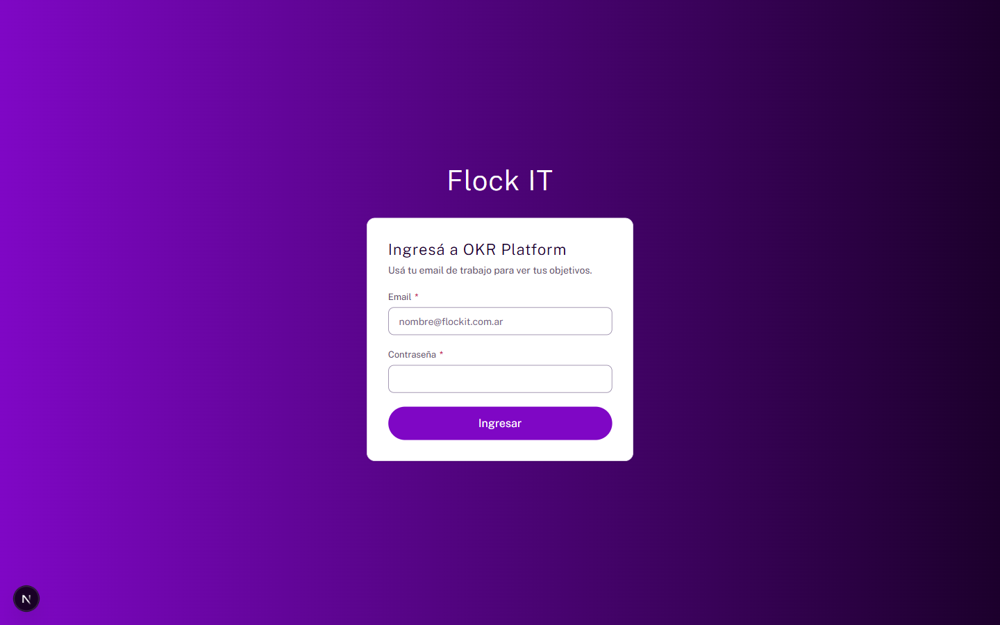

Si algo falla, verás un mensaje. Puede ser uno de estos:

- "No pudimos iniciar sesión. Revisá el email y la contraseña." Los datos no coinciden o tu usuario está desactivado.
- "Hiciste demasiados intentos. Esperá un minuto y probá de nuevo." Se bloqueó el ingreso por un rato.

No existe la opción "Olvidé mi contraseña". Si la perdiste, pedile a administración que te dé una nueva.

### Qué hago la primera vez que ingreso

La primera vez, administración te da una contraseña inicial. Esa contraseña es solo para entrar la primera vez.

1. Ingresá con tu email y la contraseña inicial.
2. Vas a ver la pantalla **Elegí tu contraseña**. Hasta que la completes, no podés usar el resto de la plataforma.
3. Escribí la contraseña inicial en **Contraseña inicial**.
4. Escribí una contraseña nueva en **Contraseña nueva**. Tiene que tener al menos 12 caracteres y ser distinta de la inicial.
5. Repetila en **Repetí la contraseña nueva**.
6. Hacé clic en **Cambiar contraseña**.

Después de cambiarla, entrás a la plataforma. Una frase larga es más segura y más fácil de recordar que una palabra con símbolos.

Si no querés cambiarla ahora, hacé clic en **Cerrar sesión**. La pantalla va a aparecer de nuevo la próxima vez que ingreses.

### Cómo cambio mi contraseña cuando quiero

1. En la parte de arriba, hacé clic en **Cambiar contraseña**.
2. Escribí tu **Contraseña actual**.
3. Escribí la **Contraseña nueva** y repetila. Tiene que tener al menos 12 caracteres.
4. Hacé clic en **Cambiar contraseña**.

Al cambiarla, se cierran tus otras sesiones abiertas. Si la olvidaste, pedile a administración que te dé una nueva.

### Cómo me muevo por la pantalla

Después de ingresar llegás a **Inicio**. La pantalla tiene tres zonas:

- **Barra superior**. Muestra tu nombre, tu rol y el botón **Cerrar sesión**.
- **Menú lateral**. Tiene estas secciones: Inicio, Objetivos, Check-ins, Equipos, Ciclos, Feedback, Reconocimientos y Documentos adaptados. Junto a **Check-ins** aparece un número. Es la cantidad de check-ins que tenés vencidos.
- **Contenido**. Es la sección que elegiste.

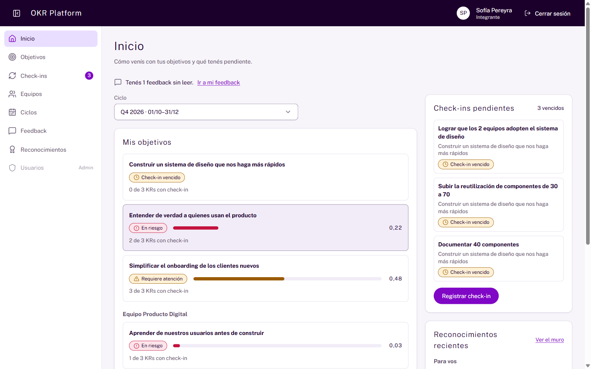

Si una acción no está disponible para vos, no desaparece. Se ve apagada y al lado dice por qué.

### Qué puedo hacer según mi rol

Hay tres roles: Integrante, Líder y Administración. Esta tabla resume lo que puede hacer cada uno.

| Tarea                                                              |            Integrante             |                                 Líder                                  |   Administración    |
| ------------------------------------------------------------------ | :-------------------------------: | :--------------------------------------------------------------------: | :-----------------: |
| Ver Inicio, objetivos publicados, equipos y ciclos                 |                Sí                 |                                   Sí                                   |         Sí          |
| Crear objetivos propios                                            |                Sí                 |                                   Sí                                   |         Sí          |
| Crear objetivos de un equipo                                       |                No                 |                       De los equipos que lidera                        | De cualquier equipo |
| Editar un objetivo y sus resultados clave                          |            Los propios            |                        Propios y de sus equipos                        |        Todos        |
| Cambiar el valor inicial y la meta de un resultado clave publicado |                No                 |                           Sí, en sus equipos                           |         Sí          |
| Registrar check-ins                                                | En lo propio y en lo de su equipo |                      Igual, más lo de sus equipos                      | Igual que el resto  |
| Dar y recibir feedback privado                                     |                Sí                 |                                   Sí                                   |         Sí          |
| Reconocer logros en el muro                                        |                Sí                 |                                   Sí                                   |         Sí          |
| Descargar el reporte PDF de un equipo                              |                No                 |                          Solo de sus equipos                           |         Sí          |
| Validar una versión adaptada por IA                                |                No                 | En sus equipos y en lo individual de sus integrantes (nunca lo propio) |         Sí          |
| Pedir un documento adaptado a una persona                          |                Sí                 |                                   Sí                                   |         Sí          |

**Líder** es el rol de la persona en toda la plataforma. **Líder del equipo** es la persona marcada como líder en un equipo en particular. Las opciones de líder valen solo para los equipos donde figurás como **Líder del equipo**. Tener el rol **Líder** sin figurar como líder de un equipo no alcanza.

## Conceptos básicos

### Qué es un objetivo

Un objetivo es lo que querés lograr. Se escribe con palabras, sin números. Ejemplo: "Simplificar el onboarding de los clientes nuevos".

Cada objetivo pertenece a una persona o a un equipo. También pertenece a un ciclo.

### Qué es un resultado clave (KR)

OKR quiere decir "Objectives and Key Results", es decir, objetivos y resultados clave. Un resultado clave, o KR, mide si el objetivo avanza.

Hay dos tipos de KR:

| Tipo                    | Cómo se mide                                                               | Ejemplo                                      |
| ----------------------- | -------------------------------------------------------------------------- | -------------------------------------------- |
| Numérico                | Va de un valor inicial a una meta. Tiene una unidad, como días o clientes. | Bajar el tiempo de onboarding de 14 a 5 días |
| Manual (se cumple o no) | Quien registra elige un puntaje de 0,0 a 1,0, de a 0,1.                    | Validar el prototipo con 5 usuarios          |

Cada KR tiene una persona responsable.

### Cuántos objetivos y KR tengo que definir

- Cada responsable define entre 3 y 5 objetivos por ciclo.
- Cada objetivo tiene entre 3 y 5 resultados clave.

Estos límites no son una sugerencia. Para publicar necesitás cumplirlos.

### Qué es el puntaje

El puntaje es un número entre 0,00 y 1,00. Indica qué tan cerca está algo de su meta.

- En un KR numérico, el puntaje sale de esta cuenta: (valor actual − valor inicial) ÷ (meta − valor inicial). El resultado nunca baja de 0 ni pasa de 1. También sirve para metas que bajan, como pasar de 14 a 5 días.
- En un KR manual, el puntaje es el que elegiste en el check-in.
- El puntaje de un objetivo es el promedio de todos sus KR.

Un KR sin check-ins cuenta como 0 en ese promedio. Por eso un objetivo puede verse en rojo aunque uno de sus KR esté bien.

### Qué significan los colores de estado

El estado se muestra siempre con un ícono, una palabra y un color. Nunca solo con color.

| Estado                          | Puntaje     | Qué significa                      |
| ------------------------------- | ----------- | ---------------------------------- |
| Verde, **En ruta**              | 0,70 a 1,00 | Avanza como se esperaba.           |
| Amarillo, **Requiere atención** | 0,40 a 0,69 | Hay avance, pero conviene revisar. |
| Rojo, **En riesgo**             | 0,00 a 0,39 | Está lejos de la meta.             |

Hay otros dos estados, sin color de avance:

- **Sin check-ins**. Todavía no hay ningún avance registrado. No se le asigna estado.
- **Check-in vencido**. Pasó más tiempo que la cadencia del ciclo sin registrar un avance.

### Qué diferencia hay entre comprometido y aspiracional

Al crear un objetivo elegís su tipo.

- **Comprometido**. Se espera cumplirlo por completo. Su meta es 1,00.
- **Aspiracional**. Es una apuesta ambiciosa. Llegar a 0,70 ya es un buen resultado.

Cada ciclo define desde qué puntaje un objetivo cuenta como logrado. En los ciclos de ejemplo es 1,00 para los comprometidos y 0,70 para los aspiracionales.

Cuando el ciclo se cierra, cada objetivo muestra su puntaje final. También dice si quedó **Logrado** o **No logrado**.

### Qué es top-down y bottom-up

Cada objetivo indica de dónde nace.

- **Top-down**. Baja desde la dirección.
- **Bottom-up**. Nace en las personas.

Lo ideal es que en cada equipo cada origen esté entre 40 % y 60 %. Es la "mezcla 50/50". Si el equipo se sale de ese rango, verás un aviso suave. El aviso nunca bloquea nada.

### Qué es un ciclo y qué es la cadencia

Un ciclo es un período con fecha de inicio y de fin. Los objetivos se organizan por ciclo.

- **Anual**. Es el ciclo estratégico. Ejemplo: "2026".
- **Trimestral**. Es el ciclo táctico, dentro de un anual. Ejemplo: "Q4 2026".

La cadencia es cada cuánto se espera un check-in. Puede ser semanal (7 días), quincenal (14 días) o mensual (30 días).

Un KR queda vencido si pasa más tiempo que la cadencia sin check-in. El tiempo se cuenta desde el último check-in. Si no hubo ninguno, se cuenta desde que se publicó el objetivo.

Un ciclo puede estar en **Borrador**, **Activo** o **Cerrado**.

### En qué estados puede estar un objetivo

| Estado        | Qué implica                                                                                         |
| ------------- | --------------------------------------------------------------------------------------------------- |
| **Borrador**  | Solo lo ven quienes pueden editarlo. Se puede cambiar todo y eliminar. Todavía no admite check-ins. |
| **Publicado** | Lo ve toda la organización. Admite check-ins. Ya no se puede eliminar ni cambiar su tipo u origen.  |
| **Cerrado**   | El ciclo terminó. Muestra el puntaje final y si se logró. Ya no admite check-ins.                   |

## Inicio

### Cómo veo cómo vengo

**Inicio** responde en segundos la pregunta "¿cómo vengo?". Muestra el ciclo vigente. Para ver otro, usá el selector **Ciclo**.

Inicio tiene estas partes:

- **Mis objetivos**. Tus objetivos individuales y, aparte, los de tus equipos. Cada uno muestra su estado, su puntaje y cuántos KR tienen check-in. Ejemplo: "2 de 3 KRs con check-in".
- **Check-ins pendientes**. Los KR vencidos, hasta 5, y el botón **Registrar check-in**. Si no hay ninguno, dice "Estás al día con tus check-ins."
- **Reconocimientos recientes**. Los que recibiste ("Para vos") y los últimos del muro.
- **Aviso de feedback**. Si tenés feedback sin leer, dice "Tenés N feedback sin leer." con un enlace. Nunca muestra el contenido ni quién lo mandó.

### Qué ve un líder en Inicio

Si sos líder, Inicio suma tres cosas:

- En **Mis objetivos**, aparecen también los objetivos de tus equipos.
- La tarjeta **Mis equipos** muestra la mezcla top-down y bottom-up de cada equipo. Ejemplo: "Top-down 44 % · Bottom-up 56 % · Equilibrado".
- En **Check-ins pendientes**, aparecen también los KR vencidos de tus equipos.

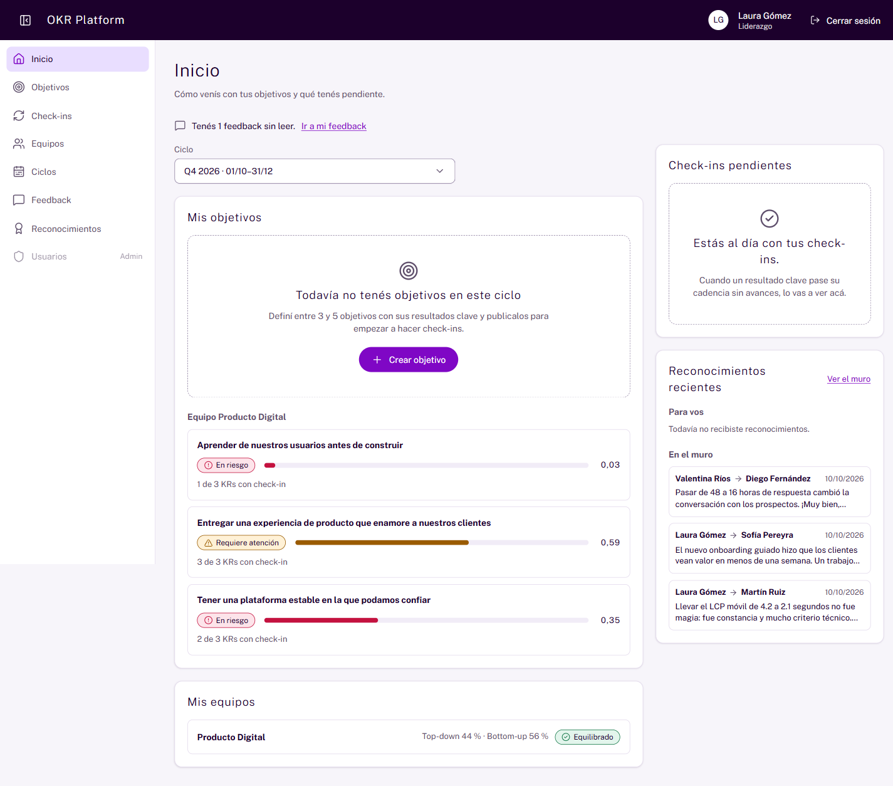

## Objetivos y resultados clave

### Cómo busco y consulto un objetivo

1. Entrá a **Objetivos**.
2. Filtrá con **Ciclo**, **Equipo responsable**, **Persona responsable** y **Estado**.
3. Hacé clic en el objetivo para abrir su detalle.

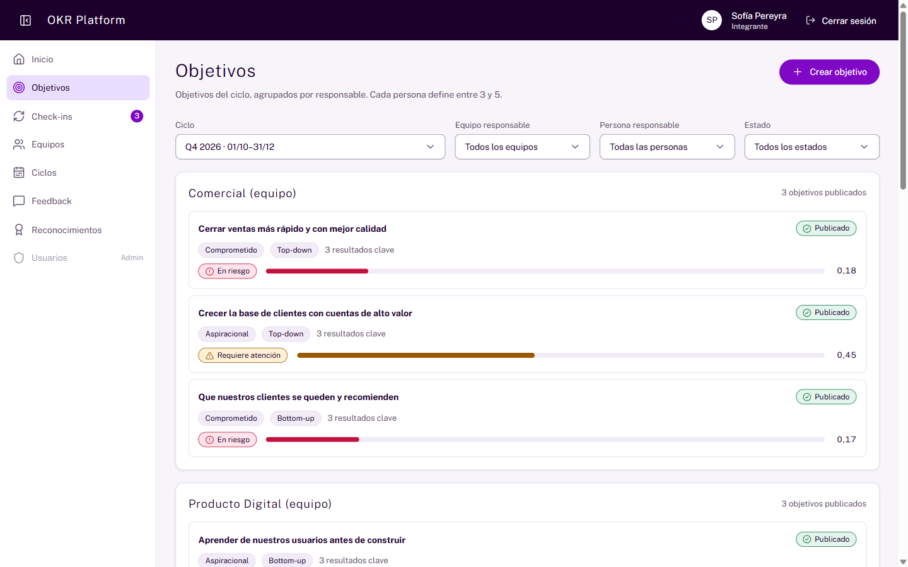

El detalle tiene estas partes:

- **Resumen**: estado, tipo, origen, responsable, ciclo, descripción y puntaje.
- **Alineación**: a qué objetivo se alinea y qué objetivos se alinean a este.
- **Resultados clave**: una tabla con el tipo, el inicio, la meta, el valor actual, la unidad, el puntaje y el estado de cada KR.
- **Historial de check-ins**: cada avance con fecha, autor, acción, valor, puntaje y nota.

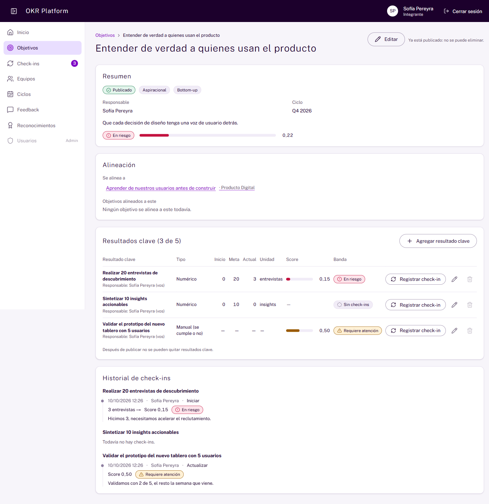

### Cómo creo un objetivo

1. En **Objetivos**, hacé clic en **Crear objetivo**.
2. Completá el formulario:
   - **Ciclo**. Solo aparecen ciclos que no están cerrados.
   - **Responsable**. Si sos integrante, solo podés elegirte a vos. Los objetivos de equipo los crea su líder.
   - **Título** y, si querés, **Descripción**.
   - **Tipo**: Comprometido o Aspiracional.
   - **Origen**: Top-down o Bottom-up.
   - **Alineado a** (opcional): un objetivo ya publicado. Puede ser de otro ciclo.
3. Hacé clic en **Crear objetivo**.

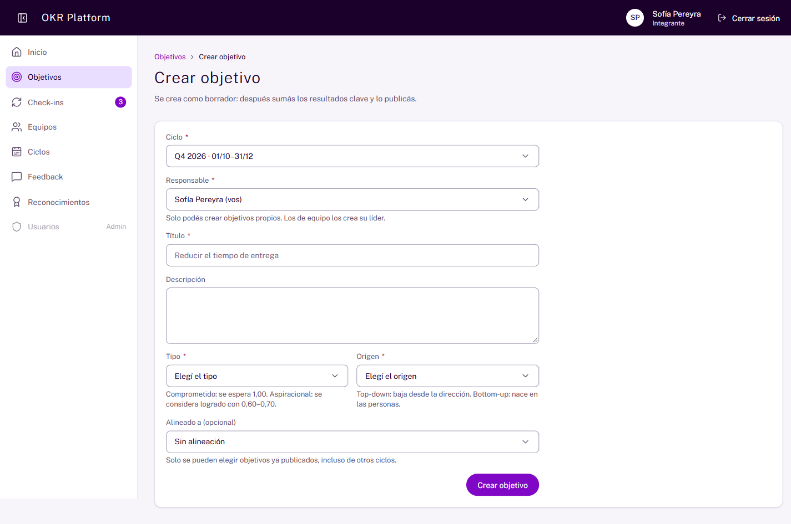

El objetivo queda en **Borrador**. El paso siguiente es agregarle resultados clave.

Si la IA está activa, podés pedir ayuda para escribirlo. Mirá [Cómo pido una sugerencia de redacción](#ayudas-de-ia).

### Cómo agrego o edito un resultado clave

1. En el detalle del objetivo, hacé clic en **Agregar resultado clave**.
2. Completá el formulario:
   - **Resultado clave**: qué vas a medir.
   - **Cómo se mide**: Numérico o Manual (se cumple o no).
   - Si es numérico: **Valor inicial**, **Meta** y **Unidad**. Ejemplos de unidad: clientes, %, días.
   - **Responsable**: quién lo va a ejecutar.
3. Hacé clic en **Agregar resultado clave**.

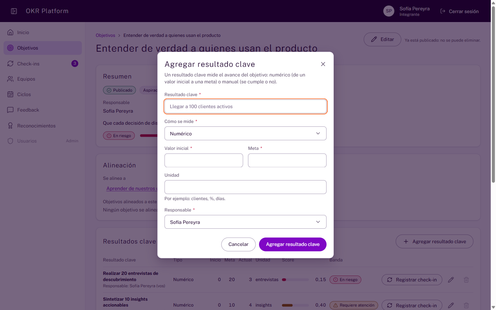

Para cambiar un KR, usá el ícono de lápiz de su fila. Para quitarlo, usá el ícono de papelera. Solo podés quitarlo mientras el objetivo es borrador.

### Cómo publico un objetivo

1. En el detalle del objetivo en borrador, hacé clic en **Publicar**.
2. Leé el mensaje y hacé clic en **Publicar objetivo**.

Para publicar necesitás dos cosas:

- Al menos 3 objetivos del mismo responsable en el ciclo. El máximo es 5.
- Al menos 3 resultados clave en el objetivo que publicás.

Si falta algo, la plataforma te dice qué completar.

Después de publicar pasa esto:

- Todos en la organización pueden ver el objetivo.
- Ya no podés eliminarlo.
- No podés cambiar el tipo ni el origen. Sí podés editar el título, la descripción y la alineación.
- Solo un líder o administración puede cambiar el valor inicial y la meta de un KR.
- Podés agregar KR nuevos, pero no quitarlos.

Un borrador se elimina con **Eliminar**, desde su detalle.

### Cómo cambio la meta de un KR ya publicado (líderes)

Si sos líder, podés cambiar el valor inicial y la meta de los KR de tus equipos. También podés hacerlo en los objetivos individuales de tus integrantes.

1. Abrí el detalle del objetivo.
2. Usá el ícono de lápiz en la fila del KR.
3. Cambiá el valor y guardá.

Si no corresponde, la plataforma te lo explica al guardar. Cada cambio queda registrado en la auditoría.

### Cómo creo y publico objetivos de equipo (líderes)

- Al crear un objetivo, en **Responsable** podés elegirte a vos o a un equipo que lideres.
- Podés editar los objetivos de tus equipos y sus KR.
- Podés publicarlos con las mismas reglas: de 3 a 5 objetivos y al menos 3 KR en cada uno.
- Los objetivos individuales de tus integrantes los crea cada persona.

Agregar o quitar integrantes, y crear equipos, ciclos o usuarios, es tarea de administración. En esas pantallas verás los botones apagados con el motivo.

## Check-ins

### Cuándo tengo que hacer un check-in

Un check-in es el registro de cómo avanza un resultado clave. Lo hacés con la frecuencia que marca el ciclo: semanal, quincenal o mensual.

Si pasás ese tiempo sin registrar, el KR queda **vencido**. Aparece en tus pendientes y suma al número del menú.

### Cómo veo mis pendientes

1. Hacé clic en **Check-ins** en el menú.
2. Mirá tus KR vencidos, agrupados por objetivo. Cada uno muestra la fecha del último check-in o de la publicación.
3. Hacé clic en **Registrar check-in** en el KR que quieras actualizar.

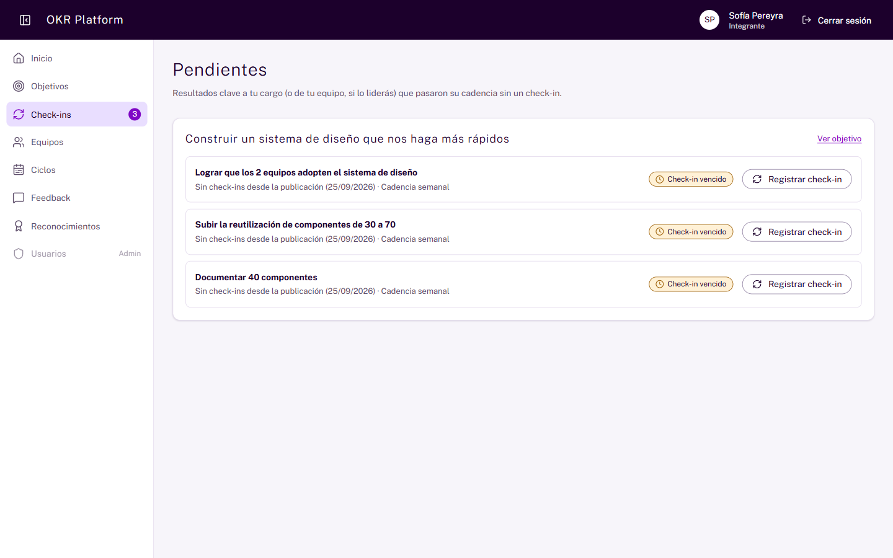

### Cómo registro un check-in

1. Abrí el detalle del objetivo, o entrá a **Check-ins**. Hacé clic en **Registrar check-in** en la fila del KR.
2. En el panel lateral, elegí **¿Qué vas a hacer?**
3. Cargá el **Valor actual**, si el KR es numérico. Si es manual, elegí el puntaje de 0,0 a 1,0.
4. Mirá el recuadro **Así quedaría el resultado clave**. Muestra el puntaje y el estado antes de guardar.
5. Si querés, escribí una **Nota** de hasta 2000 caracteres. Contá qué pasó o qué necesitás.
6. Hacé clic en **Registrar check-in**.

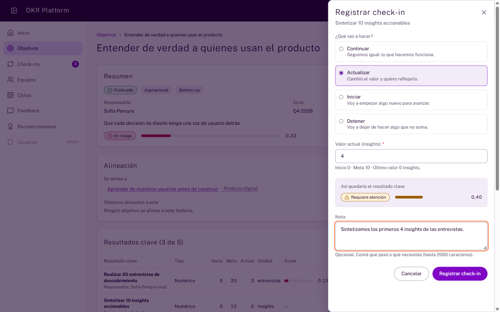

El puntaje del KR y del objetivo se actualizan al instante. El avance queda en el historial. Un check-in no se puede editar después.

### Qué significa cada acción del check-in

Estas son las cuatro opciones de **¿Qué vas a hacer?**

| Acción         | Cuándo la elegís                         |
| -------------- | ---------------------------------------- |
| **Continuar**  | Todo sigue igual. Lo que hacés funciona. |
| **Actualizar** | Cambió el valor y querés reflejarlo.     |
| **Iniciar**    | Vas a empezar algo nuevo para avanzar.   |
| **Detener**    | Vas a dejar de hacer algo que no suma.   |

### Quién puede registrar un check-in

Podés registrar un check-in en estos casos:

- Sos responsable del KR.
- Sos responsable del objetivo.
- Sos integrante del equipo responsable.
- Sos líder de ese equipo.

El objetivo debe estar publicado y su ciclo no puede estar cerrado. Administración no tiene permisos especiales para registrar check-ins.

Si el botón está apagado, al lado dice el motivo.

## Feedback

### Quién puede ver mi feedback

El feedback es una conversación privada entre dos personas. Solo lo ven quien lo escribe y quien lo recibe.

No lo ven líderes ni administración. Tampoco aparece en reportes ni en el PDF. En Inicio solo se muestra cuántos mensajes tenés sin leer.

### Cómo leo mi feedback

1. Hacé clic en **Feedback**.
2. Elegí la pestaña **Recibido** o **Enviado**. Los mensajes nuevos dicen **Sin leer**.
3. Abrí un mensaje para leerlo completo. Al abrirlo, queda marcado como leído.

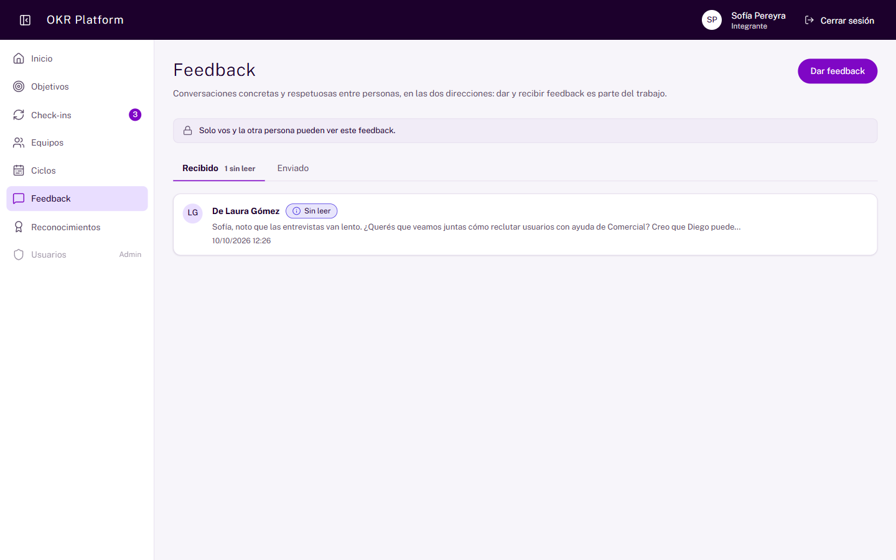

### Cómo doy feedback

1. En **Feedback**, hacé clic en **Dar feedback**.
2. Elegí **Para quién**.
3. Escribí el **Mensaje**. Puede tener hasta 2000 caracteres. Contá qué viste, qué impacto tuvo y qué podría seguir o cambiar.
4. Si querés, enlazá un objetivo o resultado clave relacionado.
5. Hacé clic en **Enviar feedback**.

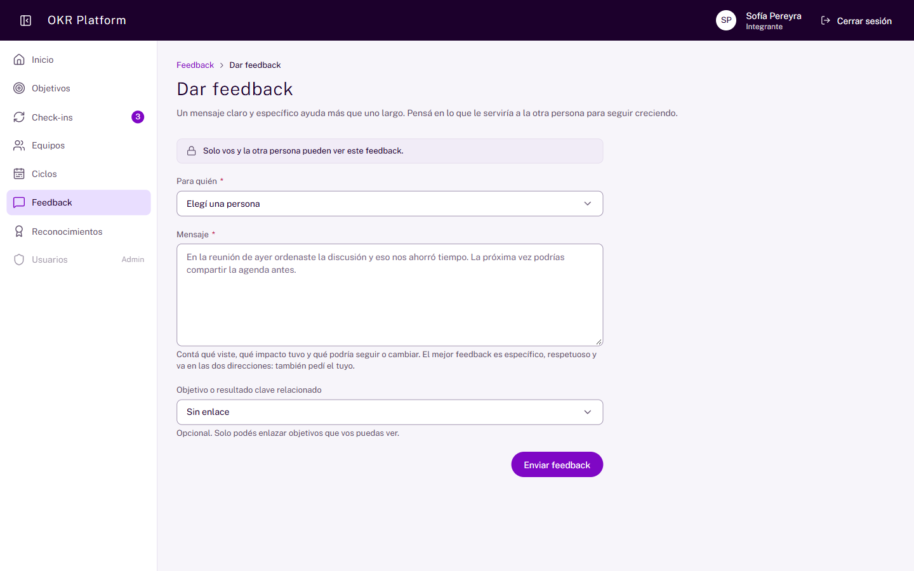

Quien escribió un feedback puede editarlo o eliminarlo desde su detalle. Si lo edita, aparece la marca "Editado". No podés mandarte feedback a vos mismo.

## Reconocimientos

### Qué es el muro de reconocimientos

El muro es público. Sirve para agradecer logros concretos. No hay puntos, rankings ni posiciones.

Cada tarjeta muestra quién reconoce a quién, el mensaje, el logro y la fecha. El logro incluye su estado y su puntaje actual. El muro muestra 10 por página, del más nuevo al más viejo.

### Cómo veo el muro

1. Hacé clic en **Reconocimientos**.
2. Para ver los de una persona, elegila en **Filtrar por persona**.
3. Hacé clic en **Filtrar**.

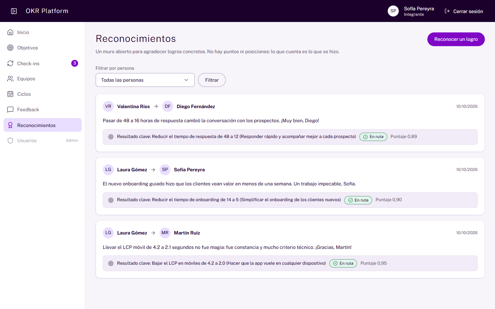

### Cómo reconozco un logro

1. Hacé clic en **Reconocer un logro**.
2. Elegí la **Persona** y hacé clic en **Continuar**.
3. Elegí el **Logro**. La lista incluye los KR de esa persona con puntaje de 0,70 o más. También incluye sus objetivos ya cerrados.
4. Escribí el **Mensaje**. Contá qué hizo y por qué importó.
5. Hacé clic en **Reconocer logro**.

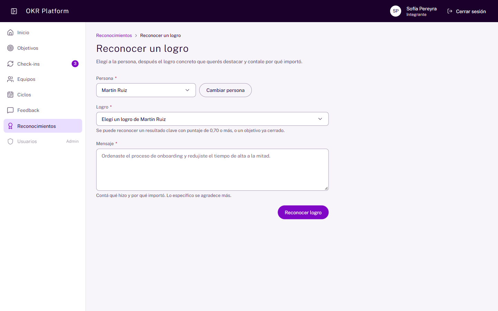

No podés reconocerte a vos mismo. Si la persona todavía no tiene logros que cumplan la regla, la lista queda vacía.

## Equipos y ciclos

### Cómo consulto los equipos

**Equipos** muestra cómo se organiza Flock IT, como un árbol. En cada equipo ves:

- los integrantes y quién lidera;
- la mezcla 50/50 del ciclo que elijas;
- el botón **Descargar reporte PDF**, si lideras ese equipo o sos administración.

### Cómo consulto los ciclos

**Ciclos** muestra los ciclos anuales con sus trimestres, sus fechas y su estado. En cada ciclo ves la cadencia de check-in y los umbrales de logro.

## Reportes PDF

### Quién puede descargar el reporte de un equipo

Pueden descargarlo:

- administración;
- los líderes de ese equipo.

No pueden descargarlo los integrantes del equipo ni los líderes de otro equipo. Para ellos el botón no aparece. Si necesitás el reporte, pedile uno a tu líder.

### Cómo descargo el reporte de mi equipo (líderes)

1. Entrá a **Equipos** y abrí tu equipo. También podés usar el enlace de **Mis equipos** en Inicio.
2. En **Mezcla de objetivos (50/50)**, elegí el **Ciclo**.
3. Hacé clic en **Descargar reporte PDF**.

Se descarga un archivo con un nombre como `reporte-producto-digital-q4-2026.pdf`.

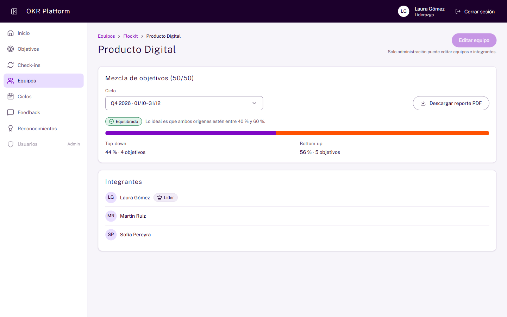

Si elegís **Sin ciclo**, el botón queda apagado. El reporte siempre corresponde a un ciclo.

### Qué incluye el reporte PDF

El PDF incluye:

- la mezcla de origen top-down y bottom-up;
- cada objetivo del equipo, con sus KR, su estado, su puntaje y la fecha del último check-in.

El PDF nunca incluye feedback, rankings ni datos de compensación. Las personas aparecen en orden alfabético.

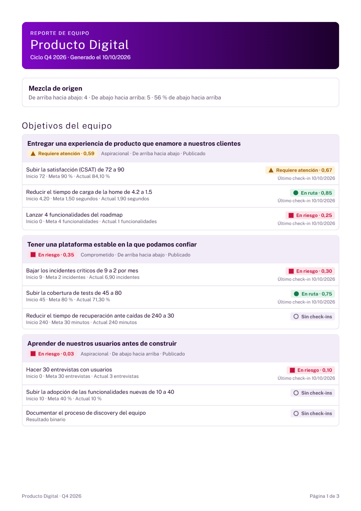

## Ayudas de IA

### Qué son las ayudas de IA

IA quiere decir inteligencia artificial. OKR Platform la usa para que los textos sean más fáciles de leer y de escribir.

Hay cuatro ayudas:

- **Ver en lectura fácil**.
- **Ver en lenguaje claro**.
- **Sugerir redacción**.
- **Resumir check-ins**.

Estas ayudas cumplen con el Real Decreto 707/2026 de accesibilidad cognitiva. Ese decreto pide que los textos puedan adaptarse para que todas las personas los entiendan.

### Qué debo saber antes de usarlas

- **Son gratuitas.** No pagás nada por usarlas. Las paga la organización.
- **Son opcionales.** Si no querés usarlas, el resto de la plataforma funciona igual.
- **Nunca cambian nada solas.** Siempre decidís vos.
- **Pueden fallar.** Si la IA está apagada, no ves los botones. Si no responde, ves el aviso "La ayuda de IA no está disponible ahora. El resto de la plataforma funciona normal." Tu texto original queda intacto.
- **Tienen un tope.** Si hacés muchos pedidos seguidos, ves "Hiciste muchos pedidos seguidos. Probá en un minuto."
- **Cuidan tu privacidad.** La IA recibe solo el texto, sin nombres, emails ni identificadores.

### Qué diferencia hay entre lectura fácil y lenguaje claro

- **Lectura fácil.** Usa frases muy cortas y palabras simples. Sirve para quien necesita máxima sencillez.
- **Lenguaje claro.** Mantiene el contenido completo, pero con frases directas y sin rodeos. Sirve para cualquier persona.

### Cómo veo un texto en lectura fácil o en lenguaje claro

1. Abrí el detalle de un objetivo, un check-in del historial o el detalle de un feedback.
2. Hacé clic en **Ver en lectura fácil** o en **Ver en lenguaje claro**.
3. Esperá unos segundos. La versión aparece debajo del texto original.
4. Si te sirve, hacé clic en **Me sirve**.

Solo puede marcar **Me sirve** la persona que pidió esa versión. Es el mismo botón en las versiones adaptadas y en el resumen de check-ins.

Si preferís que te ayude una persona, hacé clic en **Pedilo a una persona**. Mirá [Cómo pido un documento adaptado](#cómo-pido-un-documento-adaptado).

La versión puede traer un glosario con la explicación de palabras difíciles.

### Qué significa "pendiente de validación"

Toda versión generada por IA lleva esta marca: **Generado por IA · pendiente de validación**. Significa que la generó una máquina y que ninguna persona la revisó todavía.

Estas son las marcas posibles:

| Marca                                         | Qué significa                                                                                                     |
| --------------------------------------------- | ----------------------------------------------------------------------------------------------------------------- |
| **Generado por IA · pendiente de validación** | La IA la generó. Todavía no la revisó nadie. Leela con atención.                                                  |
| **Validado por una persona**                  | Una persona autorizada la revisó y la aprobó.                                                                     |
| **Requiere revisión humana**                  | La IA no pudo garantizar que la versión sea fiel. Te mostramos el texto original. Pedile a alguien que lo revise. |

### Cómo valido una versión si soy líder

Quién puede validar depende de quién es la persona dueña del objetivo:

| El objetivo es...               | Pueden validar                                                                                   |
| ------------------------------- | ------------------------------------------------------------------------------------------------ |
| **De un equipo**                | Administración y quien figura como **Líder del equipo** de ese equipo.                           |
| **Individual** (de una persona) | Administración y quien figura como **Líder del equipo** en alguno de los equipos de esa persona. |

Estas reglas valen siempre:

- El rol **Líder** solo no alcanza. Tenés que figurar como **Líder del equipo** en el equipo que corresponde.
- Si liderás otro equipo, no podés validar.
- Si sos dueña de un objetivo individual, **no podés validar tu propia versión**, aunque además liderés uno de tus equipos. Tiene que validarla otra persona.
- Un integrante común no valida.

1. Abrí el texto con su versión adaptada.
2. Hacé clic en **Validar**.
3. Si hace falta, corregí el texto. Mantené los mismos bloques y el mismo orden.
4. Si querés, escribí una **Nota de validación**.
5. Hacé clic en **Validar versión**.

La marca pasa a **Validado por una persona**. Una versión validada ya no vuelve atrás.

Si no podés validar, el botón **Validar** se ve apagado y explica por qué.

El feedback no se valida. Es privado entre dos personas y nadie más puede leerlo. En un feedback solo podés marcar **Me sirve**.

### Cómo pido una sugerencia de redacción

1. Al crear un objetivo o un resultado clave, escribí un borrador.
2. Hacé clic en **Sugerir redacción**.
3. Leé la sugerencia. Aparece aparte, con observaciones sobre tu borrador. Los valores que propone la IA aparecen resaltados: revisalos.
4. Hacé clic en **Usar sugerencia** para completar los campos del formulario. O hacé clic en **Descartar**.

Usar la sugerencia no guarda nada. Vos enviás el formulario cuando quieras.

La sugerencia está disponible al crear un objetivo y en el formulario de resultado clave. No está al editar un objetivo que ya existe.

### Cómo resumo los check-ins de un resultado clave

1. Abrí el historial de un resultado clave.
2. Hacé clic en **Resumir check-ins**.
3. Leé el resumen. Incluye el avance, la tendencia, lo destacado y los riesgos.
4. Hacé clic en **Me sirve** o en **Descartar**.

La tendencia puede ser **Mejorando**, **Estable**, **Empeorando** o **Pocos datos**. El resumen habla del resultado clave. Nunca evalúa a las personas.

## Cómo pido un documento adaptado

### Qué es un pedido de documento adaptado

Según el artículo 14.5 del Real Decreto 707/2026, toda persona trabajadora puede pedir documentos adaptados. Esto incluye una versión en lectura fácil o en lenguaje claro, en audio, con apoyo visual o una reunión adaptada.

Hay dos caminos:

1. **Con la IA.** Usá **Ver en lectura fácil** o **Ver en lenguaje claro** en el texto que necesitás. La versión llega en segundos y no tiene costo.
2. **Con una persona.** Le pedís el documento a una persona de administración. Funciona siempre, aunque la IA esté apagada. No tiene costo para vos.

### Cómo pido un documento a una persona

1. En el menú lateral, entrá a **Documentos adaptados**.
2. Hacé clic en **Pedir un documento adaptado**.
3. En **¿Qué documento necesitás?**, escribí en pocas palabras qué es. Por ejemplo: "El reporte del ciclo".
4. En **¿En qué formato te sirve?**, elegí una opción: lectura fácil, lenguaje claro, audio, apoyo visual, reunión adaptada u otro.
5. En **Detalle**, si querés, contanos más para ayudarte mejor.
6. Hacé clic en **Enviar pedido**.

También podés empezar desde un objetivo, un check-in o un feedback. Hacé clic en **¿Necesitás otro formato? Pedilo a una persona**. El pedido queda vinculado a ese elemento.

Si lo vinculás a un **feedback**, solo funciona con los feedback que enviaste o recibiste. Administración no puede leer tu feedback: contanos en el **Detalle** lo que necesitás.

### Cómo sigo mi pedido

1. Entrá a **Documentos adaptados**.
2. En **Mis pedidos** vas a ver cada pedido con su estado. El estado siempre tiene ícono y palabra:

| Estado        | Qué significa                                                            |
| ------------- | ------------------------------------------------------------------------ |
| **Pendiente** | Todavía nadie se hizo cargo.                                             |
| **En curso**  | Una persona de administración ya se está ocupando.                       |
| **Entregada** | Ya tenés tu documento. Mirá la **Nota de entrega** y, si hay, el enlace. |
| **Rechazada** | No pudimos hacerlo. Mirá **Por qué no pudimos hacerlo**.                 |

Mientras el pedido está abierto, ves la **Fecha límite**. Son 10 días corridos desde que lo pediste. Si pasa la fecha, el pedido muestra la marca **Vencido** y administración lo ve resaltado.

Solo vos ves tus pedidos, además de administración. Ninguna otra persona puede abrirlos.

### Qué pasa si rechazan mi pedido

La organización solo puede negarse si la adaptación le exige un esfuerzo desproporcionado. En ese caso tiene que explicártelo por escrito, y esa explicación es obligatoria. La plataforma no deja rechazar un pedido sin ella.

Vas a leerla en **Por qué no pudimos hacerlo**, dentro de tu pedido, escrita en lenguaje claro. Si no la entendés o no estás de acuerdo, hablá con administración y podés hacer un pedido nuevo.

## Preguntas frecuentes

### Por qué mi objetivo está en rojo si ya cargué check-ins

El puntaje del objetivo es el promedio de todos sus KR. Un KR sin check-ins vale 0.

Ejemplo con los datos de prueba: un objetivo tiene tres KR. Sus puntajes son 0,15, 0,50 y uno sin check-ins, que vale 0. El promedio es (0,15 + 0,50 + 0) ÷ 3 = 0,22. Eso es **En riesgo**, aunque un KR esté en amarillo.

Registrá el avance de los KR que faltan. Aunque sea un primer valor.

### Por qué un objetivo dice "Sin check-ins" y no tiene color

Porque ninguno de sus KR tiene avances registrados. La plataforma no le asigna estado hasta que haya datos.

### Qué significa "Check-in vencido"

Pasó más tiempo que la cadencia del ciclo desde el último check-in del KR. Si nunca tuvo uno, se cuenta desde la publicación. Registrá un check-in y deja de estar vencido.

### Por qué no puedo registrar un check-in

El botón apagado muestra el motivo. Las causas posibles son estas:

- El objetivo todavía es borrador.
- El objetivo o el ciclo está cerrado.
- No sos responsable del KR ni del objetivo, ni integrante o líder del equipo responsable.

### Por qué no puedo publicar mi objetivo

Cada responsable necesita al menos 3 objetivos en el ciclo. Cada objetivo necesita al menos 3 resultados clave. El mensaje de la pantalla dice qué falta.

### Puedo borrar un objetivo publicado o quitarle un KR

No. Solo se eliminan objetivos y KR en borrador.

### Por qué no puedo cambiar la meta de un KR

Después de publicar, solo un líder o administración puede cambiar el valor inicial y la meta. Así nadie mueve la meta a mitad de camino.

### Mi líder puede leer mi feedback

No. Solo lo leen vos y la otra persona. Ni tu líder ni administración.

### Por qué no puedo reconocer a alguien por un objetivo o KR

Solo se reconocen KR con puntaje de 0,70 o más, y objetivos ya cerrados. Tampoco podés reconocerte a vos mismo.

### El puntaje de un reconocimiento es el del día en que se hizo

No. Es el puntaje actual del KR o del objetivo.

### Los OKR influyen en mi sueldo o en bonos

No. Los resultados de los OKR nunca se vinculan con compensaciones.

### Olvidé mi contraseña. Qué hago

Pedile a administración que te dé una nueva. Lo hacen desde la sección Usuarios.

### Por qué no veo los botones de IA

La IA puede estar apagada. Es una decisión de la organización. Todo lo demás funciona igual. Si necesitás una adaptación, pedísela a una persona en **Documentos adaptados**. Mirá [Cómo pido un documento adaptado](#cómo-pido-un-documento-adaptado).

### Por qué no puedo validar la versión de mi propio objetivo

Si sos dueña de un objetivo individual, no podés validar tu propia versión, ni siquiera si liderás uno de tus equipos. Tiene que validarla otra persona: administración o quien lidera alguno de tus equipos. Mirá [Cómo valido una versión si soy líder](#cómo-valido-una-versión-si-soy-líder).

### Por qué la IA me mostró mi texto original en vez de una versión nueva

La IA no pudo garantizar que la versión fuera fiel al original. Por seguridad, te muestra el original y marca **Requiere revisión humana**. Pedile a alguien que lo revise.

## Glosario

| Término                          | Qué significa                                                                                             |
| -------------------------------- | --------------------------------------------------------------------------------------------------------- |
| **Administración**               | Rol que gestiona usuarios, equipos y ciclos.                                                              |
| **Alineación**                   | Vínculo entre un objetivo y otro de nivel superior al que ayuda.                                          |
| **Aspiracional**                 | Objetivo ambicioso. Llegar a 0,70 ya es un éxito.                                                         |
| **Banda**                        | Grupo de puntaje con nombre y color: En ruta, Requiere atención o En riesgo.                              |
| **Bottom-up**                    | Objetivo que nace en las personas.                                                                        |
| **Cadencia**                     | Cada cuánto se espera un check-in: semanal, quincenal o mensual.                                          |
| **Check-in**                     | Registro del avance de un resultado clave. Incluye acción, valor o puntaje, y nota.                       |
| **Check-in vencido**             | Resultado clave que pasó la cadencia sin registrar avance.                                                |
| **Ciclo**                        | Período en el que se organizan los objetivos. Puede ser anual o trimestral.                               |
| **Comprometido**                 | Objetivo que se espera cumplir por completo. Su meta es 1,00.                                             |
| **Feedback**                     | Mensaje privado entre dos personas. Solo ellas lo ven.                                                    |
| **IA (inteligencia artificial)** | Programa que genera textos. En esta plataforma ayuda a escribir y a leer.                                 |
| **Lectura fácil**                | Texto con frases cortas y palabras simples, para máxima comprensión.                                      |
| **Lenguaje claro**               | Texto directo y ordenado, que se entiende en una sola lectura.                                            |
| **Fecha límite**                 | Día hasta el que hay que responder un pedido de documento adaptado. Son 10 días corridos desde el pedido. |
| **Líder**                        | Rol de una persona en toda la plataforma. No alcanza para liderar un equipo.                              |
| **Líder del equipo**             | Persona marcada como líder en un equipo en particular.                                                    |
| **Mezcla 50/50**                 | Proporción de objetivos top-down y bottom-up de un equipo. Lo ideal es entre 40 % y 60 % de cada uno.     |
| **Objetivo**                     | Lo que querés lograr en un ciclo. Pertenece a una persona o a un equipo.                                  |
| **OKR**                          | "Objectives and Key Results": un objetivo y los resultados clave que lo miden.                            |
| **Pedido de documento adaptado** | Pedido que le hacés a una persona de administración para recibir un documento en otro formato.            |
| **Pendiente de validación**      | Marca de una versión generada por IA que ninguna persona revisó todavía.                                  |
| **Puntaje**                      | Número de 0,00 a 1,00 que indica el avance hacia la meta.                                                 |
| **Reconocimiento**               | Agradecimiento público en el muro por un logro concreto.                                                  |
| **Resultado clave (KR)**         | Medida concreta del avance de un objetivo. Puede ser numérica o manual.                                   |
| **Sin check-ins**                | Estado de un KR u objetivo que no tiene avances registrados.                                              |
| **Top-down**                     | Objetivo que baja desde la dirección.                                                                     |
| **Umbral de logro**              | Puntaje mínimo para que un objetivo cuente como logrado al cerrar el ciclo.                               |
| **Validar**                      | Revisar una versión de IA y aprobarla. Lo hace una persona autorizada.                                    |
| **Vencido**                      | Pedido de documento adaptado que sigue abierto y ya pasó su fecha límite.                                 |
| **Versión adaptada**             | Texto reescrito en lectura fácil o en lenguaje claro.                                                     |
