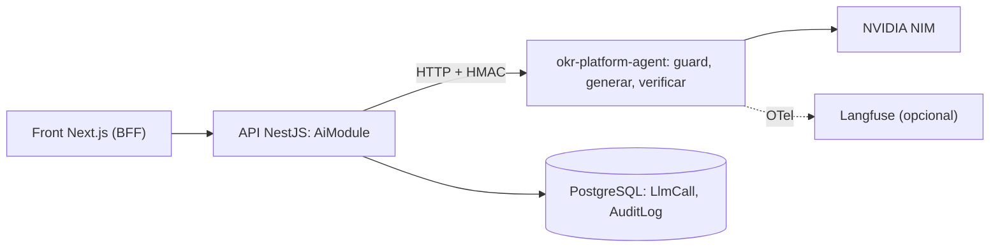

# IA de accesibilidad cognitiva

Funcionalidad de IA dentro del producto: un agente genera versiones en **lectura fácil** o **lenguaje claro** de objetivos, check-ins y feedback, resume check-ins y sugiere la redacción de OKRs. Una persona decide siempre qué hacer con el resultado. Además de responder al feedback del AI Day, es la forma en que la plataforma cubre la parte de textos del RD 707/2026 (ver la sección de cumplimiento en `okr-platform-back/docs/arquitectura.md`; en el monorepo, `apps/back/docs/arquitectura.md`).

- Contrato HTTP entre la API y el agente: [`agent-contract.md`](./agent-contract.md) (v1, fuente única de acoplamiento).
- Detalle de arquitectura, modelos, seguridad y riesgo RGPD: sección "IA de accesibilidad cognitiva" de `okr-platform-back/docs/arquitectura.md`.

## Modelos (medidos el 2026-10-18 con la cuenta real)

La fuente de verdad es `okr-platform-agent/config/models.yaml`. Solo responden los modelos "Free Endpoint" de la cuenta; muchos IDs del catálogo devuelven 404. Los costos en USD son estimaciones: el free tier de NVIDIA no factura.

| Paso | Primario | Respaldo | Por qué |
| --- | --- | --- | --- |
| Clasificar / guard | `nvidia/nemotron-3-super-120b-a12b` (sin thinking) | `google/diffusiongemma-26b-a4b-it` | diffusiongemma es más rápido (~1 s) pero marcó como fuera de alcance 3 de 9 textos válidos; super clasificó bien los 10 casos |
| Generar | `nvidia/nemotron-3-super-120b-a12b` (sin thinking, ~2–5 s) | `nvidia/nemotron-3-ultra-550b-a55b` (~18 s, mejor lectura fácil) | Con thinking activo tardaba 30–43 s por ~1.500 tokens de razonamiento |
| Juez de fidelidad | `google/diffusiongemma-26b-a4b-it` (0,3–2,5 s) | `openai/gpt-oss-20b` | Otra familia que el generador; acertó 4/4 pruebas (fiel, número cambiado, dato inventado, juicio de valor). gpt-oss tardó 6–15 s y falló una |

Costo medido en las evals: ~USD 0,0007–0,0016 por pedido (estimado); latencia típica de punta a punta 4–6 s.

## Checklist del AI Day (textos literales del feedback)

Las rutas son del workspace; en el monorepo, `okr-platform-back` es `apps/back`, `okr-platform-front` es `apps/front` y `okr-platform-agent` es `apps/agent`.

### Builder (7 puntos)

| # | Punto | Cómo se cumple | Dónde |
| --- | --- | --- | --- |
| 1 | Orquestación real (RAG, multi-agente o un pipeline de varios pasos) con manejo de fallos en cada paso, no solo en el camino feliz | `SequentialAgent` de ADK: guard → generar → verificar. Cada paso tiene timeout, reintento con backoff, modelo de respaldo, reparación de JSON y una regeneración; si todo falla devuelve el original con `needsHumanReview`. Fail-closed en el clasificador | `okr-platform-agent/src/okr_agent/agent/pipeline.py`, `agent/steps/`, `agent/resilient_llm.py` |
| 2 | Uso estratégico del LLM: qué modelo elegiste para cada tarea y por qué (costo, latencia, complejidad) | Un tier por paso con respaldo, elegido con mediciones reales (tabla de arriba); el juez es de otra familia y el servicio no arranca si no | `okr-platform-agent/config/models.yaml`, `agent/models.py` |
| 3 | Consumo de tokens medido | `usage[]` por cada intento (también los fallidos) → `LlmCall` con tokens, latencia y costo estimado; `GET /ai/usage` y pantalla `admin/uso-ia` con p50/p95 | `okr-platform-back/okr-platform/src/ai/ai-metrics.service.ts`, `domain/usage-mapper.ts`; `okr-platform-front/src/app/(app)/admin/uso-ia/` |
| 4 | Criterios de seguridad: validación de lo que entra y sale del modelo, manejo de datos sensibles, permisos acotados | Entrada: largo, clasificador de alcance e inyección (con eval de inyección real que debe rechazarse). Salida: Pydantic estricto, fidelidad de números/fechas, juez. Datos: minimización en Nest y enmascarado de PII antes de NVIDIA. Permisos: el agente no tiene BD ni herramientas; HMAC entre servicios; feedback ajeno → 404; nada se aplica sin una persona | `okr-platform-agent/src/okr_agent/guards/`, `api/auth.py`; `okr-platform-back/okr-platform/src/ai/domain/minimize.ts`, `domain/access.ts` |
| 5 | Trazabilidad y observabilidad | `traceId` de punta a punta, `LlmCall` append-only por trigger, `AuditLog` sin contenido, trazas OTel en Langfuse (perfil `observability`) | `okr-platform-back/okr-platform/prisma/migrations/20261018120000_ai_accesibilidad/`; `okr-platform-agent/src/okr_agent/telemetry.py`; `okr-platform-back/docker-compose.yml` |
| 6 | Prompts versionados y separados del código, secretos vía variables de entorno | `prompts/<id>/v<N>.md` con front-matter; las versiones publicadas no se editan (v1 → v2); el hash va a `LlmCall.promptHash`. Claves solo en `.env` (ignorado por git) | `okr-platform-agent/prompts/`, `src/okr_agent/prompts/loader.py`, `.env.example` |
| 7 | Un README o diagrama mínimo de arquitectura | Este README, el contrato y la sección de IA con diagrama Mermaid | `docs/ai/`; `okr-platform-back/docs/arquitectura.md`; `okr-platform-agent/README.md` |

### Específico del rol (Software Engineer / Architect)

| Punto | Cómo se cumple | Dónde |
| --- | --- | --- |
| Separación entre lógica de negocio, prompts y llamadas al modelo | Negocio y permisos en Nest (`domain/` puro); prompts en archivos; llamadas al modelo solo en `ResilientLlm` del agente | `okr-platform-back/okr-platform/src/ai/domain/`; `okr-platform-agent/prompts/`; `agent/resilient_llm.py` |
| Manejo de errores cuando la API del LLM falla o responde de forma inesperada | Errores tipados (`INPUT_REJECTED`, `OUTPUT_INVALID`, `MODEL_UNAVAILABLE`, `RATE_LIMITED`), nunca un 500 crudo; Nest degrada con 503 `AI_UNAVAILABLE` y el resto de la app sigue andando | `okr-platform-agent/src/okr_agent/api/errors.py`; `okr-platform-back/okr-platform/src/ai/ai.errors.ts` |
| Uso de variables de entorno para API keys, nunca hardcodeadas | `NVIDIA_NIM_API_KEY`, `AGENT_SHARED_SECRET`, `LANGFUSE_*` solo por entorno; `.env.example` con placeholders | `okr-platform-agent/.env.example`; `okr-platform-back/okr-platform/.env.example` |
| Tests automatizados sobre la lógica que rodea al modelo | Agente: LLM falso guionado para todos los caminos de falla + evals reales (`pytest -m eval`). Back: unit de dominio y e2e con stub del agente. Front: vitest + Playwright con axe | `okr-platform-agent/tests/`, `evals/`; `okr-platform-back/okr-platform/test/ai.e2e-spec.ts`; `okr-platform-front/e2e/journeys/adaptacion-ia.spec.ts` |

### Próximo paso 4 del feedback: métrica de impacto

`GET /ai/impact` y `admin/uso-ia`: adopción (adaptaciones aceptadas o validadas, sugerencias aceptadas), tiempo de entrega de una adaptación (art. 14.5 del RD 707/2026, "sin retrasos indebidos"), calidad (delta INFLESZ y tasa de revisión humana) y costo por función. Conversaciones 1:1 sigue pendiente como fase 2 del CFR.

### Art. 14.5 con una persona (complementa a la IA)

La IA es una vía inmediata, pero el art. 14.5 del RD 707/2026 habla de poder pedir documentos adaptados y, si se rechaza, de justificarlo por escrito. Por eso hay además un circuito humano que funciona aunque la IA esté apagada: `POST /adaptation-requests` (formato preferido, vínculo opcional a objetivo, check-in o feedback propio), plazo de 10 días configurable, asignación a administración, entrega con nota y enlace, y rechazo con justificación escrita obligatoria (422 si falta). La persona ve el estado y la justificación en `Documentos adaptados`; administración los gestiona en `admin/pedidos-adaptacion` con los vencidos resaltados (ícono + palabra). Cada paso se audita sin texto libre y la pantalla `admin/auditoria` lo muestra. Detalle en `okr-platform-back/docs/arquitectura.md` ("Pedidos de documento adaptado") y evidencia en `okr-platform-back/okr-platform/test/adaptation-requests.e2e-spec.ts` y `okr-platform-front/e2e/journeys/07-pedidos-adaptacion.spec.ts`.

## Cómo probarlo

- **Tests del agente**: `cd okr-platform-agent; .venv\Scripts\pytest` (los evals con modelos reales se saltean sin `NVIDIA_NIM_API_KEY`; `pytest -m eval -s` los corre).
- **Tests del back**: `npm test` y `npm run test:e2e` desde `okr-platform-back/okr-platform` (con `docker compose up -d db-test`).
- **Demo local**: `tools/demo/demo-up.ps1` levanta el agente si existen `okr-platform-agent\.env` y `.venv`; si no, la demo corre con la IA apagada (`tools/demo/README.md`).
- **Contenedores**: `docker compose --profile ai up -d agent` y, para trazas, `docker compose --profile observability up -d` (desde `okr-platform-back`).

## Límites conocidos

- La IA mide costos con precios de referencia, no facturados.
- Las versiones generadas no están certificadas por una entidad de lectura fácil; por eso se muestran como pendientes de validación.
- La validación con personas con dificultades cognitivas (art. 4.2.g) es un proceso de la organización, no una función del software.
- Preparar el documento adaptado que se pide a una persona y juzgar si un rechazo es proporcionado (art. 14.5) también es de la organización: el software registra, marca los vencidos y exige la justificación escrita.
- Validar una versión de IA de un objetivo individual: ADMIN o líder (`isLead`) de un equipo de la persona dueña; la dueña no se autovalida (solo ADMIN).
- El enmascarado de PII por patrones no detecta nombres propios escritos en texto libre; ver el riesgo RGPD en la arquitectura.
- `SequentialAgent` figura como obsoleto en ADK 2.12 (a favor de `Workflow`): funciona hoy y hay que migrarlo a futuro.
