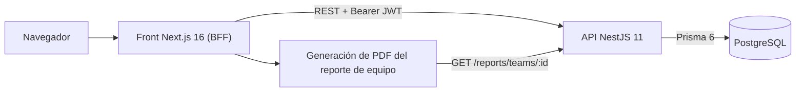
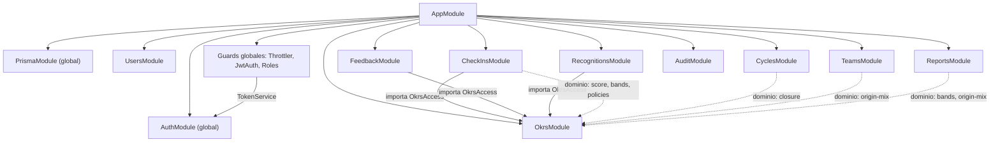
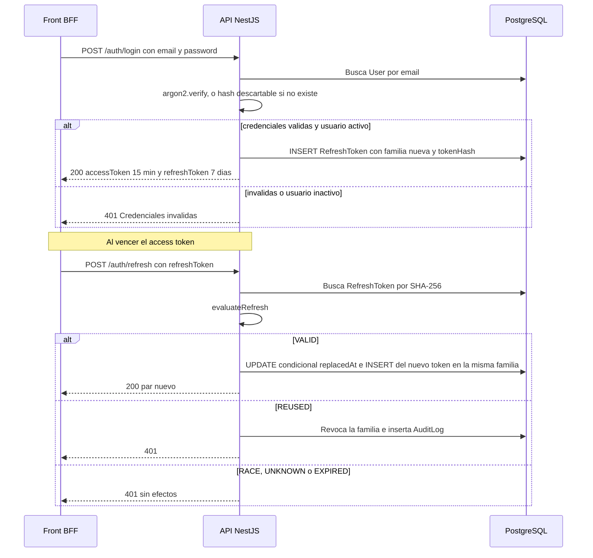
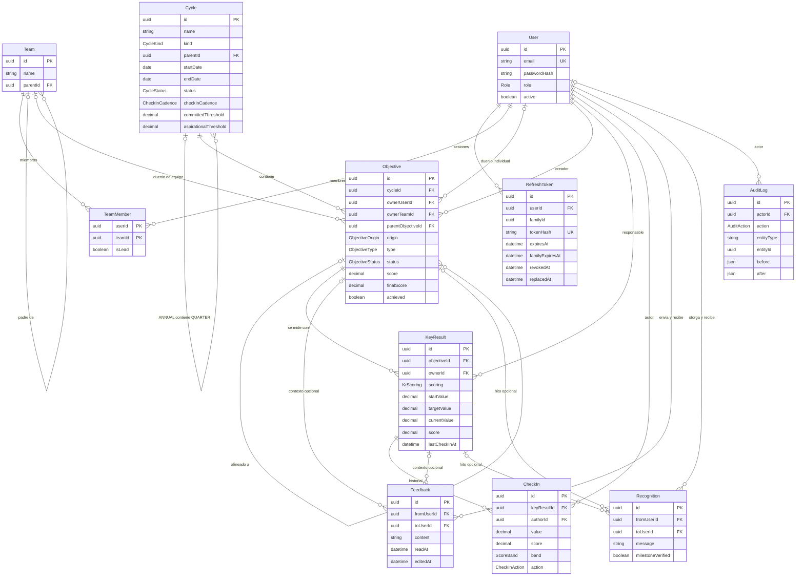

# Arquitectura del back

API de la plataforma OKR: NestJS 11 + Prisma 6 + PostgreSQL. La aplicación vive en `okr-platform/` (este repo agrega en la raíz el `docker-compose.yml`, husky y la configuración de lint/format compartida).

> Todas las rutas de archivo de este documento son relativas a `okr-platform/`.

## 1. Vista general del sistema

El front actúa de BFF: guarda los tokens del back en cookies httpOnly y llama a esta API desde el servidor. El PDF del reporte de equipo se genera en el front con los datos de `GET /reports/teams/:id?cycleId=`; el back solo entrega el JSON. El detalle del front está en [`apps/front/docs/arquitectura.md`](../../front/docs/arquitectura.md) (ruta del monorepo).

## 2. Módulos del back

`src/app.module.ts` registra los módulos de feature, el `ThrottlerModule`, el `ConfigModule` global, tres guards globales (en este orden: `ThrottlerGuard` → `JwtAuthGuard` → `RolesGuard`) y el filtro global `PrismaExceptionFilter`. `PrismaModule` y `AuthModule` son `@Global()`: el primero expone `PrismaService` a todos; el segundo exporta `TokenService`, que usa el `JwtAuthGuard`.

Las flechas continuas son dependencias de módulo Nest (imports/exports). Las punteadas son imports directos de funciones puras de `src/okrs/domain/`, sin inyección. Todos los módulos usan `PrismaService` (global).

| Módulo             | Carpeta                | Responsabilidad                                                                     | Endpoints principales                                                                                                                                           |
| ------------------ | ---------------------- | ----------------------------------------------------------------------------------- | --------------------------------------------------------------------------------------------------------------------------------------------------------------- |
| Health             | `src/health`           | Liveness (público)                                                                  | `GET /health`                                                                                                                                                   |
| Auth               | `src/auth`             | Login, rotación de refresh, logout y perfil                                         | `POST /auth/login`, `POST /auth/refresh`, `POST /auth/logout`, `GET /auth/me`                                                                                   |
| Users              | `src/users`            | Alta y edición de usuarios, rol, desactivación y reseteo de clave                   | `GET /users`; ADMIN: `POST /users`, `PATCH /users/:id`, `POST /users/:id/password`                                                                              |
| Teams              | `src/teams`            | Árbol de equipos sin ciclos, membresías con líder (`isLead`) e indicador 50/50      | `GET /teams`, `GET /teams/:id?cycleId=`; ADMIN: `POST /teams`, `PATCH /teams/:id`, `PUT` y `DELETE /teams/:id/members/:userId`                                  |
| Cycles             | `src/cycles`           | Ciclos ANNUAL/QUARTER, cadencia de check-in, umbrales, activación y cierre          | `GET /cycles`, `GET /cycles/:id`; ADMIN: `POST /cycles`, `PATCH /cycles/:id`, `POST /cycles/:id/activate`, `POST /cycles/:id/close`                             |
| Okrs               | `src/okrs`             | Objetivos y KRs: límites, publicación, alineación, visibilidad y score              | `GET/POST /objectives`, `GET/PATCH/DELETE /objectives/:id`, `POST /objectives/:id/publish`, `POST /objectives/:id/key-results`, `PATCH/DELETE /key-results/:id` |
| CheckIns           | `src/check-ins`        | Check-ins inmutables con snapshot de score y banda, historial y pendientes vencidos | `POST/GET /key-results/:id/check-ins`, `GET /check-ins/pending`                                                                                                 |
| Feedback (CFR)     | `src/cfr/feedback`     | Feedback privado entre emisor y receptor                                            | `POST/GET /feedback`, `GET/PATCH/DELETE /feedback/:id`, `PATCH /feedback/:id/read`                                                                              |
| Recognitions (CFR) | `src/cfr/recognitions` | Muro público de reconocimientos, con hito validado opcional                         | `POST /recognitions`, `GET /recognitions`                                                                                                                       |
| Reports            | `src/reports`          | Datos agregados del equipo en un ciclo para el PDF                                  | `GET /reports/teams/:id?cycleId=`                                                                                                                               |
| Audit              | `src/audit`            | Consulta paginada y filtrada del log de auditoría                                   | ADMIN: `GET /audit`                                                                                                                                             |

Piezas transversales en `src/common/`: decoradores (`@Public`, `@Roles`, `@CurrentUser`), guards, `PrismaExceptionFilter` (P2002 y P2003 → 409, P2025 → 404, violación de CHECK → 422), validadores y el tipo `Result` del dominio (`src/common/domain/result.ts`).

`src/configure-app.ts` concentra la configuración compartida entre `main.ts` y los tests e2e: `helmet`, CORS restringido a `FRONT_ORIGIN`, `ValidationPipe` con `whitelist`, `forbidNonWhitelisted` y `transform`, y Swagger en `/api`. El documento OpenAPI se versiona en `openapi.json` (lo emite `npm run openapi:emit`) y `src/openapi.spec.ts` falla si quedó desactualizado; el front genera sus tipos desde ese contrato.

### Convención de capas

Cada feature separa:

- **Controller**: HTTP, DTOs y Swagger.
- **Service**: orquesta I/O (Prisma, transacciones, locks, auditoría).
- **`domain/`**: funciones puras sin Nest ni Prisma, que devuelven `Result` (`ok` / `err(code, message)`). Los servicios traducen el código de error a HTTP con un mapeo por feature (`src/okrs/okrs.errors.ts`, `src/cycles/cycles.errors.ts`, `src/cfr/cfr.errors.ts`). Jest exige 90 % de cobertura en `**/domain/**`.

## 3. Autenticación y autorización

### Tokens

| Token   | Formato                                                                                             | Vida                                                          | Dónde se valida                |
| ------- | --------------------------------------------------------------------------------------------------- | ------------------------------------------------------------- | ------------------------------ |
| Access  | JWT HS256 con `sub` y `role`, firmado con `JWT_ACCESS_SECRET`                                       | 15 minutos                                                    | `JwtAuthGuard` en cada request |
| Refresh | Opaco: 32 bytes aleatorios en base64url; en BD se guarda solo su SHA-256 (`RefreshToken.tokenHash`) | 7 días deslizantes, con techo absoluto de 30 días por familia | `AuthService.refresh`          |

Constantes en `src/auth/auth.constants.ts`; firma y hash en `src/auth/token.service.ts`.

- **Login** (`AuthService.login`): normaliza el email, verifica con argon2 y, si el usuario no existe, verifica igual contra un hash descartable para no filtrar por tiempo qué emails existen. Credenciales inválidas y usuario inactivo devuelven el mismo 401. Cada login abre una **familia** nueva de refresh tokens.
- **Refresh con rotación** (`AuthService.refresh` + `src/auth/domain/refresh-rotation.ts`): la función pura `evaluateRefresh` clasifica el token presentado:
  - `VALID`: se marca `replacedAt` con un `UPDATE` condicional dentro de una transacción (solo una request concurrente gana) y se emite un par nuevo en la misma familia.
  - `RACE`: el token se reemplazó hace 10 s o menos (requests paralelas legítimas). Devuelve 401 sin revocar nada.
  - `REUSED`: el token ya estaba revocado o se reemplazó fuera de la gracia. Se revoca toda la familia y se audita `REFRESH_REUSE_DETECTED` (primera detección) o `REFRESH_REVOKED_USED` (la familia ya estaba revocada).
  - `UNKNOWN` / `EXPIRED`: 401 sin efectos. El reuso tiene prioridad sobre la expiración.
- **Revocación**: `POST /auth/logout` revoca la familia (idempotente). Desactivar un usuario o resetearle la clave (`src/users/users.service.ts`) revoca todos sus refresh tokens.
- **Efecto inmediato**: el `JwtAuthGuard` (`src/common/guards/jwt-auth.guard.ts`) busca al usuario por PK en cada request. Si está inactivo devuelve 401, y el rol que adjunta a `req.user` es el vigente en BD, no el del token.

### Roles y guards

- **Roles globales** (`Role` en `prisma/schema.prisma`): `ADMIN`, `LEADER` y `MEMBER`. El liderazgo de un equipo concreto lo da `TeamMember.isLead`, no el rol.
- **Guards globales** (`src/app.module.ts`). El orden importa:
  1. `ThrottlerGuard`: límite general de 300 requests por minuto. `POST /auth/login` y `POST /auth/refresh` declaran con `@Throttle` un límite propio de 5 por minuto, configurable con `LOGIN_THROTTLE_LIMIT` (solo para e2e).
  2. `JwtAuthGuard`: exige un Bearer válido salvo en rutas `@Public()` (`/health`, login, refresh y logout).
  3. `RolesGuard` (`src/common/guards/roles.guard.ts`): si la ruta declara `@Roles(...)`, exige uno de esos roles. Si no, deja pasar.
- **Autorización fina en el dominio**: lo que depende del recurso no está en decoradores. Vive en funciones puras:
  - `src/okrs/domain/policies.ts`:
    - **Crear objetivos**: un MEMBER solo para sí mismo; un LEADER también para los equipos donde es `isLead`; un ADMIN para cualquiera.
    - **Editar objetivos**: el dueño, el líder del equipo dueño o un ADMIN.
    - **Ver**: un DRAFT solo lo ven quienes pueden editarlo.
    - **Cambiar start/target de un KR publicado**: ADMIN o líder.
    - **Check-in**: el responsable del KR, el dueño del objetivo o los miembros del equipo dueño. **Sin bypass para ADMIN.**
  - `src/cfr/feedback/domain/privacy.ts`: el feedback lo ven solo el emisor y el receptor. **Sin bypass por rol.**

  `OkrsAccess` (`src/okrs/okrs-access.service.ts`) carga el actor con sus membresías y devuelve 404 (no 403) ante un objetivo que el actor no puede ver, para no revelar que existe.

## 4. Modelo de datos

Fuente: `prisma/schema.prisma`. El cliente se genera en `generated/prisma` (no versionado). Los CHECK y el índice parcial que Prisma no modela se agregan a mano en las migraciones:

- `0001_init`:
  - equipo raíz único;
  - fechas y umbrales de ciclo válidos;
  - exactamente un dueño por objetivo;
  - scores en [0,1];
  - valores obligatorios de un KR DERIVED;
  - no auto-feedback ni auto-reconocimiento.
- `20261009180000_auditlog_append_only`: trigger de `AuditLog`.

Notas:

- `Objective` tiene un único dueño: `ownerUserId` **o** `ownerTeamId` (CHECK `objective_single_owner`).
- `CheckIn` y `AuditLog` no tienen `updatedAt`: son inmutables.
- `Feedback` y `Recognition` tienen dos relaciones con `User` (`fromUser` y `toUser`). El diagrama las resume en una sola línea.
- Un guard anti-compensación (`src/schema-guard.ts`, verificado por `src/schema-guard.spec.ts`) falla si el schema incorpora modelos, campos o enums con nombres de salario, bonus, rating, ranking, etc.

## 5. Reglas de dominio clave

### Score y bandas

| Regla               | Detalle                                                                                                                                                                                              | Dónde                                                                                              |
| ------------------- | ---------------------------------------------------------------------------------------------------------------------------------------------------------------------------------------------------- | -------------------------------------------------------------------------------------------------- |
| Score de KR DERIVED | `(actual - inicial) / (meta - inicial)`, acotado a [0,1] y redondeado a 4 decimales. Admite meta menor que el inicial (métricas a la baja).                                                          | `krScore` en `src/okrs/domain/score.ts`                                                            |
| Score de KR MANUAL  | Valor manual en [0,1], en pasos de 0,1.                                                                                                                                                              | `krScore` y `assertManualStep` en `src/okrs/domain/score.ts`                                       |
| Score de objetivo   | Promedio simple de los scores de sus KRs; sin KRs vale 0. Un KR sin check-ins aporta 0: se crea con `score` 0 y, si es DERIVED, con `currentValue` igual al inicial.                                 | `objectiveScore` en `src/okrs/domain/score.ts`; alta en `src/okrs/key-results.service.ts`          |
| Recálculo           | El score del objetivo se recalcula en la misma transacción al crear, editar o borrar un KR y en cada check-in. Las escrituras se serializan con un advisory lock por objetivo (`krs:<objectiveId>`). | `src/okrs/key-results.service.ts`, `src/check-ins/check-ins.service.ts`, `OkrsAccess.advisoryLock` |
| Bandas              | Sobre el score sin redondear: RED [0; 0,4), YELLOW [0,4; 0,7), GREEN [0,7; 1].                                                                                                                       | `bandOf` en `src/okrs/domain/bands.ts`                                                             |
| Sin check-ins       | Los DTOs exponen `hasCheckIns` (derivado de `lastCheckInAt`) para que el front muestre un estado neutro en vez de RED.                                                                               | `src/okrs/okrs.mapper.ts`                                                                          |
| Logro al cierre     | `achieved = finalScore >= umbral`. El umbral es `committedThreshold` (default 1,00) para COMMITTED y `aspirationalThreshold` (default 0,70) para ASPIRATIONAL. El borde es inclusivo.                | `isAchieved` en `src/okrs/domain/closure.ts`                                                       |

### KR DERIVED vs MANUAL

`src/okrs/domain/key-result.ts`:

- **DERIVED** (numérico): exige valor inicial y meta, y que sean distintos. Los decimales se comparan como enteros escalados para evitar errores de coma flotante.
- **MANUAL** (binario): no lleva valor inicial ni meta.

En el check-in (`src/check-ins/domain/check-in.ts`), DERIVED exige `value` y calcula el score; MANUAL exige `manualScore` y rechaza `value`. Cambiar el valor inicial o la meta de un KR de un objetivo PUBLISHED queda auditado como `KR_TARGET_CHANGED`.

### Objetivos: límites, publicación y alineación

- **Límites** (`src/okrs/domain/limits.ts`):
  - máximo 5 objetivos por dueño y ciclo (cuentan DRAFT y PUBLISHED);
  - máximo 5 KRs por objetivo;
  - para publicar hacen falta al menos 3 objetivos del dueño en el ciclo y al menos 3 KRs en el objetivo.
- **Ciclo de vida**: DRAFT → PUBLISHED (`POST /objectives/:id/publish`, auditado `OBJECTIVE_PUBLISHED`) → CLOSED (solo al cerrar el ciclo).
  - Tras publicar solo se editan título, descripción y alineación.
  - Un objetivo CLOSED no se edita (`src/okrs/domain/objective-update.ts`).
  - Solo se borran objetivos y KRs en DRAFT.
- **Alineación** (`src/okrs/domain/alignment.ts`): el padre puede estar en otro ciclo, debe estar PUBLISHED y no puede formar un ciclo en el árbol.
- **Indicador 50/50** (`src/okrs/domain/origin-mix.ts`): advierte si el porcentaje de objetivos BOTTOM_UP queda fuera de [40 %, 60 %]. Es solo un indicador y nunca bloquea. Lo usan `GET /teams/:id?cycleId=` y el reporte.

### Ciclos y cadencia

`src/cycles/domain/cycles.ts` y `src/cycles/cycles.service.ts`:

- **Jerarquía**: un ANNUAL no tiene padre. Un QUARTER es hijo de un ANNUAL, debe estar contenido en sus fechas y no puede solaparse con QUARTERs hermanos.
- **Transiciones**: solo DRAFT → ACTIVE → CLOSED, con `UPDATE` condicional y auditoría (`CYCLE_ACTIVATED`, `CYCLE_CLOSED`).
- **Edición**: las fechas solo se editan en DRAFT. Los umbrales deben estar en (0, 1] y su cambio se audita (`CYCLE_THRESHOLDS_CHANGED`).
- **Cierre**: cada objetivo PUBLISHED pasa a CLOSED con `finalScore` (su score vigente) y `achieved` calculado con los umbrales vigentes al cierre. Cada uno queda auditado como `OBJECTIVE_CLOSED`. Los DRAFT no se cierran ni se puntúan.
- **Cadencia de check-in** (`WEEKLY` 7 días, `BIWEEKLY` 14, `MONTHLY` 30) en `src/check-ins/domain/overdue.ts`: un KR está vencido si pasó estrictamente más que la cadencia desde su último check-in, o desde la publicación si no tiene ninguno. Solo vencen KRs de objetivos PUBLISHED.
  - `GET /check-ins/pending` lista los vencidos del responsable del KR, del dueño del objetivo individual y del líder del equipo dueño.
- **Check-ins**: solo sobre objetivos PUBLISHED de ciclos no cerrados. Son inmutables y guardan un snapshot de valor, score y banda. Si el score del KR cambia, se audita como `KR_SCORE_CHANGED`.

### Auditoría append-only

`AuditLog` registra los eventos del enum `AuditAction` (publicación y cierre de objetivos, cambios de meta y score de KR, activación, cierre y umbrales de ciclo, cambio de rol y desactivación de usuarios, reuso de refresh). Las entradas se escriben dentro de la misma transacción que el cambio.

La inmutabilidad se impone en la BD: el trigger `audit_log_append_only` (migración `20261009180000_auditlog_append_only`) rechaza todo `UPDATE` y `DELETE`. La única excepción es el `SET NULL` de `actorId` que provoca el borrado de un usuario. La consulta es solo para ADMIN (`GET /audit`, con filtros por entidad, actor, acción y rango de fechas, paginada hasta 100 por página).

### CFR

- **Feedback privado** (`src/cfr/feedback/feedback.service.ts`, `src/cfr/feedback/domain/privacy.ts`):
  - solo lo ven el emisor y el receptor, sin bypass para ADMIN ni LEADER;
  - el filtro va en el `WHERE` de cada consulta, así que un feedback ajeno da 404, igual que uno inexistente;
  - solo el autor edita (fija `editedAt`) o borra, y solo el destinatario lo marca como leído (`readAt`);
  - no se puede enviar a uno mismo;
  - nunca se audita ni aparece en reportes.
- **Reconocimientos** (`src/cfr/recognitions/recognitions.service.ts`, `src/cfr/recognitions/domain/milestone.ts`):
  - forman un muro público y paginado, sin agregados por persona ni ranking;
  - pueden ser libres o enlazados a un objetivo o KR visible. En ese caso el enlace debe ser un hito (KR con score >= 0,7 u objetivo CLOSED) y queda `milestoneVerified = true`; si no lo es, devuelve 422.

### Reporte de equipo

`src/reports/reports.service.ts` arma, para un equipo y un ciclo (`cycleId` obligatorio):

- los objetivos propios del equipo;
- los objetivos individuales de sus miembros directos, agrupados por persona y ordenados por nombre;
- solo objetivos PUBLISHED y CLOSED, con KRs, scores, bandas, `finalScore` y `achieved`;
- el indicador 50/50.

Lo puede pedir cualquier usuario autenticado. Por diseño no incluye feedback, reconocimientos, rankings ni subequipos.

## 6. Cómo correrlo y tests

Los comandos se ejecutan desde `okr-platform/` (scripts en `okr-platform/package.json`). Este repo no tiene README propio. La demo local completa (API en el puerto 3100 y front en el 3101) está documentada en `tools/demo/README.md` y en el README del monorepo `okr-platform-monorepo`.

- **Base de datos**: `docker compose up -d db` desde la raíz del repo (Postgres 15 en el puerto 5432). Copiar `.env.example` a `.env` (`DATABASE_URL`, `PORT`, `FRONT_ORIGIN`, `JWT_ACCESS_SECRET`).
- **Setup**: `npm install`, `npx prisma generate`, `npx prisma migrate deploy` y `npx prisma db seed`. El seed requiere `SEED_ADMIN_EMAIL` y `SEED_ADMIN_PASSWORD`, y crea el admin y el equipo raíz.
- **Desarrollo**: `npm run start:dev`. Swagger queda en `http://localhost:<PORT>/api`.
- **Tests unitarios**: `npx jest`, con specs junto al código y foco en `domain/`.
- **Tests e2e**: `docker compose up -d db-test` (Postgres efímero en el puerto 55433) y luego `npm run test:e2e`, que usa `.env.test`. El `globalSetup` aplica las migraciones y se niega a correr si la URL no apunta a una base de test.
- **Contrato OpenAPI**: tras cambiar endpoints o DTOs, correr `npm run openapi:emit` y commitear `openapi.json`.
