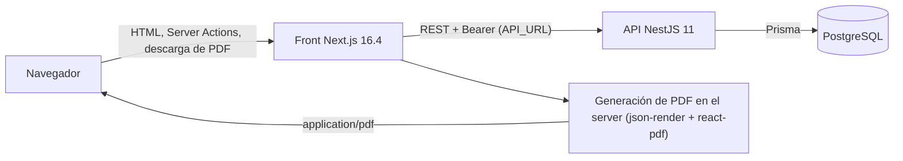
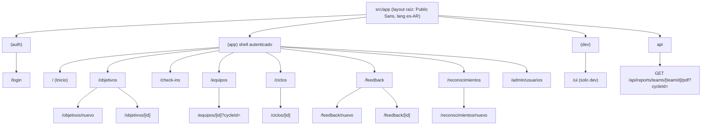
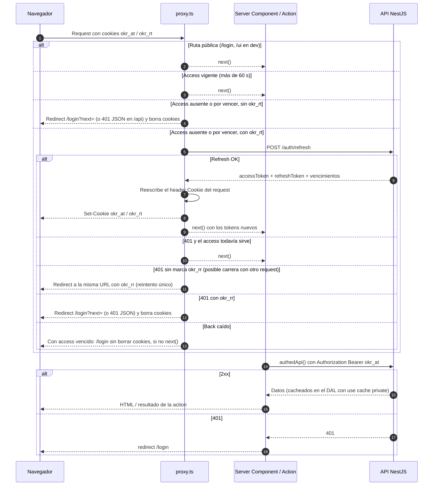
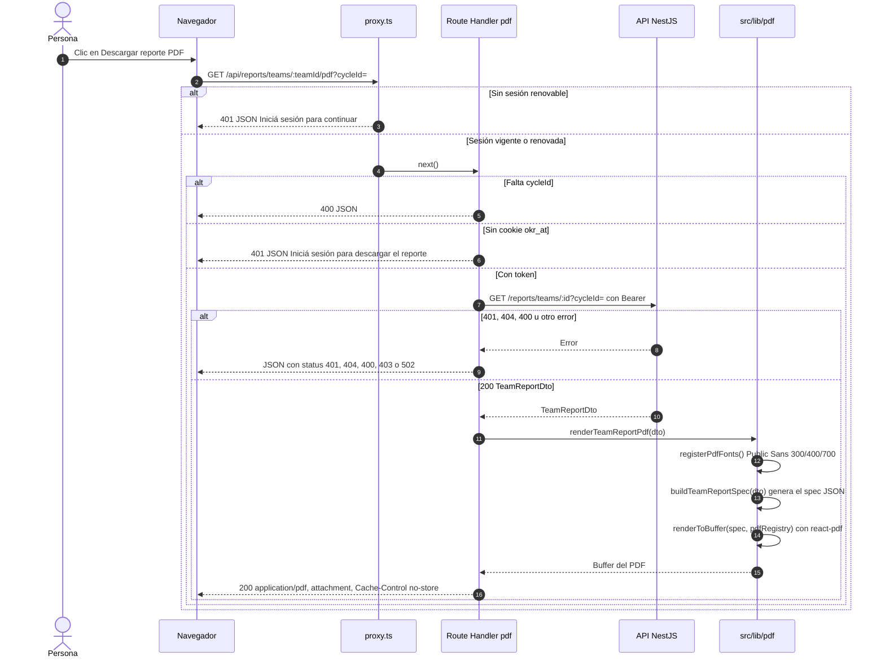

# Arquitectura del front (okr-platform-front)

> Documento de referencia de la arquitectura de la aplicación Next.js de OKR Platform. Describe cómo está armada hoy, verificado contra el código. Las reglas de cada módulo viven en los `CLAUDE.md` anidados (`src/app/(app)/<módulo>/CLAUDE.md`); el sistema de diseño, en [`design-system.md`](./design-system.md).

## Índice

1. [Vista general del sistema](#1-vista-general-del-sistema)
2. [Estructura de la app](#2-estructura-de-la-app)
3. [Comunicación con la API y sesión](#3-comunicación-con-la-api-y-sesión)
4. [Generación del PDF](#4-generación-del-pdf)
5. [Capas y convenciones](#5-capas-y-convenciones)
6. [Testing](#6-testing)

## 1. Vista general del sistema

El front es una app **Next.js 16.4** (App Router, Turbopack, `cacheComponents`) que actúa como **BFF**: el navegador nunca habla con la API. Todas las llamadas a la API NestJS salen del servidor de Next (Server Components, Server Actions, Route Handlers y `src/proxy.ts`), con la URL base tomada de `API_URL` (solo server; default `http://localhost:3000`). El PDF del reporte de equipo también se genera en el servidor de Next.



| Entorno              | Front                | API                 | Base                        |
| -------------------- | -------------------- | ------------------- | --------------------------- |
| Desarrollo / e2e     | `:3001` (Playwright) | `:3000` (default)   | `db-test` en `:55434` (e2e) |
| Demo (`tools/demo/`) | `:3101`              | `:3100` (`API_URL`) | `:55435`                    |

La arquitectura del back (módulos, autorización, modelo de datos) está documentada en [`apps/back/docs/arquitectura.md`](../../back/docs/arquitectura.md) (ruta del monorepo).

## 2. Estructura de la app

### Mapa de rutas

El App Router se organiza en tres grupos de rutas (no aparecen en la URL) y un segmento `api/`:

- `(auth)`: pública. Login y las Server Actions de login/logout.
- `(app)`: shell autenticado (`AppShell` con sidebar, header y `UserMenu`). Todas las páginas de negocio.
- `(dev)`: catálogo visual del sistema de diseño; responde 404 en producción.
- `api/`: Route Handlers. Hoy solo el PDF del reporte de equipo.



### Páginas

Los roles vienen del back (`ADMIN`, `LEADER`, `MEMBER`). Además del rol, la condición de **líder de un equipo** sale de la membresía (`user.teams[].isLead`). La autorización real es siempre del back; el front solo habilita o deshabilita acciones (con la razón visible) como espejo de esas reglas.

| Ruta                              | Qué muestra                                                                                                                                          | Quién la ve                                                                                           |
| --------------------------------- | ---------------------------------------------------------------------------------------------------------------------------------------------------- | ----------------------------------------------------------------------------------------------------- |
| `/login`                          | Superficie de marca con el formulario de ingreso. Respeta `?next=` (validado con `safeNext`).                                                        | Pública.                                                                                              |
| `/` (Inicio)                      | Dashboard del ciclo activo (`?cycleId=` opcional): mis objetivos, check-ins vencidos, reconocimientos y conteo de feedback sin leer (sin contenido). | Todos. Líderes de equipo suman "Mis equipos" (mezcla 50/50); ADMIN suma la card "Gestión".            |
| `/objetivos`                      | Lista agrupada por responsable con filtros en la URL (`cycleId`, `teamId`, `ownerUserId`, `status`) y cupo "N de 5".                                 | Todos (borradores ajenos solo si se pueden editar).                                                   |
| `/objetivos/nuevo`                | Alta de objetivo: ciclo, responsable según rol, padre opcional.                                                                                      | Todos; los responsables ofrecidos dependen del rol (ADMIN crea para cualquiera).                      |
| `/objetivos/[id]`                 | Detalle: resumen, alineación padre/hijos, tabla de KRs con historial y "Registrar check-in".                                                         | Todos (borrador ajeno: 404). Edición según políticas del back.                                        |
| `/check-ins`                      | "Pendientes": mis KRs vencidos agrupados por objetivo; registro en un `Drawer` con preview de score y banda.                                         | Todos (incluye los KRs de equipo si soy líder).                                                       |
| `/equipos`                        | Árbol de equipos.                                                                                                                                    | Todos. Crear/editar: solo ADMIN.                                                                      |
| `/equipos/[id]`                   | Integrantes, líder, selector de ciclo, indicador 50/50 y botón "Descargar reporte PDF".                                                              | Todos (el back permite el reporte a cualquier autenticado). Gestión de integrantes: solo ADMIN.       |
| `/ciclos`, `/ciclos/[id]`         | Árbol anual → trimestres y detalle con cadencia y umbrales.                                                                                          | Todos. Alta, edición, activación y cierre: solo ADMIN.                                                |
| `/feedback`                       | Bandeja privada con pestañas Recibido / Enviado (`?box=`) y contador de sin leer.                                                                    | Cada persona ve solo su feedback.                                                                     |
| `/feedback/nuevo`                 | Formulario: destinatario, mensaje y enlace opcional a un objetivo/KR.                                                                                | Todos.                                                                                                |
| `/feedback/[id]`                  | Detalle; el receptor lo marca como leído, el autor puede editar o eliminar.                                                                          | Solo emisor y receptor (ni ADMIN ni líderes: 404).                                                    |
| `/reconocimientos`                | Muro público paginado (10 por página) con filtro por persona. Sin rankings ni conteos.                                                               | Todos.                                                                                                |
| `/reconocimientos/nuevo`          | Flujo en dos pasos sin estado en el cliente: persona → logro (hito) + mensaje.                                                                       | Todos.                                                                                                |
| `/admin/usuarios`                 | Alta de usuarios, cambio de nombre/rol/estado y reseteo de contraseña.                                                                               | Solo ADMIN. El resto recibe `notFound()` y ve "Usuarios" deshabilitado en el menú con la explicación. |
| `/ui`                             | Catálogo visual de Flock UI.                                                                                                                         | Solo en desarrollo (público para el proxy en dev; 404 en producción).                                 |
| `/api/reports/teams/[teamId]/pdf` | Route Handler que devuelve el PDF del equipo para `?cycleId=`.                                                                                       | Cualquier sesión válida; sin sesión responde 401 JSON.                                                |

Cada ruta del grupo `(app)` sigue el mismo patrón de carpeta: `page.tsx` (contenedor server), `actions.ts` (Server Actions), `messages.ts` (copy es-AR por código de error del back), `*-form-data.ts` (parseo puro del `FormData`), `policy.ts` cuando hace falta (espejo de las reglas del back) y `_components/` (vistas presentacionales y hojas cliente).

## 3. Comunicación con la API y sesión

### Piezas

| Pieza               | Archivo                                                 | Rol                                                                                                                                                                                            |
| ------------------- | ------------------------------------------------------- | ---------------------------------------------------------------------------------------------------------------------------------------------------------------------------------------------- |
| Cliente tipado      | `src/lib/api/create-client.ts`                          | `openapi-fetch` sobre `schema.d.ts` (generado con `npm run api:types` desde el OpenAPI del back). `cache: 'no-store'`: la caché vive en el DAL, no en `fetch`.                                 |
| Cliente autenticado | `src/lib/api/client.ts`                                 | `authedApi()` lee `okr_at` con `cookies()` y agrega `Authorization: Bearer`. Sin cookie o ante un 401 de Nest hace `redirect('/login')`. `publicApi()` para login, refresh y logout.           |
| Errores             | `src/lib/api/errors.ts`, `error-copy.ts`, `call-api.ts` | `unwrap()` lanza `ApiError`; `callApi()` normaliza el resultado de una mutación en Server Actions; `failureMessage()` traduce código de dominio o status a copy es-AR.                         |
| DAL                 | `src/lib/dal/*.ts`                                      | Lecturas `server-only` con `'use cache: private'` + `cacheTag` (`me`, `okrs`, `cycles`, `teams`, …). Feedback NO usa caché (privacidad).                                                       |
| Sesión              | `src/lib/dal/session.ts`                                | `getCurrentUser()` → `GET /auth/me`, cacheado con `cacheTag('me')`; expone solo `id`, `name`, `role`, `teams`.                                                                                 |
| Cookies             | `src/lib/auth/constants.ts`                             | `okr_at` (access), `okr_rt` (refresh), `okr_rr` (marca de reintento, 10 s). `httpOnly`, `SameSite=Lax`, `Secure` en producción, `path=/`; `maxAge` según los vencimientos que informa el back. |
| Login / logout      | `src/app/(auth)/actions.ts`                             | Server Actions: `POST /auth/login` y set de cookies; `POST /auth/logout` (best effort) y borrado de cookies.                                                                                   |
| Proxy               | `src/proxy.ts`                                          | Chequeo optimista + refresh silencioso en cada request (salvo estáticos, imágenes y `/login`).                                                                                                 |

Reglas que sostienen el diseño:

- Solo `loginAction`, `logoutAction` y `src/proxy.ts` escriben cookies: Next no permite setearlas durante el render de un Server Component.
- El token **nunca** es argumento de una función `'use cache'` (los argumentos se guardan en texto plano). `'use cache: private'` lee `cookies()` adentro.
- Las mutaciones van por Server Actions con `callApi()` e invalidan con `updateTag(...)` (feedback usa `refresh()` porque no tiene caché).
- El proxy no es autorización: cada Server Action y Route Handler vuelve a pasar por el back, que es quien decide.

### Refresh silencioso y requests sin sesión

El proxy considera "por vencer" un access con menos de 60 s de vida (`REFRESH_SKEW_SECONDS`). Para rutas de página redirige a `/login?next=<ruta>`; para `/api/*` responde **401 JSON** (`Iniciá sesión para continuar.`), porque un redirect no le sirve a una descarga.



## 4. Generación del PDF

El botón "Descargar reporte PDF" del detalle de equipo (`equipos/_components/download-report-button.tsx`) es un `<a download>` común (no `next/link`, para no prefetchear un archivo) hacia el Route Handler. Sin ciclo elegido se muestra deshabilitado con la razón ("Elegí un ciclo para descargar el reporte.").



Detalles verificados en el código:

- **Ruta**: `src/app/api/reports/teams/[teamId]/pdf/route.ts`. No usa `authedApi()` (que redirige) sino `createApiClient({ token })`, para poder responder JSON con status. No exporta `runtime`: con `cacheComponents` es un error, y Node ya es el default.
- **Respuestas**: 400 sin `cycleId`, 401 sin cookie o si el back responde 401, 404/400 del back con copy propio, 403 si el back lo devuelve, 502 si el back está caído o falla, 500 si falla el render. Todas con `Cache-Control: no-store`.
- **Nombre de archivo**: `reporte-<equipo>-<ciclo>.pdf` con slug ASCII (`src/lib/pdf/slug.ts`).
- **Spec puro** (`team-report-spec.ts`): convierte el DTO en un `Spec` de `@json-render/core` con todo el texto ya formateado (es-AR). Personas en orden alfabético, nunca por score; sin check-ins hay badge neutro "Sin check-ins"; aviso suave si la mezcla de origen sale de 40–60 %. Se testea sin renderizar.
- **Registro** (`registry.tsx`): componentes propios (`Page` con pie "Página X de Y", `BrandHeader` con degradé "Noche", `OriginMix`, `ObjectiveBlock`, `SectionTitle`). Estado = ícono SVG + palabra.
- **Adaptador** (`render-team-report-pdf.ts`): único archivo que importa el render de `@json-render/react-pdf`; cambiar de motor toca solo ese archivo.
- **Fuentes** (`fonts.ts`): Public Sans 300/400/700 en `.woff` versionados en `src/lib/pdf/fonts/` (OFL). react-pdf no acepta woff2. `next.config.ts` los incluye en el trace con `outputFileTracingIncludes` para `/api/reports/teams/*/pdf`. Solo caracteres Latin-1 en el texto.
- **Versiones fijadas**: `@json-render/core` y `@json-render/react-pdf` 0.21.0, `@react-pdf/renderer` 4.9.0 (deduplicado bajo json-render) y `zod` 4.6.5.
- **Contenido**: el PDF nunca incluye feedback, rankings ni datos de compensación.

## 5. Capas y convenciones

### Organización de carpetas

```
src/
├── proxy.ts            # auth optimista + refresh silencioso
├── app/
│   ├── layout.tsx      # layout raíz (Public Sans vía next/font, lang es-AR)
│   ├── globals.css     # tokens de Flock UI (claro / .dark)
│   ├── (auth)/         # login + Server Actions de sesión
│   ├── (app)/          # shell autenticado y módulos de negocio
│   ├── (dev)/ui/       # catálogo de componentes (solo dev)
│   └── api/            # Route Handlers (PDF)
├── components/
│   ├── ui/             # Flock UI: primitivos y piezas del shell
│   └── not-found-view.tsx
└── lib/
    ├── api/            # cliente openapi-fetch, schema.d.ts generado, errores
    ├── auth/           # cookies, safeNext, lectura de exp del token
    ├── dal/            # acceso a datos server-only (uno por dominio)
    ├── actions/        # FormState + useActionForm
    ├── pdf/            # reporte PDF del equipo
    └── *.ts            # helpers puros: format, score-band, check-in-preview, active-cycle, okr-link, cn
```

El flujo de dependencias es en una sola dirección: `app/` (páginas, actions, vistas) → `lib/dal` → `lib/api` → API. Los componentes de `components/ui` no conocen la API ni el dominio.

### Server vs Client Components

- **Server Components por defecto.** Las páginas son contenedores server que piden datos al DAL (en paralelo con `Promise.all` cuando son independientes) y envuelven lo dinámico en `<Suspense>`. El layout de `(app)` es estático: la sesión se lee solo dentro de `<UserMenu>` y `<AppNavWithRole>`, cada uno en su `<Suspense>`.
- **`'use client'` solo en hojas interactivas**: formularios (`useActionForm`), modales, drawers, `ConfirmDialog`, selectores que navegan (`cycle-select.tsx`, `objectives-filters.tsx`), `MarkAsRead`, `Toast`, `AppShell`/`Sidebar` y los controles de formulario.
- **Container / presentational**: cada módulo separa el contenedor (`page.tsx`, que resuelve datos) de vistas presentacionales en `_components/*-view.tsx` y `*-card.tsx`, que reciben props y se prueban con React Testing Library.
- **Lógica pura aparte**: parseo de formularios (`*-form-data.ts`), políticas (`policy.ts`) y helpers de `src/lib` no tocan I/O y se testean directo.
- **Formularios** con `useActionForm` (`src/lib/actions/use-action-form.ts`) en lugar de `<form action>`: React 19 resetea el form tras la action y los `<select>` perdían el valor.

### Sistema de diseño

Flock UI está implementado de forma nativa sobre Tailwind CSS 4 (sin config JS). La referencia completa está en [`docs/design-system.md`](./design-system.md) y el catálogo visual en `/ui` (solo dev).

- Tokens como variables CSS en `src/app/globals.css`, expuestos como utilidades (`bg-surface`, `text-ink`, `bg-primary`, `rounded-pill`, `p-s20`, …). No se inventan colores fuera de los tokens.
- Componentes en `src/components/ui/<nombre>.tsx`, importados directo (sin barrel), con variantes por mapa de clases y `cn()` (`clsx` + `tailwind-merge` configurado con los tokens).
- Reglas de producto: una sola acción primaria por vista; el estado nunca va solo en color (ícono + palabra); acciones sin permiso deshabilitadas con la razón visible (`DisabledAction`); formato argentino en `src/lib/format.ts`; voz es-AR con voseo.

### Accesibilidad y tema oscuro

- Foco visible (anillo de 2px `focus`), movimiento de 150–200 ms con `prefers-reduced-motion`, contadores con texto accesible ("N pendientes") y tablas que se apilan en pantallas chicas con roles ARIA explícitos.
- **Tema oscuro**: los tokens oscuros existen en `globals.css` bajo la clase `.dark` (`@custom-variant dark`), y los componentes no usan `dark:` porque los tokens ya cambian con el tema. Hoy la app **no expone un selector de tema**: el oscuro se activa agregando `.dark` al `<html>` (así lo hacen el catálogo `/ui` y los tests de accesibilidad).
- **axe**: `e2e/a11y.spec.ts` corre axe-core (WCAG 2.0/2.1 A y AA) en las rutas principales en claro y oscuro y falla ante violaciones `serious` o `critical`; `e2e/teclado-a11y.spec.ts` cubre navegación por teclado y diálogos.

## 6. Testing

Dos capas con responsabilidades separadas (detalle completo en la sección "Testing" del [`CLAUDE.md`](../CLAUDE.md) del proyecto):

| Capa               | Herramienta                            | Alcance                                                                                                                                    | Ubicación                                       |
| ------------------ | -------------------------------------- | ------------------------------------------------------------------------------------------------------------------------------------------ | ----------------------------------------------- |
| Unit / componentes | Vitest + React Testing Library (jsdom) | Helpers de `src/lib`, DAL con `fetch` mockeado, Server Actions, vistas presentacionales, spec y render del PDF, Route Handler, `proxy.ts`. | `src/**/*.test.ts(x)`, setup y mocks en `test/` |
| E2E                | Playwright contra el back real         | Módulos, recorridos por rol (`e2e/journeys/`), descarga real del PDF (`e2e/reporte-equipo.spec.ts`).                                       | `e2e/**`                                        |
| Accesibilidad      | `@axe-core/playwright`                 | Rutas principales en claro y oscuro, teclado y diálogos.                                                                                   | `e2e/a11y.spec.ts`, `e2e/teclado-a11y.spec.ts`  |

Vitest no soporta Server Components `async`: esos se cubren con E2E. Los mocks de `server-only` y `next/headers` están aliasados en `vitest.config.mts`.

Cómo correrlos:

```bash
npm test                  # Vitest (unit/componentes)
npm run test:e2e:stack    # levanta db + API e2e, corre Playwright y baja todo (requiere Docker y ../okr-platform-back)
npm run e2e:stack -- up   # solo el stack e2e; después: npx playwright test [archivo]
npm run e2e:stack -- down
```

`playwright.config.ts` levanta `next dev` en `:3001` contra la API en `:3000` (el `FRONT_ORIGIN` del back), con 4 workers y un `globalSetup` que precalienta las rutas. La primera vez hace falta `npx playwright install chromium`.
